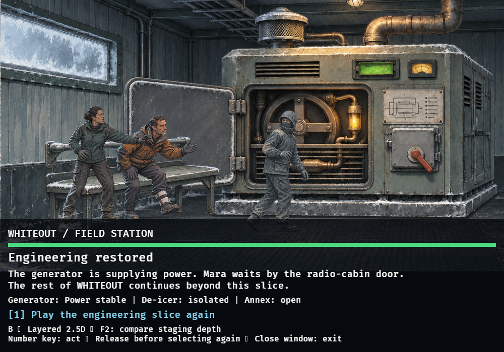
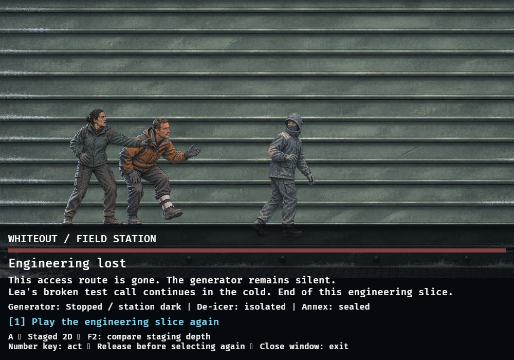

# Graphic-novel generator pilot (#83)

## Result and reproduction

The existing WHITEOUT prepared-route generator excerpt runs with native PNG
layers, three-pose cast strips, mechanical inserts, state variants, camera
moves, fades, a closing shutter, window snow and restrained breathing/vibration.
No GRIMM core, graph protocol, authoritative effect or decision rule changed.

```sh
CARGO_PROFILE_DEV_DEBUG=0 cargo run -p whiteout-game --locked -- --layered
```

F2 compares A (staged 2D) and B (layered 2.5D) in the same running scene. Number
keys select existing decisions. Add `--mute` when no working audio device exists.
See [asset source/import documentation](assets/graphic-novel/README.md), its
manifest, and [screenplay bindings](SCREENPLAY.md).

## Verification, 2026-11-06

Rust/Cargo 1.98.1, Bevy 0.20.1. `CARGO_PROFILE_DEV_DEBUG=0` for build/test/Clippy:

- `cargo fmt --all --check`: passed.
- `cargo build --workspace --locked`: passed.
- `cargo test --workspace --locked`: 263 passed, zero failed, including 42 WHITEOUT tests.
- `cargo clippy --workspace --all-targets --locked -- -D warnings`: passed.

New tests decode every runtime PNG through Bevy, check genuine alpha/cell bounds,
exercise scheduled insert/state selection with bounded entities, bound parallax,
preserve epoch/time/effects/cues across a real F2 input event, and prove initial
asset waiting does not consume authored scene time. Existing narrative, keyboard,
deadline equality, stale-input, effect and REPLACE tests remain passing.
LSP diagnostics timed out with stale results; Cargo supplies the reliable check.

The first local full-debug build exhausted `/tmp` and the linker failed. Correcting
the task worktree's cache link and using the documented debug-free profile fixed
that environment failure. One unchanged CLI terminal test timed out while the
software renderer ran; the complete rerun after closing the window passed without
CLI modifications. The initial draft CI found two Clippy parameter-count issues;
they were corrected in this follow-up.

## Actual graphical playtest

Linux/X11 isolated Xvfb display, actual 1000×700 Bevy/Vulkan window, Mesa 26.2.4
llvmpipe (LLVM 23.1.1). Keyboard press/release events targeted only this task's own
application PID. No effects or graph position were injected. This is a real
software-rendered window, not a headless mock or a target-GPU performance test.

Observed native transitions in one continuous run:

```text
GENERATOR_ANNEX 1 → GENERATOR_STARTUP 2 → DISPATCH_WARM 3
DISPATCH_APPROACH 4 → GENERATOR_ANNEX 5 → DISPATCH_COLD 6
DISPATCH_APPROACH 7 → GENERATOR_ANNEX 8 → ANNEX_SEALED 9
```

Success used key 2 after readiness, abandonment used key 1, and timeout used no
selection. The final timeout transition occurred about 30.31 seconds after annex
entry (authored 30 seconds, next render frame). Deterministic tests establish exact
semantics; these frame observations do not redefine deadlines. The final cast
placement was adjusted from visible floating feet/seats to improve grounding.

Composition: cold sage room, fixed west window, right-hand isolator/diagram,
left-hinged cover and amber powered insert remain recognizable. Alex stays masked;
Mara's teal silhouette/bun and Jonas's ochre jacket/splint retain identity across
poses. Close-ups preserve the key mechanical vocabulary. The opaque bottom UI
keeps decisions/countdown legible and above moving artwork; some foreground feet
are deliberately cropped by its top edge. Withdrawal poses remain in front of
the closing shutter. The room/props, not independent full-scene paintings, persist
between shots.

Animation is deliberately limited: camera reframe/push, short fades, atlas pose
changes, subpixel breath, mechanical vibration, bounded depth shifts and falling
snow outside the window. There is no lip sync or articulated interaction. A/B
switching visibly changes only depth treatment; scene position and media continue.
Software rendering handled the small layer set and keyboard routes; no FPS,
frame-time benchmark or hardware performance guarantee is claimed.

Runs used `--mute` because the prior device-backed playtest exposed ALSA underrun/
POLLERR errors. Existing WAV decoding and audio scheduling remain tested, but
this pilot does **not** claim verified listening quality. Target-machine listening
and subjective art-direction review remain required.

## Production comparison and recommendation

| Criterion | Previous 3D experiment | A: Staged 2D | B: Layered 2.5D |
|---|---|---|---|
| Visual quality | Blocky cast and weak material/face detail | Strong illustrated texture and readable identity | Same art; subtle depth gain |
| Consistency | Mesh/costume/lighting needed more work | Shared master and pose sheets reduce drift | Same benefit; layer contacts need calibration |
| Production effort | Rig, contact, material and light work | One master + selected inserts/poses per set | A plus extraction/registration/depth review |
| Animation | Potentially flexible, expensive to finish | Fades, poses, small transforms | Same, plus bounded parallax |
| Camera | Broad spatial freedom | Authored fixed views and limited pushes | Limited depth moves; no free orbit |
| Technical risk | GLB/PBR/rig/lighting and software-render cost | PNG load/alpha/atlas/layout | A plus depth separation/edge gaps |
| Whole-game scale | High cost before approved visual result | Budget by location and meaningful story beat | Reserve for shots with visible depth benefit |

Recommend the illustrated asset direction with **A as the default** and B retained
as a narrowly bounded optional treatment. The current parallax improvement is
small; it does not justify making every future shot more complex. This is a
production proposal awaiting maintainer review, not approval for bulk assets.
The user has deferred further 3D work; none is planned or implemented here.

For later production, inventory one master per location, 2–4 reusable depth layers
only where useful, a small cast pose sheet per costume, state variants for actual
mechanical changes and inserts only for story-critical gestures. Budget review
and contact corrections separately from generation: this pilot uses ten PNGs
including its source master, about 18 MiB, rather than one independent image per
storyboard shot. Do not extrapolate a full-game delivery estimate from this sample.
No remaining WHITEOUT locations were produced.

## Remaining visual limits and review questions

- State-strip framing needs explicit import calibration; it is not a pixel-perfect
  extraction of the closed master. Minor casing/cover proportions drift between
  wide and insert views. Future art should use reviewed paint-over masters.
- Pose changes are discrete, gestures/contact approximate. Withdrawal compresses
  a walk into a pose and small offset. No skeleton, blink sheet or facial acting.
- Powered warmth is concentrated on the machine; the whole room is not relit.
- The intended view is 1000×700; extreme small-window/aspect-ratio layouts have not
  been polished. UI typography and the three inherited sounds remain prototypes.
- Alex face policy, Jonas injury side and repository distribution licensing remain
  explicit production decisions; this pilot does not settle them.
- PR #82 stays closed. Native loading/preflight/cleanup lessons are useful; its
  mesh assets, PBR dependencies and rig pipeline are not imported. Asset backlog
  #26/#40/#42 should be re-scoped only after review of this pilot.

Related work: #76 (slice), #77 (screenplay), #78 (cast), #79 (environment), #80,
#81 (storyboard), #82 (closed experiment), #83 (this pilot).

## Unedited runtime captures

These are actual application-window captures, not generated mockups. Both warm
views use the same final art/pose calibration and scene; tiny breathing phase and
bounded background offsets can differ. No screenshot test framework was added.

| A — Staged 2D | B — Layered 2.5D |
|---|---|
|  |  |


