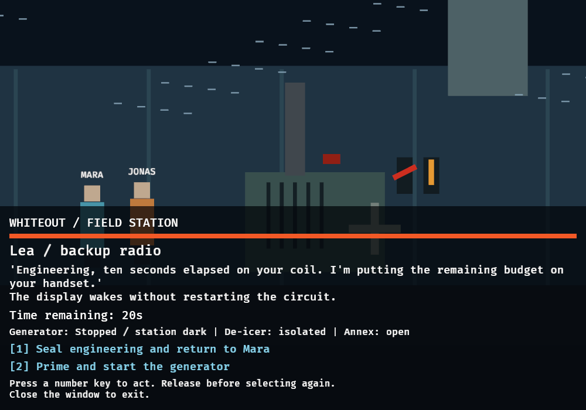
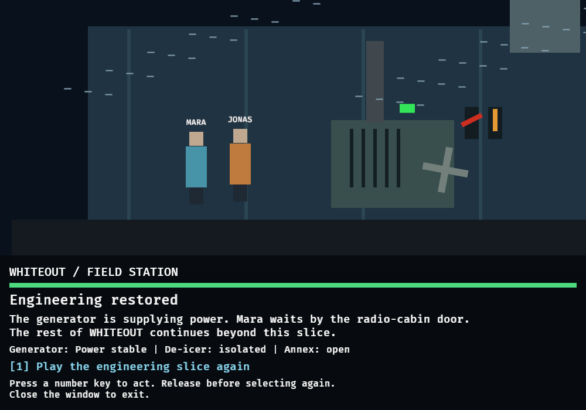
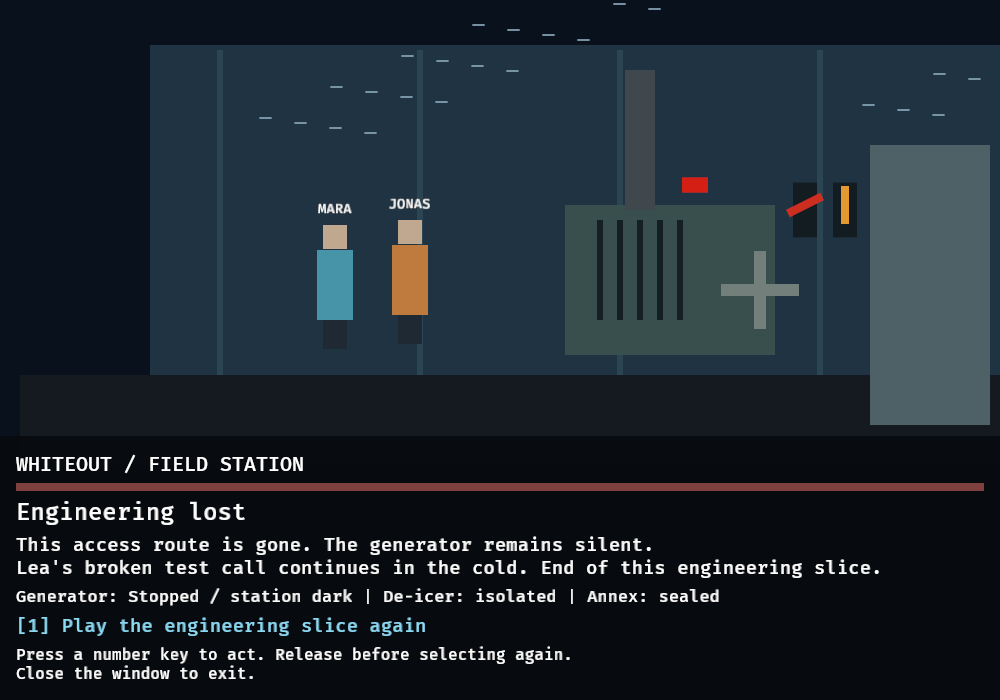

# Generator-annex verification (#70)

## Automated checks (2026-11-05)

Rust/Cargo 1.98.1, Bevy 0.20.1, Linux. Commands from repository root, with
`CARGO_PROFILE_DEV_DEBUG=0 CARGO_BUILD_JOBS=2` for Cargo build/test/Clippy:

- `cargo fmt --all --check`: passed.
- `cargo build --workspace --locked`: passed.
- `cargo test --workspace --locked`: **258 passed**, zero failed; includes
  **37 WHITEOUT tests**, preserving the 26 existing #67–#69 tests.
- `cargo clippy --workspace --all-targets --locked -- -D warnings`: passed.

Tests use deterministic headless Bevy time, not wall-clock sleeps. They cover
full 32.5-second powered path, abandonment, timeout, exact deadline equality,
live condition recheck, timed effects, ordinary transition node, concurrent
caption/audio/camera, deduplication, stale requests, REPLACE cleanup over repeat
plays, fixed asset bounds, live missing assets/objects, real PCM decoding,
actual transform interpolation independent of effects, and canonical text parity.
The LSP bridge returned stale/time-out diagnostics; Cargo is the verification
source rather than a claim of clean LSP analysis.

## Desktop smoke (2026-11-05)

Actual 1000×700 Bevy window on Linux/X11, Mesa 26.2.4 llvmpipe (LLVM 23.1.1).
OS key press/release events targeted only the application's window, identified
by its PID and title. Captured and visually inspected approach, warning,
starter close-up, warm outcome and sealed timeout outcome.

Observed path / epochs:

```text
GENERATOR_ANNEX epoch=1
GENERATOR_STARTUP epoch=2
DISPATCH_WARM epoch=3
DISPATCH_APPROACH epoch=4
GENERATOR_ANNEX epoch=5
ANNEX_SEALED epoch=6
```

- Jonas/Mara and the generator set are visible; camera close-ups change framing.
- The radio warning displays **20s**, with both choices available and de-icer
  isolated. Starting via key 2 enters the lever/primer close-up.
- Startup traversed after approximately 4.70s (authored 4500ms, next render
  frame). Powered outcome shows green lamp, rotating wheel and stable power.
- Key 1 restarted; silence on the next attempt reached the sealed outcome after
  approximately 30.14s (authored 30000ms). Shutter is down, lamp red, power stopped
  and access sealed. Window close exited with status 0.
- These observations do not replace exact fake-clock timing/equality tests.
  Voluntary abandonment is covered headlessly, not claimed as another desktop run.





### Audio limitation

Bevy created real device-backed `AudioSink` components for wind in each entry,
annex alarm, startup motor, overlapping wind/motor at the warm return, and the
second warning/timeout alarms. All three WAVs decode to non-silent PCM in tests.
However the local ALSA/Rodio output reported buffer underrun/overrun errors and
`alsa::poll()` POLLERR messages during this software-rendered desktop run,
especially around shutdown. The process still closed successfully. The cause
has not been isolated; **audible quality is not verified**. A listening/performance
pass on the target hardware is still needed. No desktop audio recording was
made and no production audio-quality or frame-rate claim is made.

## Illustrated pilot follow-up (#83, 2026-11-06)

The counts and sprite captures above describe the earlier #70 baseline. The
[current graphic-novel verification and A/B captures](GRAPHIC-NOVEL-PLAYTEST.md)
record 263 passing workspace tests, 42 WHITEOUT tests, the illustrated renderer
and actual success, abandonment and timeout playthroughs. They supersede the
placeholder-art observations for the current application, while retaining the
original baseline evidence and its audio limitation.
