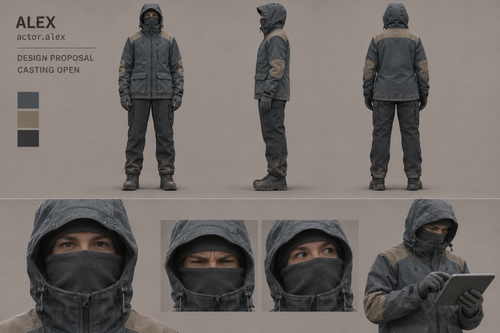
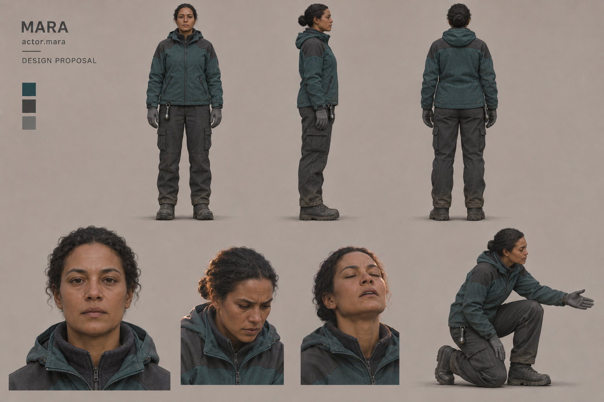
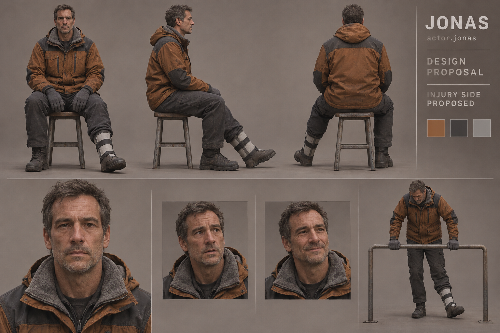
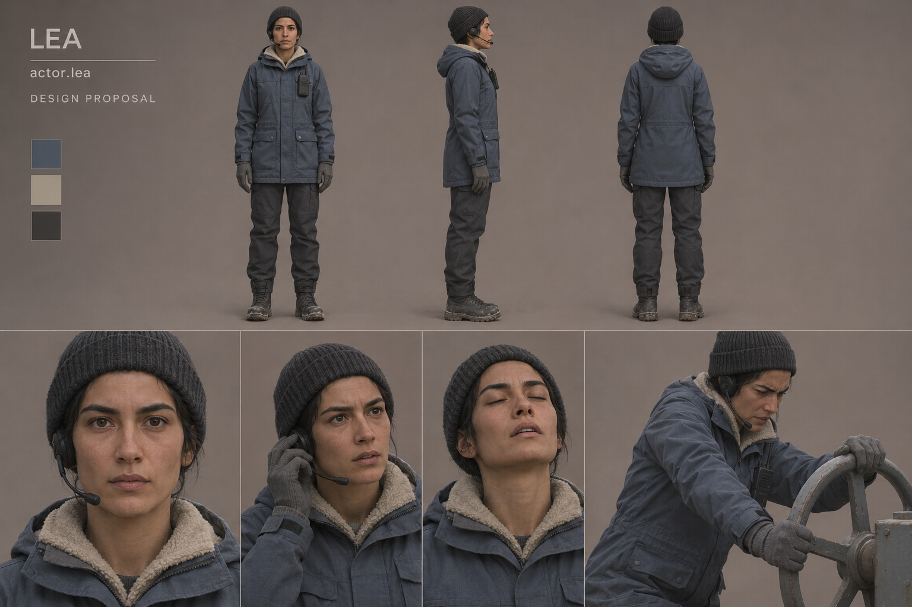

# Reference artifacts, provenance and agent inspection

Generated 2026-11-05 using the built-in `image_gen` tool (imagegen skill).
The tool does not disclose a backend model/version in its result; none is
invented here. Four independent **sheet requests**, each locking the same actor
within all its views, not a collection of unrelated portraits. No external
photo, celebrity, concept artist work or other third-party reference was input.
Briefs were authored from repository canon and explicitly proposed visual traits.

The PNGs are copied into this repository; they are not dependent on ephemeral
tool paths. Prompts are the exact submitted text, saved alongside. Re-running
a stochastic model is **not** a promise of pixel-identical output or identity:
use the selected sheet as visual identity reference for future derivatives.

## Artifacts

| Stable artifact ID | Sheet | Exact prompt | Dimensions | SHA-256 |
| --- | --- | --- | --- | --- |
| `actor.alex.reference.v1` | [alex](references/alex-v1.png) | [prompt](prompts/alex-v1.txt) | 1536×1024 PNG | `61a7c503356591266fbe458cc06b30c4c2656110d49418661d19cfaa69695449` |
| `actor.mara.reference.v1` | [mara](references/mara-v1.png) | [prompt](prompts/mara-v1.txt) | 1536×1024 PNG | `3d09b422240cc4361a4cc49fbc02ddea541ff4acc4ce9a3e96338c46c024209b` |
| `actor.jonas.reference.v1` | [jonas](references/jonas-v1.png) | [prompt](prompts/jonas-v1.txt) | 1536×1024 PNG | `9ae2bf0c0b3b64a6bad7bab802c7bff224a984009ad40ea434de9ae91100a8a1` |
| `actor.lea.reference.v1` | [lea](references/lea-v1.png) | [prompt](prompts/lea-v1.txt) | 1536×1024 PNG | `4b4551972b1983deac58e5a149e8373d19ad73ade50fccdd2dbb07a24a3435ed` |

## Inspection results — agent review, not maintainer approval

| Actor | Inspected evidence | Limits / follow-up |
| --- | --- | --- |
| Alex | Complete front/profile/back, same slate/sand hooded costume, neutral upper-face close-up, effort/listening and two-hand device study. No unmasked reveal. | Only a casting-neutral **costume envelope**. Generated eye/skin cues are incidental, not locked demographics. The device is a rehearsal control surrogate, not a granted tablet/tool. |
| Mara | Same curled/bun hair, face, teal/charcoal jacket and boot construction across complete views; neutral, concentration, tired relief; low kneeling support study. | Torch clip uses proposed anatomical right hip in this candidate; retain if accepted, but no handedness is canonical. Partner contact not validated with an actual Jonas rig. |
| Jonas | Complete seated front/profile/back and face studies; consistent orange/soot jacket and hair/stubble; proposed anatomical left splint in front/back/side and low rail-brace. No unsupported healthy standing calibration. | Injury side is [A]/[O], not [C]. Seated posture is not a metric height chart; carry/brace still needs rehearsal. No medical or rig safety proof claimed. |
| Lea | Same cap/headset, cream collar, blue-grey longer coat, neutral/listening/tired relief faces and manual-wheel stance. No permanently carried mug/copper. | Wheel is a gesture-study surrogate, not final #35 geometry. Full rig contacts and actual duty transitions remain future work. |

All four sheets were visually inspected at generation output. Views contain
complete bodies/boots, repeat an identifiable costume/head within each sheet
and provide neutral plus performance studies. Face studies trend more detailed
than the intended modest real-time baseline; this does not mandate pore-level
textures. Shared neutral studio lighting and palette construction support the
chosen direction. These are not orthographic scans or production geometry.

Silhouette review uses hooded neutral Alex, short compact Mara, seated/protected
long-torso Jonas and narrow cap/headset Lea. This is an editorial distinction,
not a measured small-screen/greyscale render pass. Such a pass is explicitly
required before final assets (ENVIRONMENT-HANDOFF). Do not claim a neutral
sheet proves all possible light/pose variants; those are specified in writing.

## Source / usage record

- Inputs: original text briefs plus repository story/screenplay; no external
  image files or imported third-party attribution/license obligations.
- Output: AI-generated concept proposals via built-in `image_gen`, not photographs
  of real cast, commissioned human concept art or approved final assets.
- Repository currently has no root LICENSE file; this PR does not select a
  publication license or assert rights exclusivity. Record actual production
  source/terms again for any later external reference or commissioned asset.
- Review status: agent inspected; **maintainer art/casting approval pending**.
  No automatic merge approval and no claim that generation alone clears a
  later production acceptance gate.

## Alex — candidate v1

## Mara — candidate v1

## Jonas — candidate v1

## Lea — candidate v1

