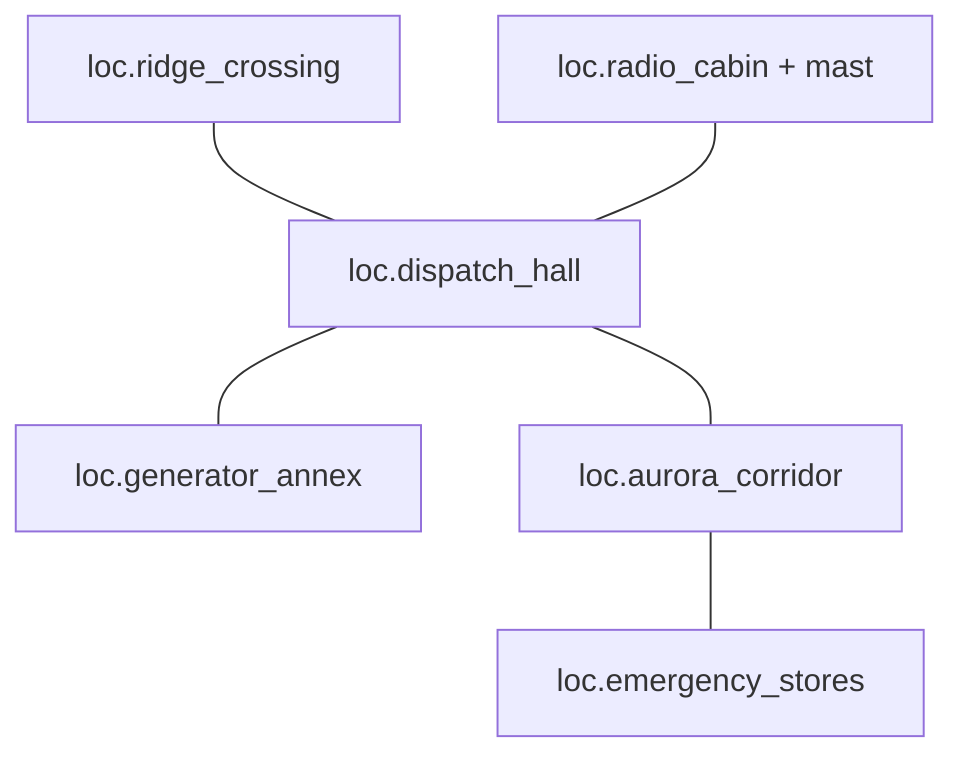

# Spatial continuity / blocking plans

All coordinates, sizes and compass labels here are **[A] staging proposals**,
not canonical geography, final architectural drawings or building-code claims.
Use metres in a local top-down plan: +x east/right, +y north/up, z height.
Compass labels are **local drawing axes**, not one survey coordinate system.
Hall and ridge share their north-looking orientation. Annex/radio are registered
to the hall by their named entrance: hall east meets annex south; hall west meets
radio south. Rotate local plans at those joins; do not invent an extra corridor
to reconcile coordinate labels. World west-radio/east-engineering relation stays
fixed. This convention does not add game navigation.
Diagrams are schematic; coordinate/clearance tables carry the dimensional intent.
**[O]** Rehearse final sizes with actual actor bodies/partner rigs before assets.

## Station adjacency — physical layout is not a new story graph



Corridor has the blackout group and leads past the stores threshold to dispatch.
Stores uses **one shared entry/exit**, not a new back door. The initial carry into
stores and departure to hall use that same threshold/corridor; returning to the
old narrative situation is not a gameplay option. Lab/sleeping directions are
noninteractive background references, not additional authored rooms.

The adjacent mast platform is part of radio's connected set. It is visible from
the later ridge situation but does not create an early radio→ridge traversal or
escape shortcut. Canonical progression remains blackout→stores→dispatch, two
repairs in either order, then crisis after both jobs are resolved. Endings are
terminal compositions, not traversable new rooms in this adjacency diagram.

## Dispatch — permanent coordinates on every visit

Local footprint 6×7m. South entrance camera faces north; west radio reads LEFT,
east engineering RIGHT, ridge ahead. Do not mirror the whole set on return.

```text
                       N +y
              +--- RIDGE (3,7) ---+
              | J / duct          |
              | (1,5.8)           |
 radio (0,3.5)|     A / M         | engineering (6,3.5)
              |       ↑           |
              |   clear lane      |
              +-- SOUTH (3,0) -----+
                    C0 → north
                  corridor/stores
```

J=`actor.jonas`, M=`actor.mara`, A=`actor.alex`; Lea is present only if free or
heard remotely, never duplicated. Duct/seat northwest **does not move** when
power returns. Fixed door centres as above, proposed 2m clear thresholds;
central x=2..4 lane kept clear for supported/carry movement. South camera C0
at (3,0.5,z1.6) looks towards (3,4,z1.1); dialogue positions A(3,2.6),
M(2,4.6), J(1,5.8). Support approaches seat from east/south, leaves extended ankle
space, then moves via central lane to a selected door. No costume/seat teleports.
Eye/interaction axis is A↔M/J; keep initial coverage on the southern side.

## Stores — one threshold, accessible preparation

6×4m; south threshold (3,0) to the existing corridor. Ceiling shutter closes this
same access; no rear aisle route escapes it.

```text
                N / back wall
 +-- low tools -- shelves -- log --+
 | tray(2.1,3.3)          (4.6,3.5)|
 | J bench →                     | line/flare/pack rack
 | (.5,2.8) M       clear lane    | (5.5,2.4)
 |          A         ↑          |
 +----------- SOUTH (3,0) --------+
                C0 → north
```

Jonas faces east; protected ankle extends into x≈1.3 space, away from central
carry lane x=3..5. Mara kneels near (1.1,2.2), Alex treats from (1.8,2.1).
Tool tray top z≈0.85; log/control z≈1.15; pickup shelf range z≈0.8..1.4.
Alex moves to each station rather than reaching 2m from one mark. Clear proposed
2m transfer lane reaches 2m threshold; bench/gear must not project into it.
Camera south (3,.5,z1.6), tool/log inserts from same southern half-plane. On
accepted exit, support rises/repositions, clears the door, **then** shutter seals.
No new injury or crushing casualty is introduced by the outgoing animation.

## Generator — same joint, external isolator, safe retreat

4.5×5m; sole hall threshold south at (2.25,0), with coil-operated shutter.

```text
                     N
 +---------------------------------+
 |       GENERATOR housing          |
 |     x1.25..3.25 / y2.5..3.7       |
 |     latch/primer     fuse/diagram |
 |     (2.2,2.4)       (3.4,2.5)     |
 | rail(1.2,2.2)   A working strip   |
 | J/M assisted     y1.3..2.4        |
 | threshold rest   ↑ / retreat     |
 +------ SOUTH / coil (2.25,0) -----+
        C0 southwest → housing
```

Starter cover/latch is on south face. Diagram/tagged fuse is an **external**
south-east service panel, reachable without opening the starter cover because
the authored isolation/inspection guards do not require latch-open. No extra
access rule is invented to follow a prettier image. Camera C0(.7,.5,z1.55)
looks north-east; technical coverage stays south of the engine face.

Mara/Jonas start sheltered southwest (about .7,.8), not blocking the central
retreat. If the assisted performance applies, Mara supports a short move to
low rail (1.2,2.2), leaving the proposed injured leg unloaded; Alex approaches
latch from (2.2,1.7). Operator can shift east to fuse without crossing engine
geometry. Control heights z≈.9..1.2; proposed 2m door and clear 2m threshold
zone. Support/carry contacts and rail dimensions still require rig rehearsal.
Timeout staging gets people clear before closure; it does not trap/kill a new
cast member. The exterior vent/window is sealed dressing, not another exit.

## Radio — cabin and adjacent mast share geography and clock

Interior 6×4m; south hall threshold (3,0). Existing mast-working bay is the
connected north extension x3.5..5.5, y4..6, not a new choice node.

```text
                    N / exposed working bay
                      [wheel (4.5,5)]
                         L / A
 +--- sealed window --- open mast working threshold ---+
 | transmitter/                                           
 | bracket + mug          clear visual axis              |
 | (1.8..2.3,2.8)         north-east                     |
 |                                                      |
 +---------------- SOUTH (3,0) --------------------------+
                   C0 → north
```

Desk west/north-left, jumper bracket on same desk, z≈1.1. Wheel centre
(4.5,5,z1.1), proposed radius .32m, Lea at (4.5,4.5), Alex beside her for
alignment. C0(3,.7,z1.6) sees transmitter LEFT and wheel RIGHT through the
working threshold. Cable routing is along wall/roof, not a trip line across
access. Handwheel axis/rail clearances need actual glove/shoulder rehearsal.
A single connected performance moves Alex between stations; a cut does not
spawn another Lea or restart the sixty-second reserve. Cabin door can close
while Lea's established external low-power-beacon responsibility remains;
that is not an alternate explorable escape path for Alex.

## Ridge — two targets, one coherent separation

8×12m layout excerpt, south station door at (4,0), not a claim of the complete
terrain's scale. Camera looks north: Lea WEST/LEFT, Jonas EAST/RIGHT.

```text
                    N / marked crossing fades
             marker     marker      marker
                    ↑ route beyond
   antenna shelter                 broken guy wire
   L(1.5,5)                 J(6.5,2.2) / manifold
                 A / M (4,1.2)
 +--------------- station door (4,0) ----------------+
                  C0 → north
```

Mast/shelter is on the radio side of the world layout, manifold/exhaust on the
engineering side. Do not put the radio mast on engineering's east side in a
reverse shot. C0(4,.4,z1.65); target inserts use the same southern side of the
L↔J axis until an explicit wide re-establishes orientation. Jonas has lower
supported/resting pose, Lea higher shelter/wheel silhouette. A route to one
cannot look like passing within easy reach of the other for free.

No permanent handrail, new bridge, ladder or second marked safe path solves the
need for a possessed safety line. Coastal-track sightline is a branch image,
not a new selectable exit. Weather erases this same marker sequence, not a
newly regenerated terrain. Carry envelope and support contact must be tested
with real meshes; coordinates show blocking plausibility, not a finalized level.

## Corridor and terminal compositions

Corridor: proposed 2.4m-wide shared axis, four-face count and injured floor space,
then supported transfer through the stores threshold. A side insert may crop
others but returns to the same positions. No moving lab/sleeping door choices.

Rescue cabin: four fixed seating positions around a readable manifest axis;
partial variants leave the **named** place empty. Choose vehicle dressing from
actual call/coastal fallback, not a new rescue route. Retain boot/splint clearance.
Daylight report: tabletop/sketch insert, not a new explorable office.
Lost station: same exterior silhouette as establishing concept, then ridge-door
name evidence in spring; no new surviving figure or extra building.


## Threshold registration and continuous movement [A]

| Accepted transition | Connected threshold / local frame | Continuity check |
| --- | --- | --- |
| Blackout → stores | Existing corridor to stores SOUTH shared threshold. | Same injury and support partners; no treatment/gear before selected actions. |
| Stores → dispatch | Leave same SOUTH threshold, existing corridor, enter hall SOUTH. | Show/occlude the supported turn, then re-establish; no mirrored ankle or newly invented back door. |
| Dispatch → annex → dispatch | Hall EAST ↔ annex SOUTH, room-local axes rotated at joint. | Same supported threshold marks; retreat clears coil shutter, no independent injured walk. |
| Dispatch → radio → dispatch | Hall WEST ↔ radio SOUTH, room-local axes rotated at joint. | Desk/mast relation fixed in radio frame; Lea stays at mast if manual duty applies. |
| Dispatch → ridge | Hall NORTH ↔ ridge SOUTH. | Preserve west antenna / east manifold; two separated targets established before choice. |
| Ridge → ending | Accepted terminal outcome, not new explorable adjacency. | Real survivors, injury/props and actual rescue mode; no free intermediate rescue action. |

Threshold/jamb coverage can mask a later ordinary-node set swap. It cannot
teleport a partner to another side or change source travel cost, action work,
deadline start or accepted outcome. These are authoring joins, not a scene-loader
API, movement engine or new narrative FSM.
