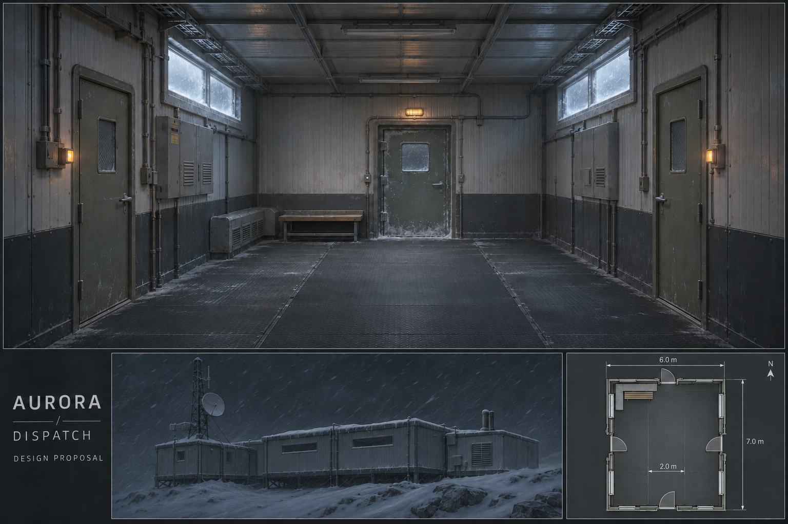
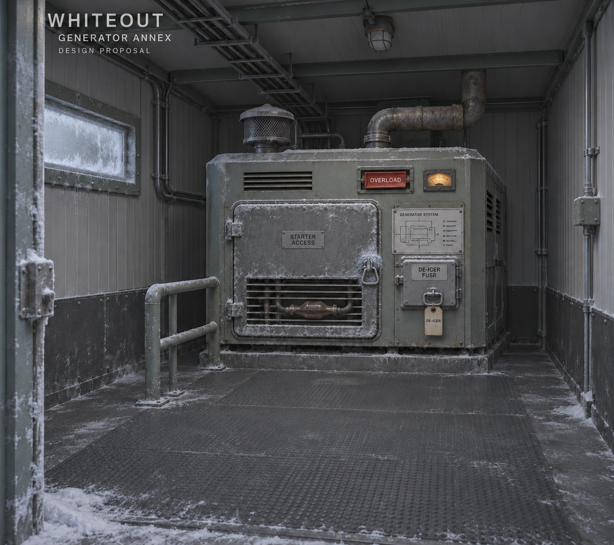
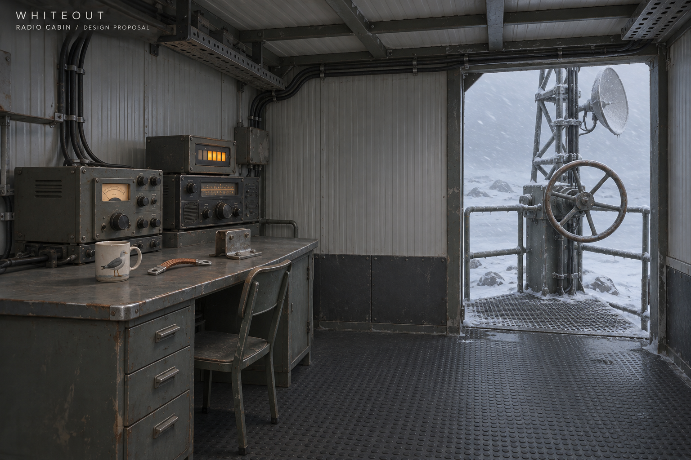
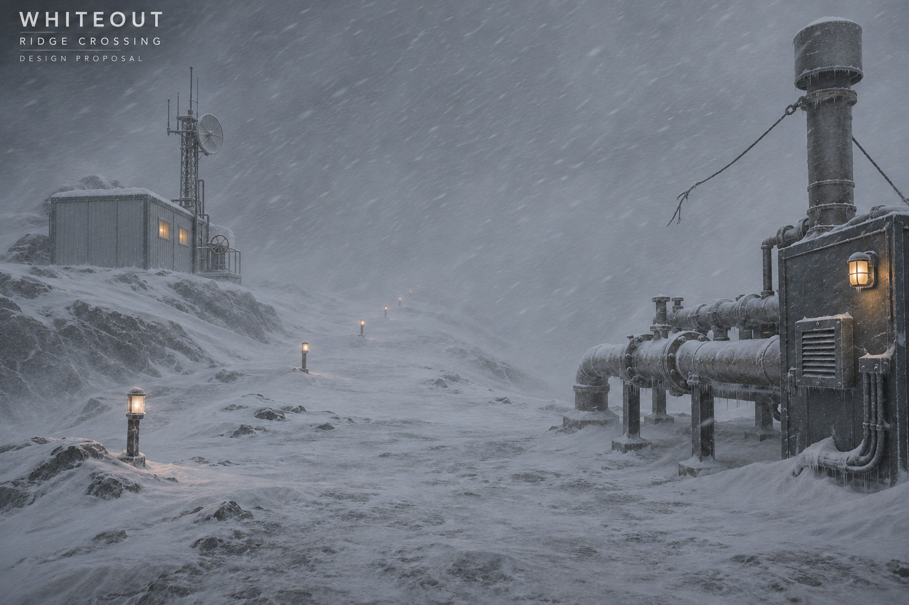
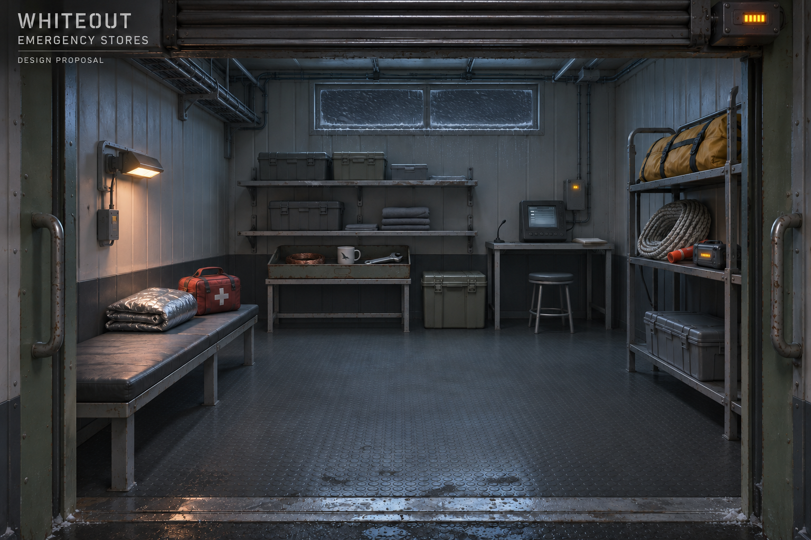

# Actual concept references, provenance and inspection

Generated 2026-11-05 using built-in `image_gen` (imagegen skill). The service
result did not disclose a backend model/version; none is invented. Original
briefs were authored from repository screenplay/cast/rules. No outside photo,
celebrity, concept artist or third-party copyrighted reference was input.

Five selected environment concepts are actually delivered, plus four original
superseded outputs retained for edit provenance. Exact generation/edit prompts
are in `prompts/`; PNGs copied into this repository, not dependent on tool-cache
paths. The edit chains preserve their targets rather than independently
redesigning a room. A prompt rerun does **not** guarantee pixel-identical output
or identity: use the selected reference/plan together for later derivatives.

## Artifacts / hashes

| Artifact | Status | Exact submitted prompt | Dimensions PNG | SHA-256 |
| --- | --- | --- | --- | --- |
| [generator-v1](references/generator-v1.png) | Superseded original, not selected | [generator-v1.txt](prompts/generator-v1.txt) | 1330×1182 | `dd69d18ff1384e7a7c411329a897e807ed526f9cc7bccba791306a220103cdcb` |
| [generator-v2](references/generator-v2.png) | **Selected proposal** | [generator-v2-edit.txt](prompts/generator-v2-edit.txt) | 1330×1182 | `520ce81372c80ff72c8bf7dc09b4eff0b0ca9bd901cdcbda02f5181c371f0f3a` |
| [radio-v1](references/radio-v1.png) | **Selected proposal** | [radio-v1.txt](prompts/radio-v1.txt) | 1536×1024 | `37ea736ba6dd1d57c4a00aa9351709275f080f96c9fc4668ec83df338aabc551` |
| [ridge-v1](references/ridge-v1.png) | Superseded original, not selected | [ridge-v1.txt](prompts/ridge-v1.txt) | 1536×1024 | `8837844065b7c6522e86fe8404727e75643777ab09a6418398b197902aa13312` |
| [ridge-v2](references/ridge-v2.png) | **Selected proposal** | [ridge-v2-edit.txt](prompts/ridge-v2-edit.txt) | 1536×1024 | `07d6245a7b93d5e07d4f05f313aab9bb8d744d7ce0b685e030ee1dbc8f93a027` |
| [station-dispatch-v1](references/station-dispatch-v1.png) | Superseded original, not selected | [station-dispatch-v1.txt](prompts/station-dispatch-v1.txt) | 1536×1024 | `f4ffc39bd55b326ac10a6e7549f4e607be84ae81b3ab344ff5d1082d228ddb6a` |
| [station-dispatch-v2](references/station-dispatch-v2.png) | **Selected proposal** | [station-dispatch-v2-edit.txt](prompts/station-dispatch-v2-edit.txt) | 1536×1024 | `a01befc5d2a59b50b63f14d39da5a319bb51d99098dd230d60870ef948ec2116` |
| [stores-v1](references/stores-v1.png) | Superseded original, not selected | [stores-v1.txt](prompts/stores-v1.txt) | 1536×1024 | `897d299ea2c68ef3a6ded444c7be158771e32bd63ce836c403aeafc0b9ecbd3d` |
| [stores-v2](references/stores-v2.png) | **Selected proposal** | [stores-v2-edit.txt](prompts/stores-v2-edit.txt) | 1536×1024 | `d528d91fb46d2574b8b1dc40d50634fad76588ba469133b42a1cfb2f78180255` |

## Edit provenance / constraints reviewed

- **Station-dispatch v1 → v2:** original target only; add south threshold to
  mini-plan, turn exterior warm windows/exhaust off. Selected hero has radio
  left, engineering right, ridge ahead, bench/duct northwest. Mini-plan now
  shows four thresholds. Same modules/mast/exhaust placement. Mini-plan is
  illustrative, not a metric export; PLANS governs measurements.
- **Generator v1 → v2:** original target only; remove invented padlock/key
  implication, keep iced mechanical latch and external tagged fuse, switch
  overhead fixture off. Same housing/rail/window/front-right controls. The
  engine-face gauge is not the entry-shutter countdown. Generated tiny labels/
  diagram marks are placeholders, not final text or an extra wiring puzzle.
- **Radio v1:** connected transmitter-left/wheel-right view, one loose gull mug
  and one braid at bracket for an assembly-study variant. Not a claim every
  playthrough owns those parts or manual radio works without Lea. Actual game
  dressing must follow possession/consumption/installed state.
- **Ridge v1 → v2:** ridge original is edit target, radio-v1 is supporting own
  continuity input only. Remove invented exterior shelter door, reveal the
  canonical working bay/wheel rather than an escape route. Same west-left mast,
  east-right manifold and marker line; no permanent crossing rail/bridge.
- **Stores v1 → v2:** original target only; raise same tray/three props to
  proposed low stand, replace daylight horizon with storm/night. Same one
  threshold/shutter, bench left, rack right, terminal back-right, clear lane.

All selected outputs were visually inspected at generation. Pale/sage insulated
panels, charcoal floor, cable trays, modest reserve lamps, same set landmarks
and storm continuity recur. No visible characters were generated, so no new
cast identity is invented. Existing Character Bible governs later staging;
PLANS uses its real support/handwheel/carry requirements and proposed scales.

These are empty **layout studies**, not literal gameplay frames without crew.
No orthographic/metric accuracy, real rig-contact proof, actual game UI crop,
GPU performance or final art approval is claimed. Lights/props in an image are
an explicitly named study variant, not WorldState mutation. Concept framing
must be reblocked to the actual caption/choice safe area before implementation.

## Source / usage / approval record

Inputs are original repository-based briefs and, for edits, the own-generated
images enumerated above. No third-party image licenses/attributions are imported.
Outputs are AI-generated production proposals, not photographs/commissioned
finished assets. Repository currently has no root LICENSE file; this PR does not
select a publication license or claim rights exclusivity. Any later external
reference needs its own real source/terms record. Agent inspection is distinct
from **pending maintainer art/layout approval**. No automatic merge approval.

## Selected proposals

### station-dispatch-v2

### generator-v2

### radio-v1

### ridge-v2

### stores-v2

