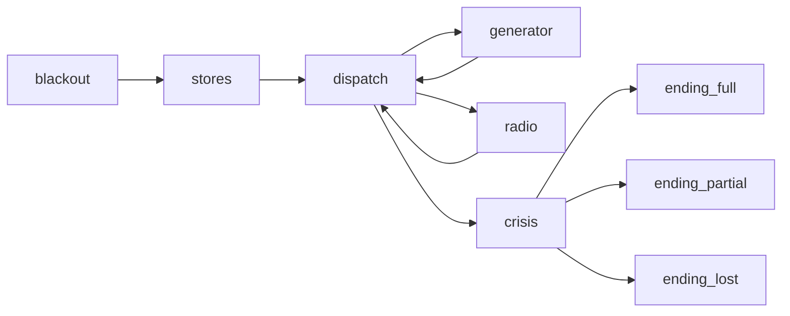

# WHITEOUT — complete interactive production screenplay

Editorial adaptation of the **complete canonical text adventure**, based on main
`a4adba6` after PR #76. This is a human-editable production foundation, not a new
story, executable screenplay format or completed Bevy port. The original
`story.yaml`, `text.yaml`, `scenes.yaml` and runnable playthroughs stay unchanged.
New dialogue, blocking, staging and art direction are marked **[A]**; canonical
facts/results **[C]**; existing technical references **[R]**.

## Read in order

1. [Format and timing contract](FORMAT.md).
2. [Act I — blackout and emergency stores](01-blackout-stores.md).
3. [Act II — first and repeated dispatch visits](02-dispatch.md).
4. [Act II — generator annex and all repair outcomes](03-generator.md).
5. [Act II — radio, jumper/manual route and cold failures](04-radio.md).
6. [Act III — ridge decisions and all three endings](05-ridge-endings.md).
7. [Cast, locations, assets and cueable inventory](INVENTORY.md).
8. [Exact interaction ledger](RULES.md), [parity matrix](PARITY.md),
   [validation and unresolved production questions](VALIDATION.md).
9. [Comparison with the existing Bevy slice](SLICE-COMPARISON.md).

## Canonical dramatic spine and interactive shape

At 03:17 Aurora loses light and power. Four people face two repair jobs before a
storm closes rescue access. Alex chooses supplies, treatment and repair order.
One copper braid can either save latch effort or make the antenna hands-free.
Jonas's signed bypass looks troubling, but the optional log reveals a de-icer
overload and failed test-call relay, not sabotage or a supernatural transmission.
Restoring heat and sending a bearing still leave a human choice at the ridge.
The final count echoes the opening: four names answered, a named absence, or no
answers. Staging makes these dependencies visible without introducing new rules.

This is the complete context topology; internal attempts/feedback stay inside
their current context. Stores have a single exit and cannot be revisited. Repair
order can be reversed; a repaired or lost job cannot be entered again. The ridge
opens only after **both jobs are resolved**, including explicit abandonment.
Warming and failed work remain local; terminal contexts have no outgoing actions.

## State and consequence inventory

The [ledger](RULES.md#initial-globals) lists all **30 globals**, initial values,
and exact effects. The screenplay uses these meanings; no new stats are added:

- **Preparation:** liner, treatment, copper, mug, spanner, safety line/flare,
  heat pack and optional maintenance knowledge.
- **Persistent repair:** cumulative latch progress; insulated lever; known
  controls; isolated de-icer; power; adapter/alignment; acknowledged call and
  automatic/manual bearing. Combination consumes components once.
- **Irreversible access/order:** `first_task` and lost engineering/radio doors.
  A later warm room does not erase the radio-first delay in Jonas's rescue.
- **Exposure:** `cold_exposure`, `accounted_ms`, current and indoor rates;
  accounting is action/timeout-driven, not an invented continuously updating stat.
- **Resolution:** four survivor flags and the three authored ending values.
  A partial ending names the person lost. Equipment repair is not rescue success.

## Production order recommended

1. **Editorial/layout rehearsal:** read the whole script against RULES; block
   hall–annex–radio–ridge geography with four persistent actors, no new assets.
   Resolve the timing/voice and conditional-presence questions in VALIDATION.
2. **Rule-faithful generator expansion:** keep PR #76's proven concurrent media,
   epoch/deduplication and cleanup; cover actual latch modes, alternatives, cold
   failures, heat extension and cutoff before adding polish. Reuse its sprites
   and three WAVs until the full-rule headless scenarios pass.
3. **Stores + repeated hall:** equipment silhouettes, splint continuity, single
   copper trade-off, two repair orders, changed return poses/light. These establish
   actor/prop identities before producing more locations.
4. **Radio:** build connected desk/mast layout, visible manual commitment versus
   installed jumper, gust overlap, failed/successful transmission and deadline
   removal. Validate that there is only one visible Lea and one scene clock.
5. **Ridge + endings:** stage both target positions, each distinct rescue predicate,
   named losses, flare and false shelter. Match four-face opening to ending
   composition before commissioning detailed rigs or voice.
6. **Production art/audio pass:** iterate canonical full/lever/manual/radio-first,
   partial and catastrophic playthroughs; commission assets by stable inventory
   ID. Listen on target hardware; only then lock VO, shot lengths and performance.

This is a dependency order for future concrete game work, not authorization to
implement it here. Save/Restore (#63), codegen (#75), IDE, screenshot automation,
asset generation and engine changes are excluded. Existing CLI remains the
playable rules reference; the graphical excerpt remains intentionally smaller.
