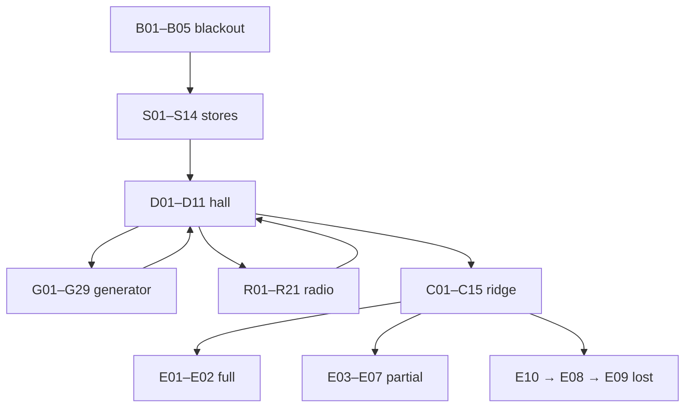

# Interactive shot branches

Each arrow below refers to actual indexed drawings. Panels are camera/pose/UI profiles, not executable narrative states. Reusing a composition refreshes offers, timer and props from the current cue sheet; it never replays entry narration or resets time. Numbered UI mock-ups show representative eligible sets, not every possible inventory/time permutation. Canonical conditions and ordered outcomes are in `../screenplay/RULES.md`.

## Every authored decision and conditional profile

### blackout

| Action | Source/variant panels | Continuation / conditions / time |
| --- | --- | --- |
| `begin` | [B05](panels/b05.png) | B05: S01 |

### stores

| Action | Source/variant panels | Continuation / conditions / time |
| --- | --- | --- |
| `take_thermal_liner` | [S03](panels/s03.png) | S03: S02 |
| `jonas_treated` | [S04](panels/s04.png) | S04: S02 |
| `take_copper_braid` | [S05](panels/s05.png) | S05: S02 |
| `take_ceramic_mug` | [S06](panels/s06.png) | S06: S02 |
| `take_spanner` | [S07](panels/s07.png) | S07: S02 |
| `take_safety_line` | [S08](panels/s08.png) | S08: S02 |
| `take_heat_pack` | [S09](panels/s09.png) | S09: S02 |
| `log_read` | [S10](panels/s10.png) | S10: S02 |
| `leave` | [S11](panels/s11.png) | S11: D01 |

### dispatch

| Action | Source/variant panels | Continuation / conditions / time |
| --- | --- | --- |
| `engineering` | [D01](panels/d01.png) | D01: G01 or R01 |
| `communications` | [D01](panels/d01.png) | D01: G01 or R01 |
| `warm_hands` | [D04](panels/d04.png) | D04: Same hall choice setup D08/D10 according to jobs; no entry replay |
| `ridge` | [D06](panels/d06.png) | D06: C01 |

### generator

| Action | Source/variant panels | Continuation / conditions / time |
| --- | --- | --- |
| `deploy_heat_pack` | [G05](panels/g05.png) | G05: G17/G16 |
| `open_generator_latch` | [G06](panels/g06.png) | G06: G17; G16 may overlap at T=10000 |
| `work_latch_with_numb_hands` | [G06](panels/g06.png) | G06: G17; G16 may overlap at T=10000 |
| `make_lever` | [G10](panels/g10.png) | G10: G27; use_lever choice then G11 or G12 (crafting alone does not open latch) |
| `use_lever` | [G11](panels/g11.png) | G11: G17 |
| `inspect_controls` | [G04](panels/g04.png) | G04: G13 or G17 |
| `isolate_deicer` | [G13](panels/g13.png) | G13: G25 or G17 according to latch |
| `start_generator` | [G18](panels/g18.png) | G18: G19 |
| `return` | [G21](panels/g21.png) | G21: D02/D05 |
| `abandon` | [G22](panels/g22.png) | G22: D05 |

### radio

| Action | Source/variant panels | Continuation / conditions / time |
| --- | --- | --- |
| `make_adapter` | [R03](panels/r03.png) | R03: R04 |
| `hand_align` | [R05](panels/r05.png) | R05: R14 |
| `send_signal` | [R08](panels/r08.png) | R08: R02/R11/R13 |
| `warm_hands` | [R11](panels/r11.png) | R11: Same setup: R14 before call, R15/R16 after call; no entry replay |
| `return` | [R12](panels/r12.png) | R12: D02/D03/D05 |
| `abandon` | [R13](panels/r13.png) | R13: D05 |

### crisis

| Action | Source/variant panels | Continuation / conditions / time |
| --- | --- | --- |
| `coordinate` | [C03](panels/c03.png) | C03: C02 same composition with refreshed remaining time; never reset to 37s |
| `help_lea` | [C06](panels/c06.png) | C06: E01 |
| `help_jonas` | [C08](panels/c08.png) | C08: E01 |
| `flare_retreat` | [C10](panels/c10.png) | C10: E03/E04 |
| `stay` | [C11](panels/c11.png) | C11: E10 |

## Binding timing and outcome notes

- Stores: 180 s from entry, 7 s briefing; preparations change inventory and injury, never cure Jonas. Leave and timeout have different panels.
- Generator: hidden 30 s from entry, reveal at T=10; heat pack adds 60 s rather than restarting. G16 shows selection at T=8, three-second latch work, overlapping warning at T=10 and input locked until at least T=11.
- Latch work costs 3 s or 5 s in numb mode; post-work cold can fail. Crafting consumes the braid/spanner but does not open the cover. Isolation is external and has no latch prerequisite. G29 deliberately shows the unsafe start offer; overload takes precedence over cold failure.
- Successful start effects resolve once at selection. G18–G20 are sequential locked media (1200/1500/1800 ms), not three new actions. Deadline-truncated work cannot power the station. G23→G24 is the timeout withdrawal/sealed-door pair.
- Hall has no decision deadline. Warm hands books time, does not replay arrival, and updates the current D08/D10 profile. Route order remains persistent.
- Radio: 60 s, 6 s arrival; gust T=15 unless auto. Adapter and alignment branches remain distinct. Cold failure precedes manual/auto success. Successful transmission removes the deadline even without power (R20); manual success still occupies Lea. R18–R21 cover unpowered and consumed-braid alternatives.
- Ridge: 45 s, 8 s briefing. Failed coordinate returns to the same clock. Coordinate requires power, call, treatment, auto-or-line, first-engineering-or-line, and cold<120000.
- Help Lea: full requires call+power+treatment+first-engineering+cold<120000; otherwise call-or-flare gives partial with Jonas lost, otherwise lost. Help Jonas: full requires call+auto+power+cold<120000 (treatment/order are not guards); otherwise call-or-flare gives partial with Lea lost, otherwise lost.
- Flare retreat consumes the flare and loses Jonas, even when better prepared. Stay and timeout lose all four. Full/partial truth detail is conditional on reading the log; lost ends on four names beside the ridge door.

## Movement keyframe pairs

B05→S01 carry into stores; G01→G04 push to controls; G23→G24 withdrawal and sealed same threshold; R03→R04 adapter insertion; C04→C05 manual-line crossing; C12→C13 snow erasure; E10→E08 exterior pullback, then E09 spring match cut. Motion/gaze arrows and camera insets are drawn in the actual panels.
