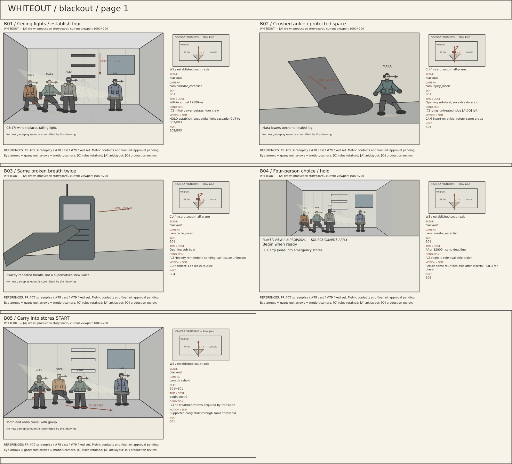
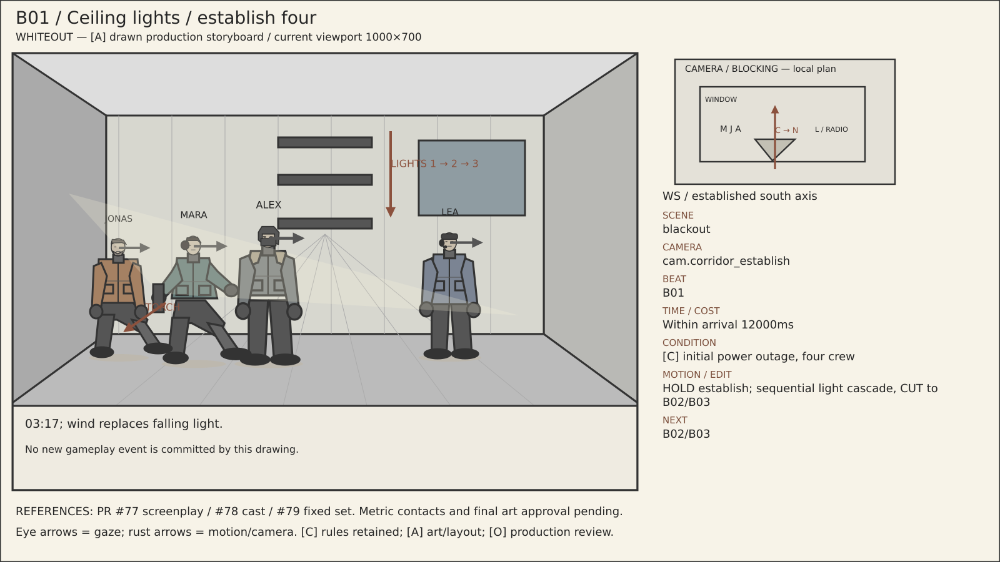
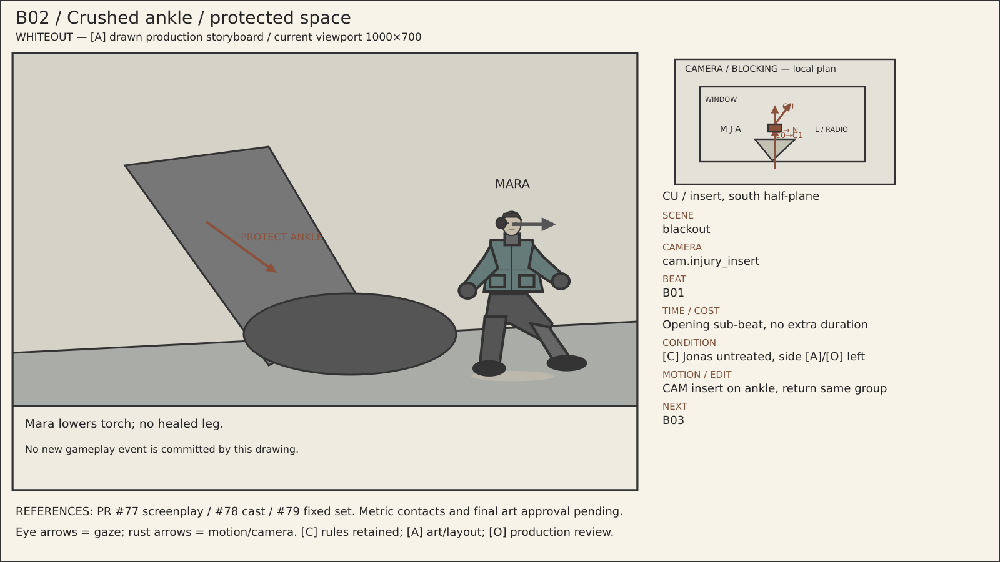
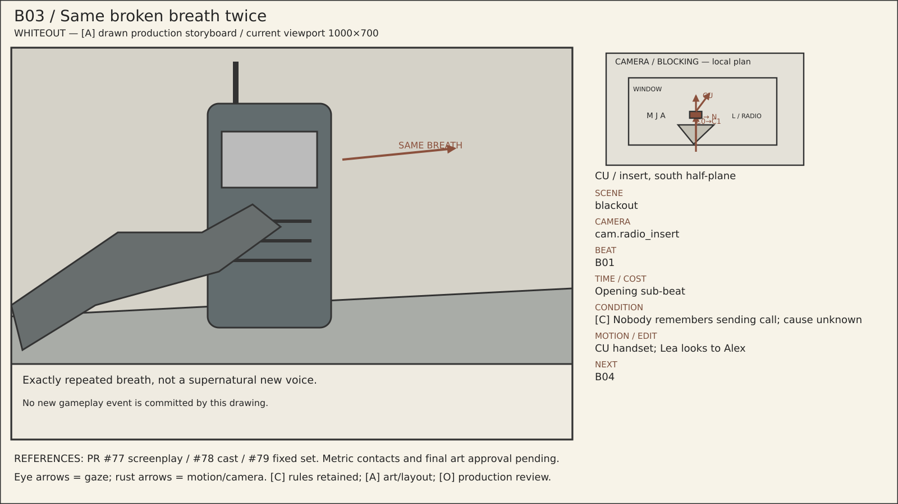
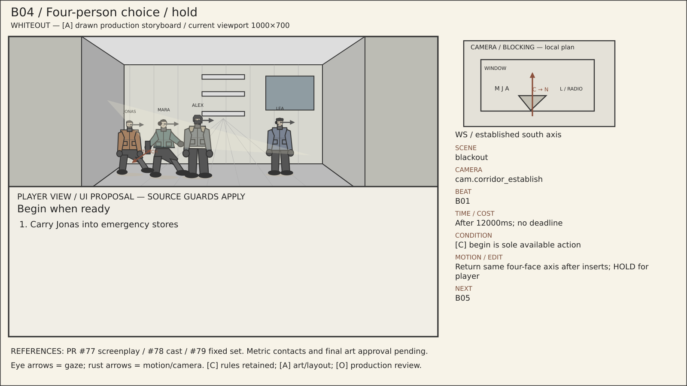
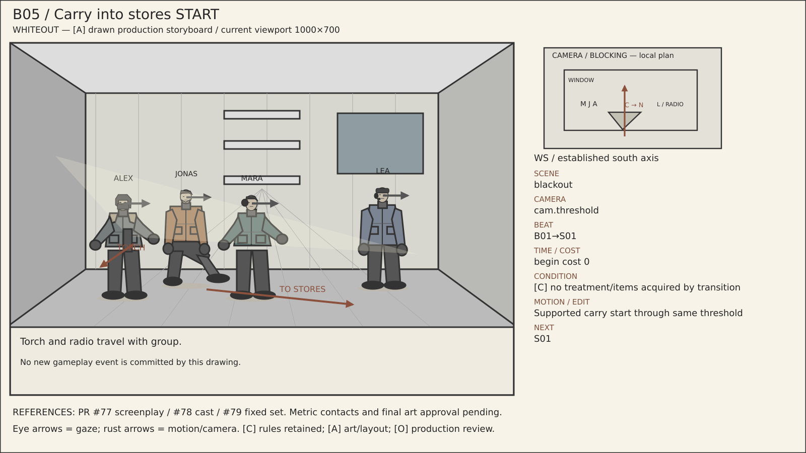

# blackout — visual storyboard pages

[Reading guide](../README.md) · [Branches](../BRANCHES.md) · [Shot index](../SHOTS.md)

The sheets are contact overviews. Full-size panels and readable metadata are
listed below on this same page; no separate file needs opening for each shot.
All imagery is [A] blocking/art, with [C] rule associations and [O] final approval.

## Sheet 1

## B01 — Ceiling lights / establish four

**Scene:** `blackout` · **Location:** `loc.aurora_corridor` · **Camera:** `cam.corridor_establish` · **Beat:** `B01`.

**Time:** Within arrival 12000ms.

**Condition / variant:** [C] initial power outage, four crew.

**Audio/dialogue:** 03:17; wind replaces falling light.

**Motion/edit:** HOLD establish; sequential light cascade, CUT to B02/B03. **Next:** B02/B03.

[Editable SVG](../panels/b01.svg) · [Source metadata](../sources/shots.json)

## B02 — Crushed ankle / protected space

**Scene:** `blackout` · **Location:** `loc.aurora_corridor` · **Camera:** `cam.injury_insert` · **Beat:** `B01`.

**Time:** Opening sub-beat, no extra duration.

**Condition / variant:** [C] Jonas untreated, side [A]/[O] left.

**Audio/dialogue:** Mara lowers torch; no healed leg.

**Motion/edit:** CAM insert on ankle, return same group. **Next:** B03.

[Editable SVG](../panels/b02.svg) · [Source metadata](../sources/shots.json)

## B03 — Same broken breath twice

**Scene:** `blackout` · **Location:** `loc.aurora_corridor` · **Camera:** `cam.radio_insert` · **Beat:** `B01`.

**Time:** Opening sub-beat.

**Condition / variant:** [C] Nobody remembers sending call; cause unknown.

**Audio/dialogue:** Exactly repeated breath, not a supernatural new voice.

**Motion/edit:** CU handset; Lea looks to Alex. **Next:** B04.

[Editable SVG](../panels/b03.svg) · [Source metadata](../sources/shots.json)

## B04 — Four-person choice / hold

**Scene:** `blackout` · **Location:** `loc.aurora_corridor` · **Camera:** `cam.corridor_establish` · **Beat:** `B01`.

**Time:** After 12000ms; no deadline.

**Condition / variant:** [C] begin is sole available action.

**Audio/dialogue:** Mara: supplies, then repairs.

**Motion/edit:** Return same four-face axis after inserts; HOLD for player. **Next:** B05.

[Editable SVG](../panels/b04.svg) · [Source metadata](../sources/shots.json)

## B05 — Carry into stores START

**Scene:** `blackout` · **Location:** `loc.aurora_corridor` · **Camera:** `cam.threshold` · **Beat:** `B01→S01`.

**Time:** begin cost 0.

**Condition / variant:** [C] no treatment/items acquired by transition.

**Audio/dialogue:** Torch and radio travel with group.

**Motion/edit:** Supported carry start through same threshold. **Next:** S01.

[Editable SVG](../panels/b05.svg) · [Source metadata](../sources/shots.json)
