# crisis — visual storyboard pages

[Reading guide](../README.md) · [Branches](../BRANCHES.md) · [Shot index](../SHOTS.md)

The sheets are contact overviews. Full-size panels and readable metadata are
listed below on this same page; no separate file needs opening for each shot.
All imagery is [A] blocking/art, with [C] rule associations and [O] final approval.

## Sheet 1

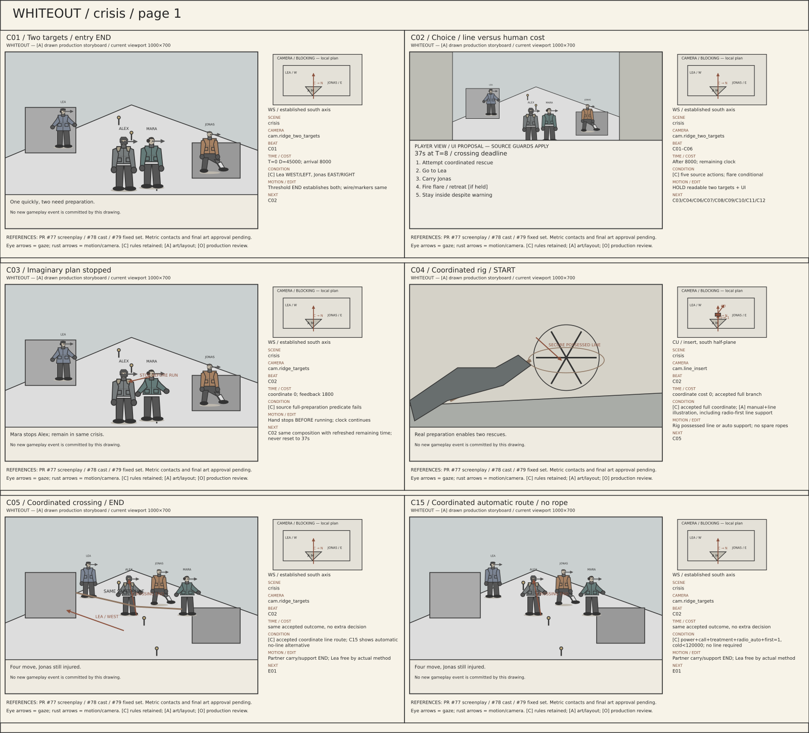

## Sheet 2

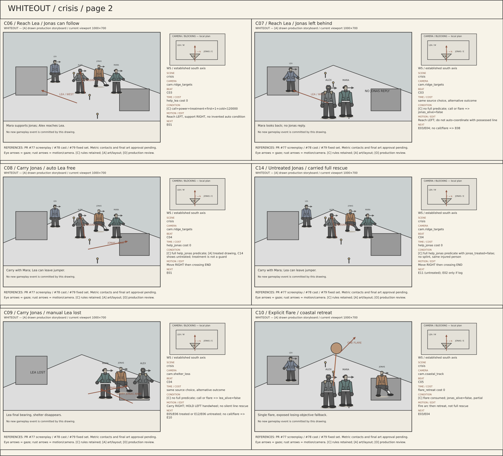

## Sheet 3

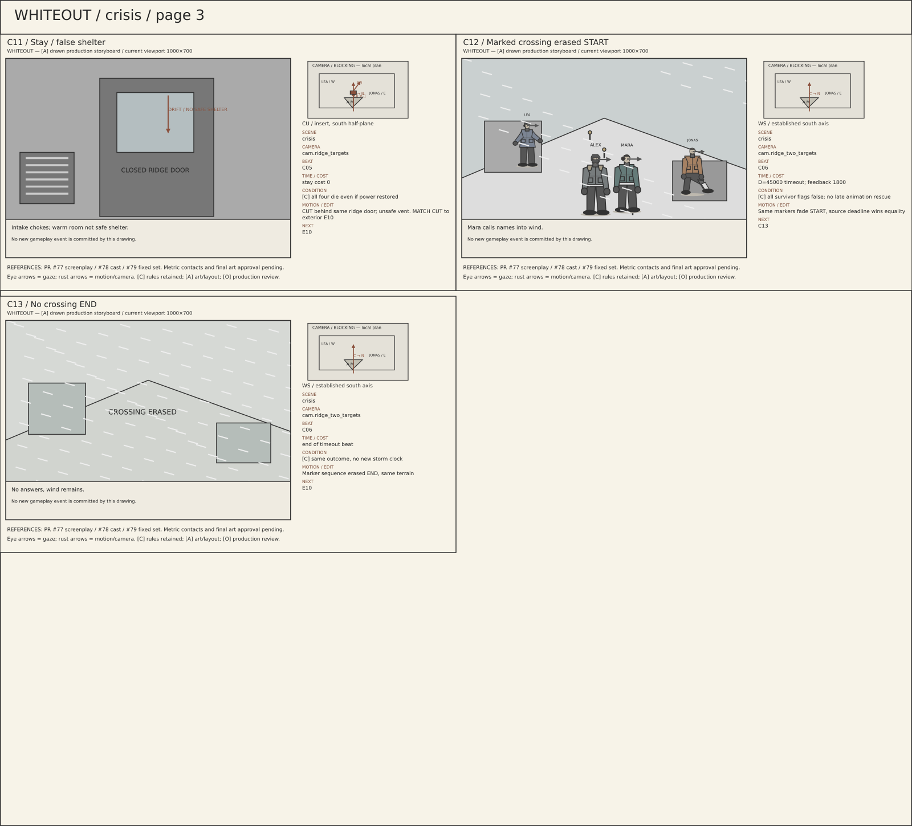

## C01 — Two targets / entry END

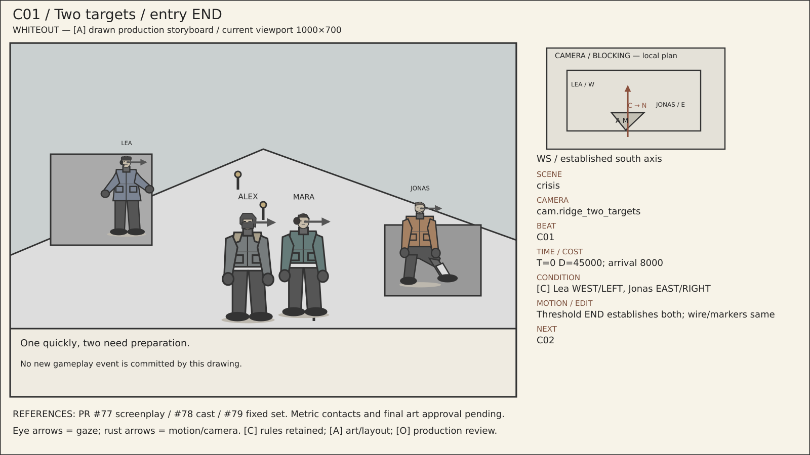

**Scene:** `crisis` · **Location:** `loc.ridge_crossing` · **Camera:** `cam.ridge_two_targets` · **Beat:** `C01`.

**Time:** T=0 D=45000; arrival 8000.

**Condition / variant:** [C] Lea WEST/LEFT, Jonas EAST/RIGHT.

**Audio/dialogue:** One quickly, two need preparation.

**Motion/edit:** Threshold END establishes both; wire/markers same. **Next:** C02.

[Editable SVG](../panels/c01.svg) · [Source metadata](../sources/shots.json)

## C02 — Choice / line versus human cost

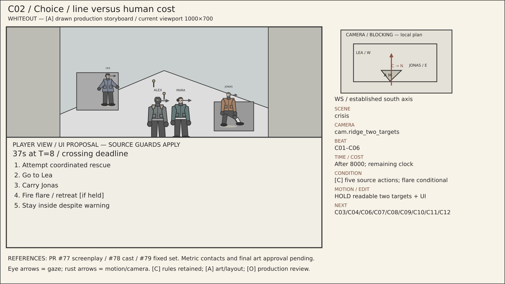

**Scene:** `crisis` · **Location:** `loc.ridge_crossing` · **Camera:** `cam.ridge_two_targets` · **Beat:** `C01–C06`.

**Time:** After 8000; remaining clock.

**Condition / variant:** [C] five source actions; flare conditional.

**Audio/dialogue:** No time reset when a plan fails.

**Motion/edit:** HOLD readable two targets + UI. **Next:** C03/C04/C06/C07/C08/C09/C10/C11/C12.

[Editable SVG](../panels/c02.svg) · [Source metadata](../sources/shots.json)

## C03 — Imaginary plan stopped

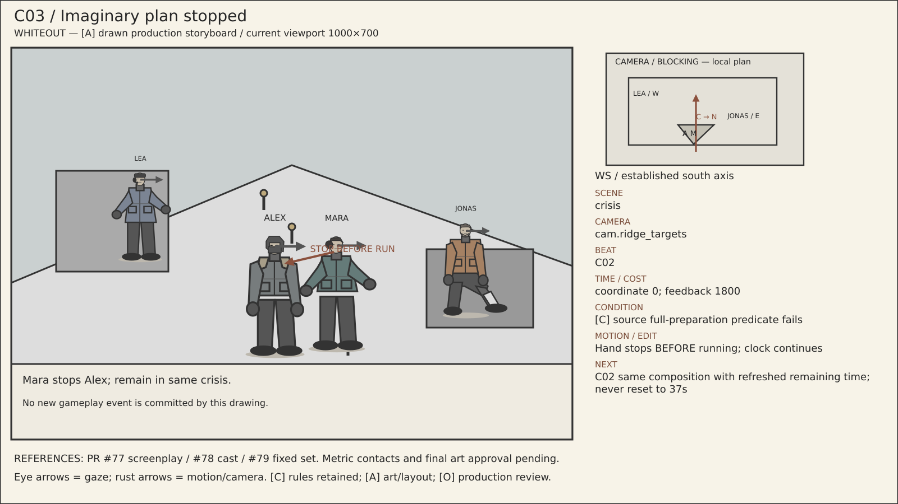

**Scene:** `crisis` · **Location:** `loc.ridge_crossing` · **Camera:** `cam.ridge_targets` · **Beat:** `C02`.

**Time:** coordinate 0; feedback 1800.

**Condition / variant:** [C] source full-preparation predicate fails.

**Audio/dialogue:** Mara stops Alex; remain in same crisis.

**Motion/edit:** Hand stops BEFORE running; clock continues. **Next:** C02 same composition with refreshed remaining time; never reset to 37s.

[Editable SVG](../panels/c03.svg) · [Source metadata](../sources/shots.json)

## C04 — Coordinated rig / START

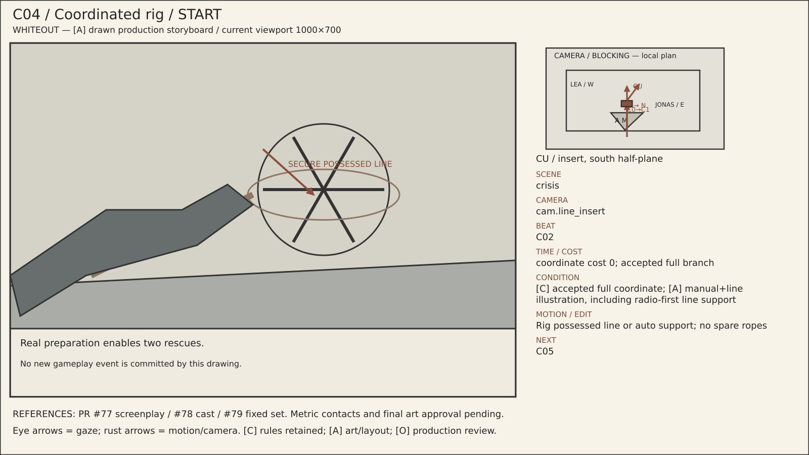

**Scene:** `crisis` · **Location:** `loc.ridge_crossing` · **Camera:** `cam.line_insert` · **Beat:** `C02`.

**Time:** coordinate cost 0; accepted full branch.

**Condition / variant:** [C] accepted full coordinate; [A] manual+line illustration, including radio-first line support.

**Audio/dialogue:** Real preparation enables two rescues.

**Motion/edit:** Rig possessed line or auto support; no spare ropes. **Next:** C05.

[Editable SVG](../panels/c04.svg) · [Source metadata](../sources/shots.json)

## C05 — Coordinated crossing / END

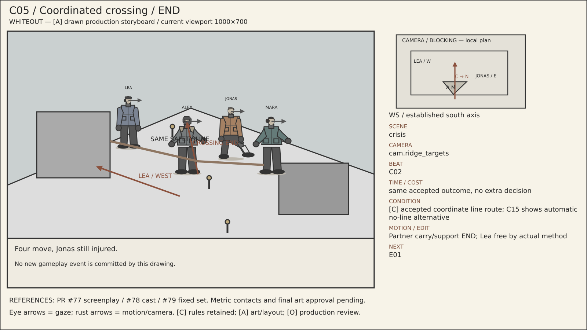

**Scene:** `crisis` · **Location:** `loc.ridge_crossing` · **Camera:** `cam.ridge_targets` · **Beat:** `C02`.

**Time:** same accepted outcome, no extra decision.

**Condition / variant:** [C] accepted coordinate line route; C15 shows automatic no-line alternative.

**Audio/dialogue:** Four move, Jonas still injured.

**Motion/edit:** Partner carry/support END; Lea free by actual method. **Next:** E01.

[Editable SVG](../panels/c05.svg) · [Source metadata](../sources/shots.json)

## C15 — Coordinated automatic route / no rope

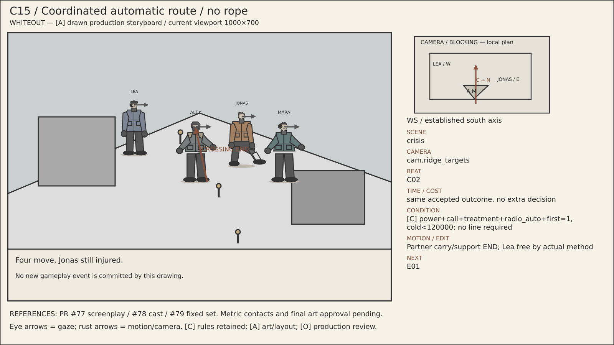

**Scene:** `crisis` · **Location:** `loc.ridge_crossing` · **Camera:** `cam.ridge_targets` · **Beat:** `C02`.

**Time:** same accepted outcome, no extra decision.

**Condition / variant:** [C] power+call+treatment+radio_auto+first=1, cold<120000; no line required.

**Audio/dialogue:** Four move, Jonas still injured.

**Motion/edit:** Partner carry/support END; Lea free by actual method. **Next:** E01.

[Editable SVG](../panels/c15.svg) · [Source metadata](../sources/shots.json)

## C06 — Reach Lea / Jonas can follow

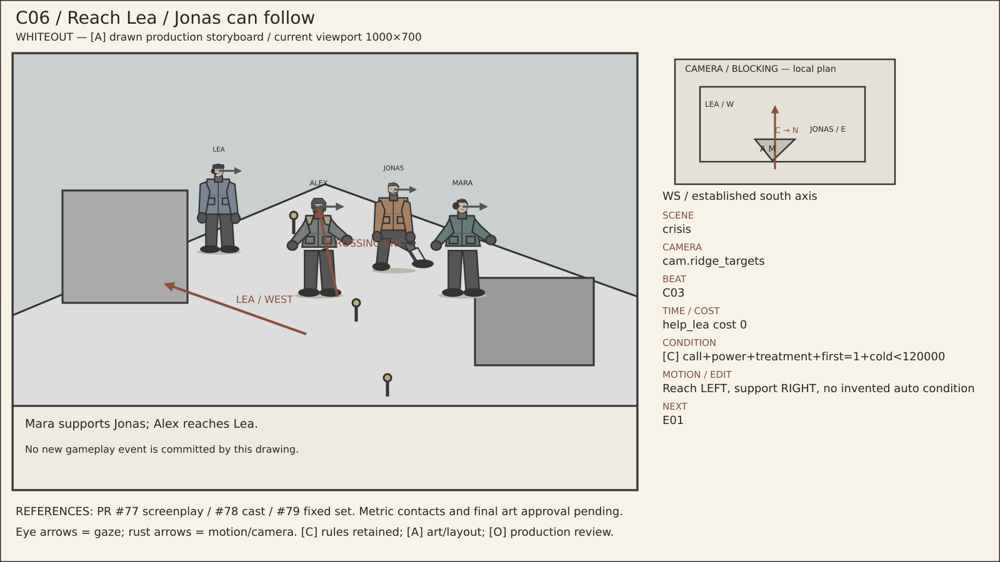

**Scene:** `crisis` · **Location:** `loc.ridge_crossing` · **Camera:** `cam.ridge_targets` · **Beat:** `C03`.

**Time:** help_lea cost 0.

**Condition / variant:** [C] call+power+treatment+first=1+cold<120000.

**Audio/dialogue:** Mara supports Jonas; Alex reaches Lea.

**Motion/edit:** Reach LEFT, support RIGHT, no invented auto condition. **Next:** E01.

[Editable SVG](../panels/c06.svg) · [Source metadata](../sources/shots.json)

## C07 — Reach Lea / Jonas left behind

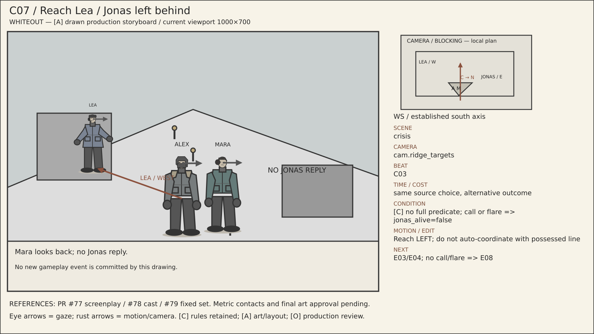

**Scene:** `crisis` · **Location:** `loc.ridge_crossing` · **Camera:** `cam.ridge_targets` · **Beat:** `C03`.

**Time:** same source choice, alternative outcome.

**Condition / variant:** [C] no full predicate; call or flare => jonas_alive=false.

**Audio/dialogue:** Mara looks back; no Jonas reply.

**Motion/edit:** Reach LEFT; do not auto-coordinate with possessed line. **Next:** E03/E04; no call/flare => E08.

[Editable SVG](../panels/c07.svg) · [Source metadata](../sources/shots.json)

## C08 — Carry Jonas / auto Lea free

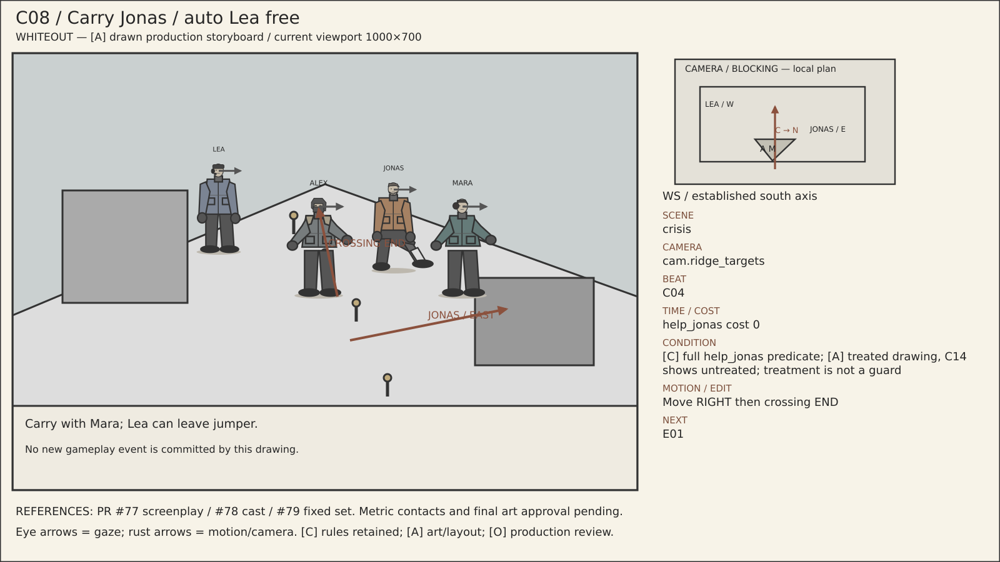

**Scene:** `crisis` · **Location:** `loc.ridge_crossing` · **Camera:** `cam.ridge_targets` · **Beat:** `C04`.

**Time:** help_jonas cost 0.

**Condition / variant:** [C] full help_jonas predicate; [A] treated drawing, C14 shows untreated; treatment is not a guard.

**Audio/dialogue:** Carry with Mara; Lea can leave jumper.

**Motion/edit:** Move RIGHT then crossing END. **Next:** E01.

[Editable SVG](../panels/c08.svg) · [Source metadata](../sources/shots.json)

## C14 — Untreated Jonas / carried full rescue

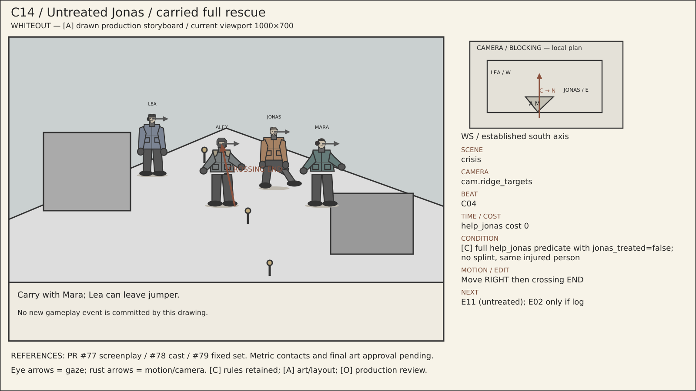

**Scene:** `crisis` · **Location:** `loc.ridge_crossing` · **Camera:** `cam.ridge_targets` · **Beat:** `C04`.

**Time:** help_jonas cost 0.

**Condition / variant:** [C] full help_jonas predicate with jonas_treated=false; no splint, same injured person.

**Audio/dialogue:** Carry with Mara; Lea can leave jumper.

**Motion/edit:** Move RIGHT then crossing END. **Next:** E11 (untreated); E02 only if log.

[Editable SVG](../panels/c14.svg) · [Source metadata](../sources/shots.json)

## C09 — Carry Jonas / manual Lea lost

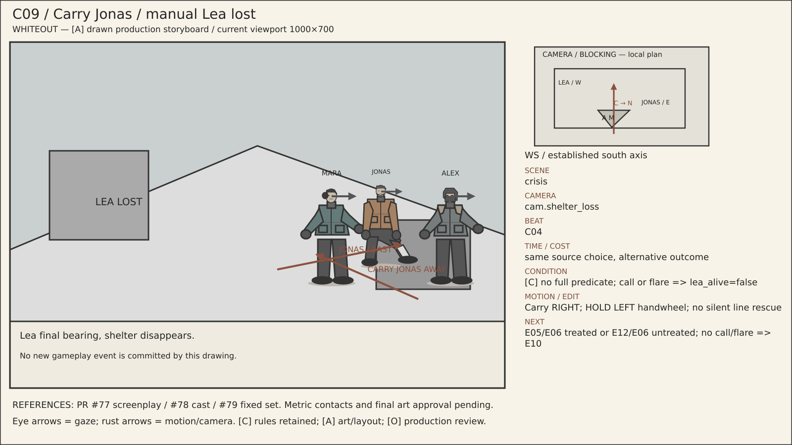

**Scene:** `crisis` · **Location:** `loc.ridge_crossing` · **Camera:** `cam.shelter_loss` · **Beat:** `C04`.

**Time:** same source choice, alternative outcome.

**Condition / variant:** [C] no full predicate; call or flare => lea_alive=false.

**Audio/dialogue:** Lea final bearing, shelter disappears.

**Motion/edit:** Carry RIGHT; HOLD LEFT handwheel; no silent line rescue. **Next:** E05/E06 treated or E12/E06 untreated; no call/flare => E10.

[Editable SVG](../panels/c09.svg) · [Source metadata](../sources/shots.json)

## C10 — Explicit flare / coastal retreat

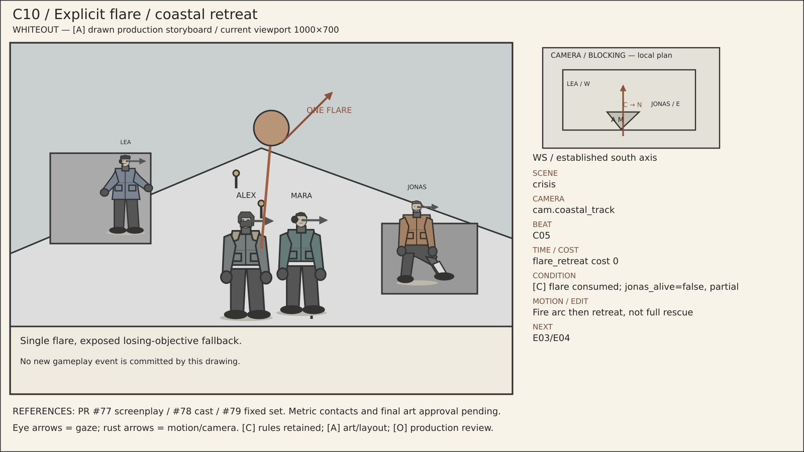

**Scene:** `crisis` · **Location:** `loc.ridge_crossing` · **Camera:** `cam.coastal_track` · **Beat:** `C05`.

**Time:** flare_retreat cost 0.

**Condition / variant:** [C] flare consumed; jonas_alive=false, partial.

**Audio/dialogue:** Single flare, exposed losing-objective fallback.

**Motion/edit:** Fire arc then retreat, not full rescue. **Next:** E03/E04.

[Editable SVG](../panels/c10.svg) · [Source metadata](../sources/shots.json)

## C11 — Stay / false shelter

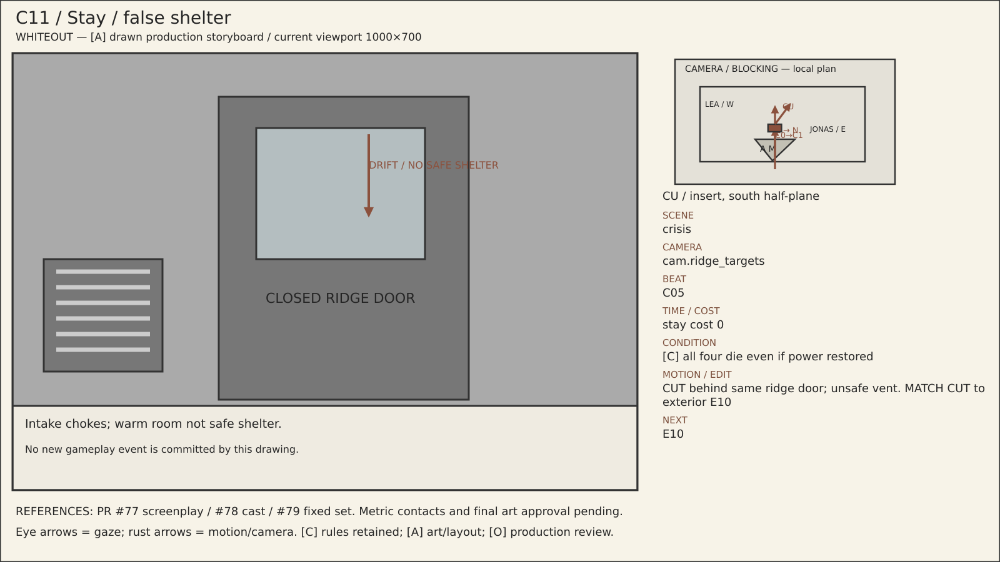

**Scene:** `crisis` · **Location:** `loc.dispatch_hall` · **Camera:** `cam.ridge_targets` · **Beat:** `C05`.

**Time:** stay cost 0.

**Condition / variant:** [C] all four die even if power restored.

**Audio/dialogue:** Intake chokes; warm room not safe shelter.

**Motion/edit:** CUT behind same ridge door; unsafe vent. MATCH CUT to exterior E10. **Next:** E10.

[Editable SVG](../panels/c11.svg) · [Source metadata](../sources/shots.json)

## C12 — Marked crossing erased START

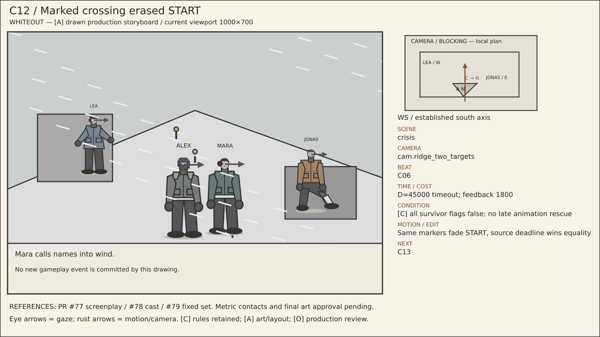

**Scene:** `crisis` · **Location:** `loc.ridge_crossing` · **Camera:** `cam.ridge_two_targets` · **Beat:** `C06`.

**Time:** D=45000 timeout; feedback 1800.

**Condition / variant:** [C] all survivor flags false; no late animation rescue.

**Audio/dialogue:** Mara calls names into wind.

**Motion/edit:** Same markers fade START, source deadline wins equality. **Next:** C13.

[Editable SVG](../panels/c12.svg) · [Source metadata](../sources/shots.json)

## C13 — No crossing END

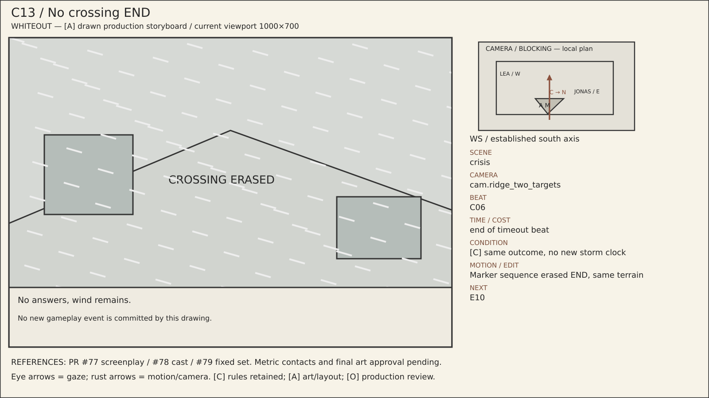

**Scene:** `crisis` · **Location:** `loc.ridge_crossing` · **Camera:** `cam.ridge_two_targets` · **Beat:** `C06`.

**Time:** end of timeout beat.

**Condition / variant:** [C] same outcome, no new storm clock.

**Audio/dialogue:** No answers, wind remains.

**Motion/edit:** Marker sequence erased END, same terrain. **Next:** E10.

[Editable SVG](../panels/c13.svg) · [Source metadata](../sources/shots.json)
