# dispatch — visual storyboard pages

[Reading guide](../README.md) · [Branches](../BRANCHES.md) · [Shot index](../SHOTS.md)

The sheets are contact overviews. Full-size panels and readable metadata are
listed below on this same page; no separate file needs opening for each shot.
All imagery is [A] blocking/art, with [C] rule associations and [O] final approval.

## Sheet 1

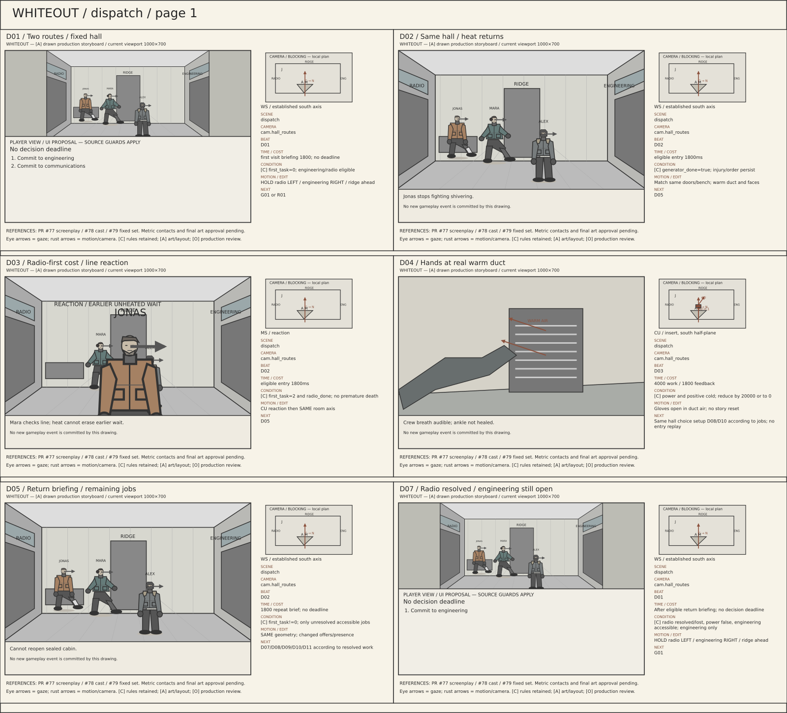

## Sheet 2

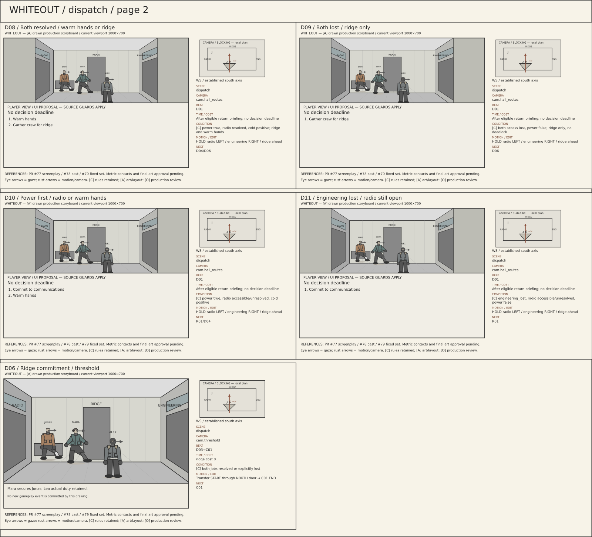

## D01 — Two routes / fixed hall

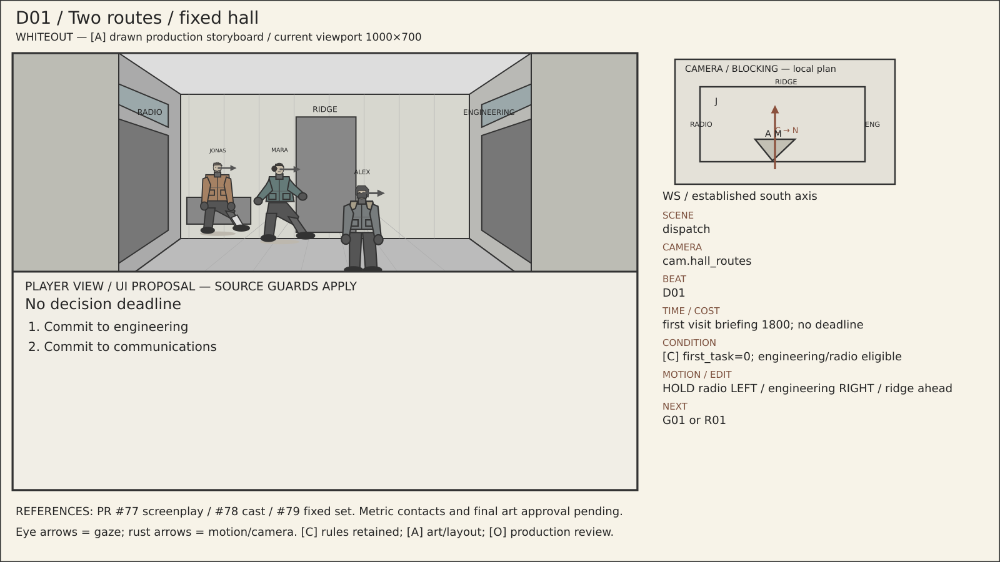

**Scene:** `dispatch` · **Location:** `loc.dispatch_hall` · **Camera:** `cam.hall_routes` · **Beat:** `D01`.

**Time:** first visit briefing 1800; no deadline.

**Condition / variant:** [C] first_task=0; engineering/radio eligible.

**Audio/dialogue:** Power first warms; radio first buys bearing.

**Motion/edit:** HOLD radio LEFT / engineering RIGHT / ridge ahead. **Next:** G01 or R01.

[Editable SVG](../panels/d01.svg) · [Source metadata](../sources/shots.json)

## D02 — Same hall / heat returns

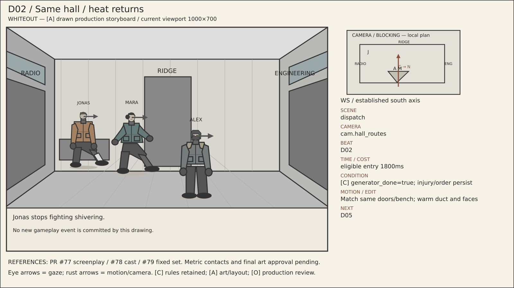

**Scene:** `dispatch` · **Location:** `loc.dispatch_hall` · **Camera:** `cam.hall_routes` · **Beat:** `D02`.

**Time:** eligible entry 1800ms.

**Condition / variant:** [C] generator_done=true; injury/order persist.

**Audio/dialogue:** Jonas stops fighting shivering.

**Motion/edit:** Match same doors/bench; warm duct and faces. **Next:** D05.

[Editable SVG](../panels/d02.svg) · [Source metadata](../sources/shots.json)

## D03 — Radio-first cost / line reaction

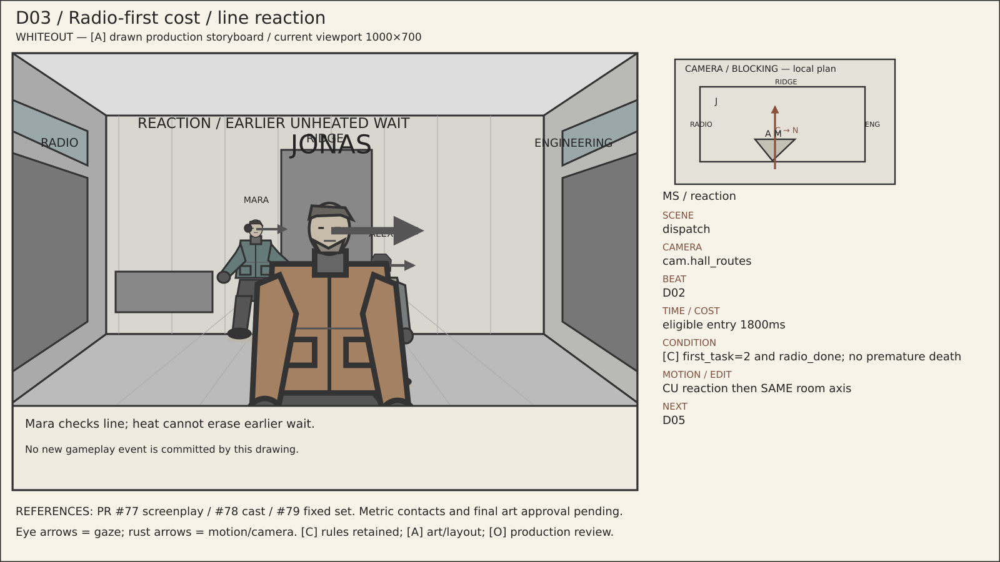

**Scene:** `dispatch` · **Location:** `loc.dispatch_hall` · **Camera:** `cam.hall_routes` · **Beat:** `D02`.

**Time:** eligible entry 1800ms.

**Condition / variant:** [C] first_task=2 and radio_done; no premature death.

**Audio/dialogue:** Mara checks line; heat cannot erase earlier wait.

**Motion/edit:** CU reaction then SAME room axis. **Next:** D05.

[Editable SVG](../panels/d03.svg) · [Source metadata](../sources/shots.json)

## D04 — Hands at real warm duct

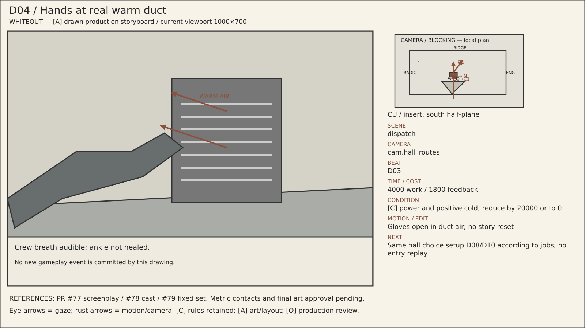

**Scene:** `dispatch` · **Location:** `loc.dispatch_hall` · **Camera:** `cam.hall_routes` · **Beat:** `D03`.

**Time:** 4000 work / 1800 feedback.

**Condition / variant:** [C] power and positive cold; reduce by 20000 or to 0.

**Audio/dialogue:** Crew breath audible; ankle not healed.

**Motion/edit:** Gloves open in duct air; no story reset. **Next:** Same hall choice setup D08/D10 according to jobs; no entry replay.

[Editable SVG](../panels/d04.svg) · [Source metadata](../sources/shots.json)

## D05 — Return briefing / remaining jobs

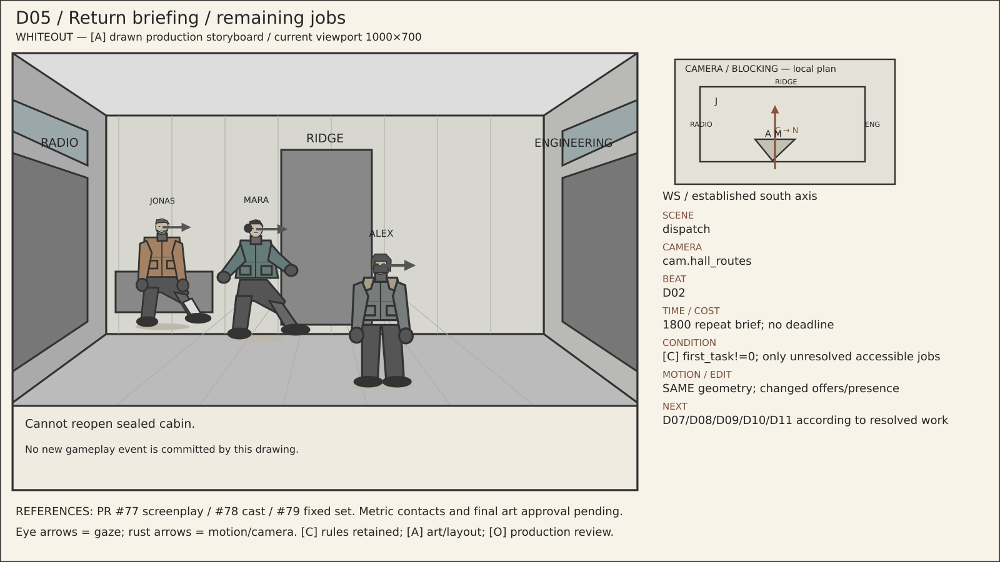

**Scene:** `dispatch` · **Location:** `loc.dispatch_hall` · **Camera:** `cam.hall_routes` · **Beat:** `D02`.

**Time:** 1800 repeat brief; no deadline.

**Condition / variant:** [C] first_task!=0; only unresolved accessible jobs.

**Audio/dialogue:** Cannot reopen sealed cabin.

**Motion/edit:** SAME geometry; changed offers/presence. **Next:** D07/D08/D09/D10/D11 according to resolved work.

[Editable SVG](../panels/d05.svg) · [Source metadata](../sources/shots.json)

## D07 — Radio resolved / engineering still open

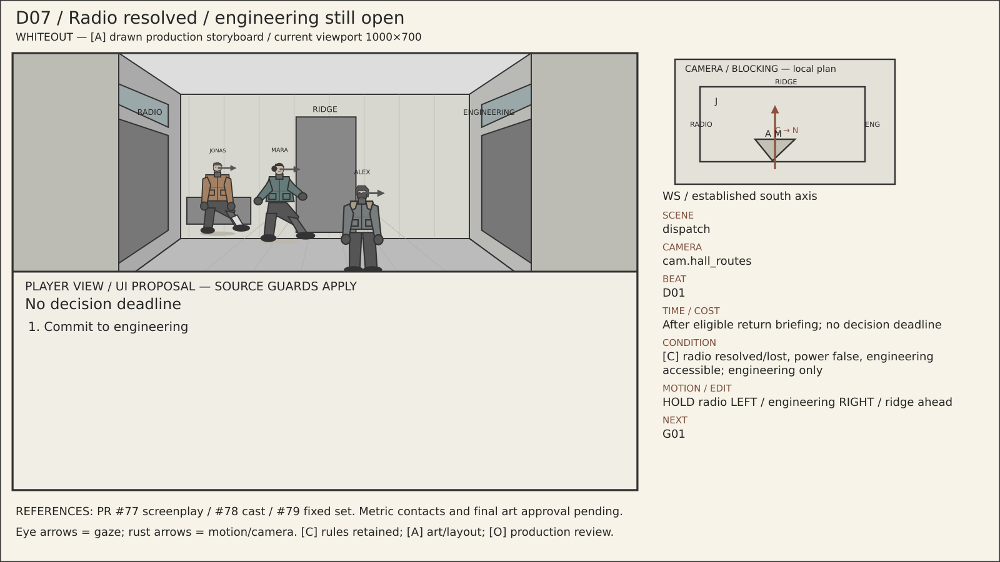

**Scene:** `dispatch` · **Location:** `loc.dispatch_hall` · **Camera:** `cam.hall_routes` · **Beat:** `D01`.

**Time:** After eligible return briefing; no decision deadline.

**Condition / variant:** [C] radio resolved/lost, power false, engineering accessible; engineering only.

**Audio/dialogue:** Power first warms; radio first buys bearing.

**Motion/edit:** HOLD radio LEFT / engineering RIGHT / ridge ahead. **Next:** G01.

[Editable SVG](../panels/d07.svg) · [Source metadata](../sources/shots.json)

## D08 — Both resolved / warm hands or ridge

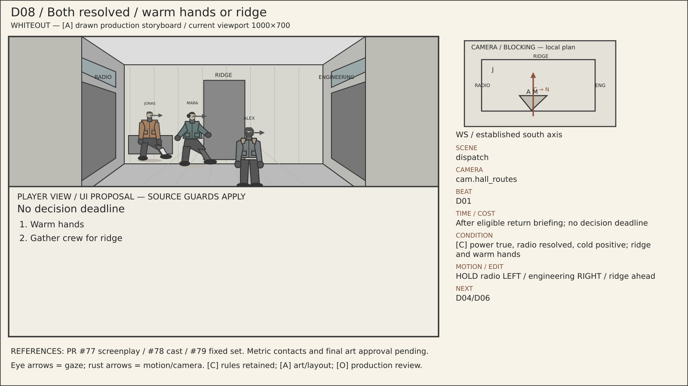

**Scene:** `dispatch` · **Location:** `loc.dispatch_hall` · **Camera:** `cam.hall_routes` · **Beat:** `D01`.

**Time:** After eligible return briefing; no decision deadline.

**Condition / variant:** [C] power true, radio resolved, cold positive; ridge and warm hands.

**Audio/dialogue:** Power first warms; radio first buys bearing.

**Motion/edit:** HOLD radio LEFT / engineering RIGHT / ridge ahead. **Next:** D04/D06.

[Editable SVG](../panels/d08.svg) · [Source metadata](../sources/shots.json)

## D09 — Both lost / ridge only

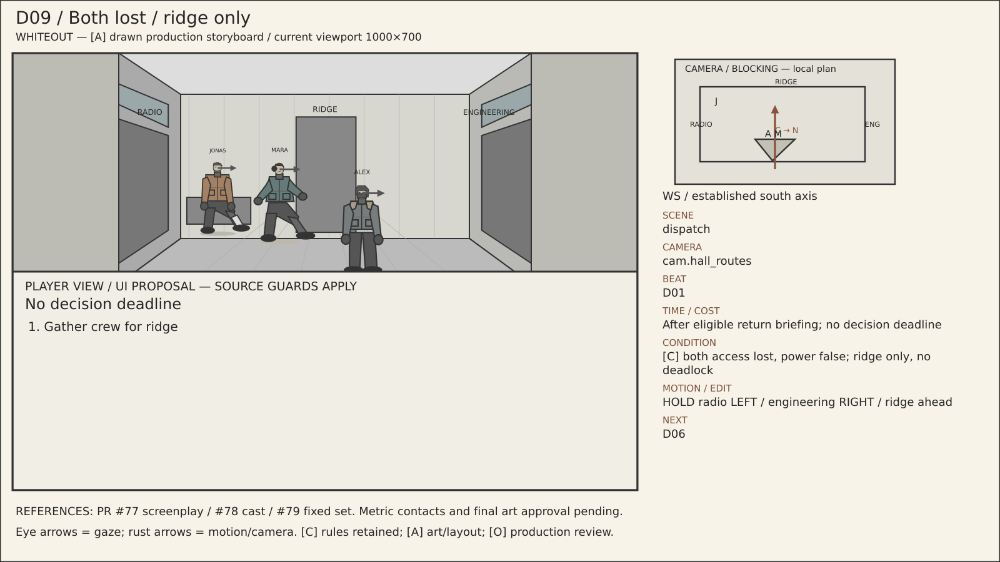

**Scene:** `dispatch` · **Location:** `loc.dispatch_hall` · **Camera:** `cam.hall_routes` · **Beat:** `D01`.

**Time:** After eligible return briefing; no decision deadline.

**Condition / variant:** [C] both access lost, power false; ridge only, no deadlock.

**Audio/dialogue:** Power first warms; radio first buys bearing.

**Motion/edit:** HOLD radio LEFT / engineering RIGHT / ridge ahead. **Next:** D06.

[Editable SVG](../panels/d09.svg) · [Source metadata](../sources/shots.json)

## D10 — Power first / radio or warm hands

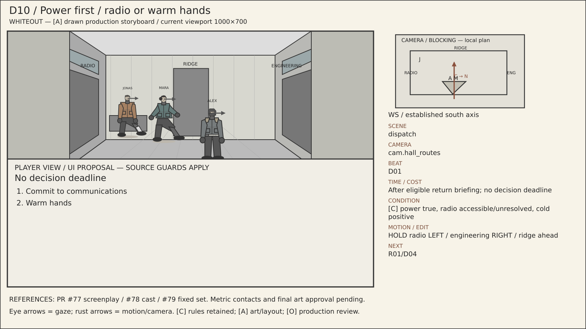

**Scene:** `dispatch` · **Location:** `loc.dispatch_hall` · **Camera:** `cam.hall_routes` · **Beat:** `D01`.

**Time:** After eligible return briefing; no decision deadline.

**Condition / variant:** [C] power true, radio accessible/unresolved, cold positive.

**Audio/dialogue:** Power first warms; radio first buys bearing.

**Motion/edit:** HOLD radio LEFT / engineering RIGHT / ridge ahead. **Next:** R01/D04.

[Editable SVG](../panels/d10.svg) · [Source metadata](../sources/shots.json)

## D11 — Engineering lost / radio still open

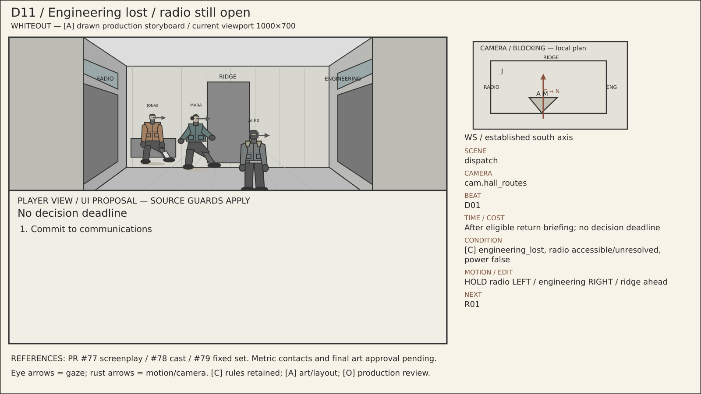

**Scene:** `dispatch` · **Location:** `loc.dispatch_hall` · **Camera:** `cam.hall_routes` · **Beat:** `D01`.

**Time:** After eligible return briefing; no decision deadline.

**Condition / variant:** [C] engineering_lost, radio accessible/unresolved, power false.

**Audio/dialogue:** Power first warms; radio first buys bearing.

**Motion/edit:** HOLD radio LEFT / engineering RIGHT / ridge ahead. **Next:** R01.

[Editable SVG](../panels/d11.svg) · [Source metadata](../sources/shots.json)

## D06 — Ridge commitment / threshold

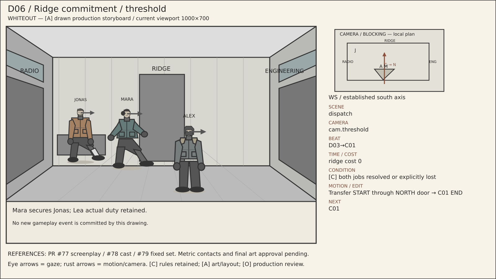

**Scene:** `dispatch` · **Location:** `loc.dispatch_hall` · **Camera:** `cam.threshold` · **Beat:** `D03→C01`.

**Time:** ridge cost 0.

**Condition / variant:** [C] both jobs resolved or explicitly lost.

**Audio/dialogue:** Mara secures Jonas; Lea actual duty retained.

**Motion/edit:** Transfer START through NORTH door → C01 END. **Next:** C01.

[Editable SVG](../panels/d06.svg) · [Source metadata](../sources/shots.json)
