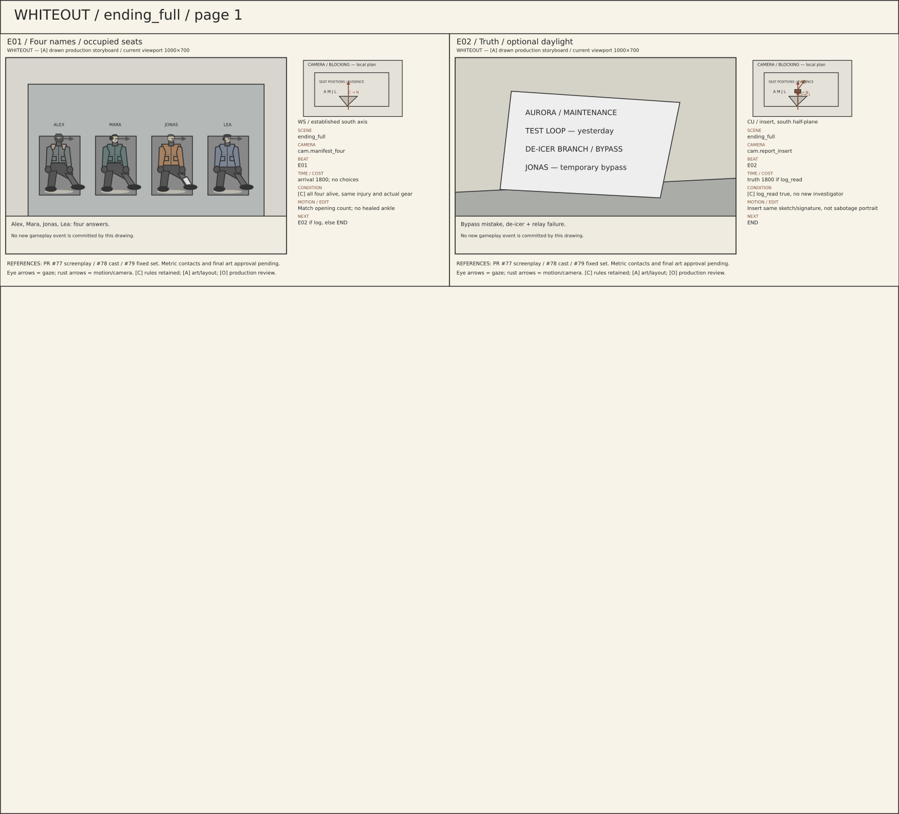
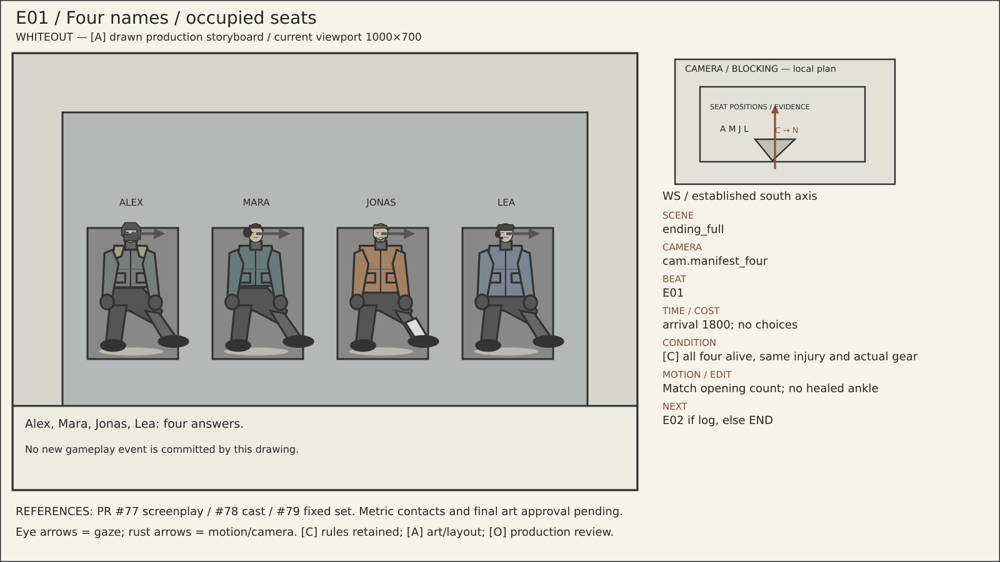
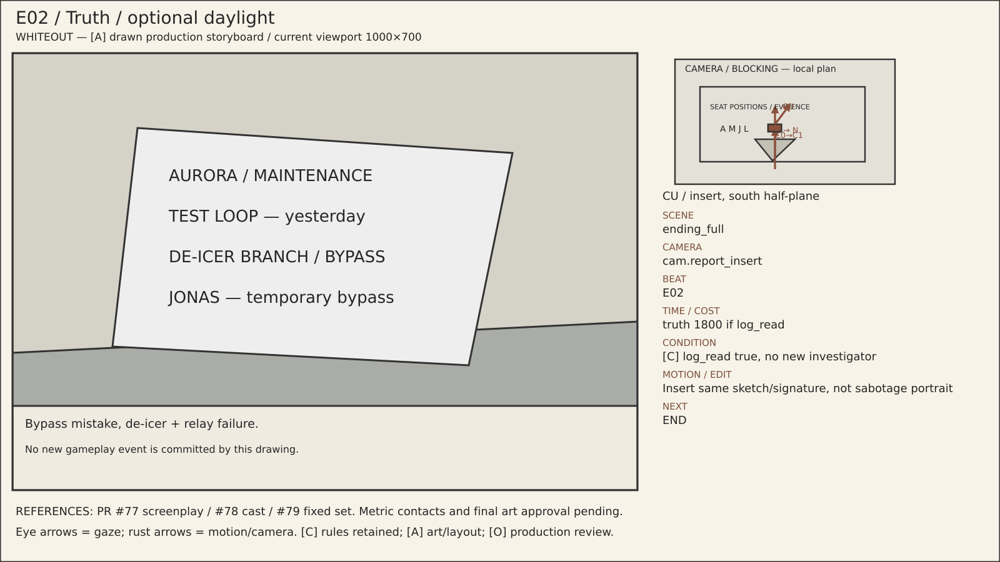

# ending_full — visual storyboard pages

[Reading guide](../README.md) · [Branches](../BRANCHES.md) · [Shot index](../SHOTS.md)

The sheets are contact overviews. Full-size panels and readable metadata are
listed below on this same page; no separate file needs opening for each shot.
All imagery is [A] blocking/art, with [C] rule associations and [O] final approval.

## Sheet 1

## E01 — Four names / occupied seats

**Scene:** `ending_full` · **Location:** `loc.rescue_cabin` · **Camera:** `cam.manifest_four` · **Beat:** `E01`.

**Time:** arrival 1800; no choices.

**Condition / variant:** [C] all four alive, same injury and actual gear.

**Audio/dialogue:** Alex, Mara, Jonas, Lea: four answers.

**Motion/edit:** Match opening count; no healed ankle. **Next:** E02 if log, else END.

[Editable SVG](../panels/e01.svg) · [Source metadata](../sources/shots.json)

## E02 — Truth / optional daylight

**Scene:** `ending_full` · **Location:** `loc.daylight_report` · **Camera:** `cam.report_insert` · **Beat:** `E02`.

**Time:** truth 1800 if log_read.

**Condition / variant:** [C] log_read true, no new investigator.

**Audio/dialogue:** Bypass mistake, de-icer + relay failure.

**Motion/edit:** Insert same sketch/signature, not sabotage portrait. **Next:** END.

[Editable SVG](../panels/e02.svg) · [Source metadata](../sources/shots.json)
