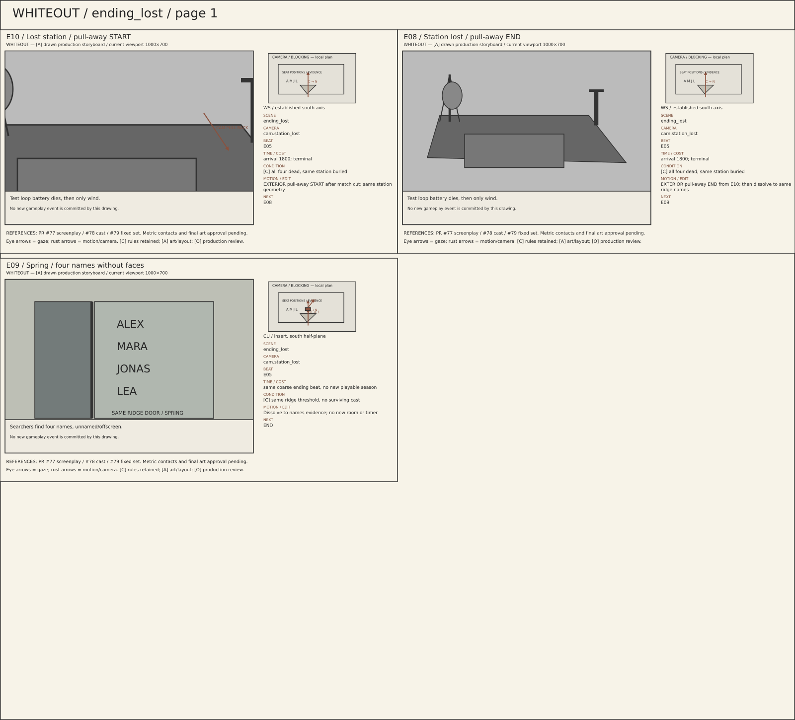
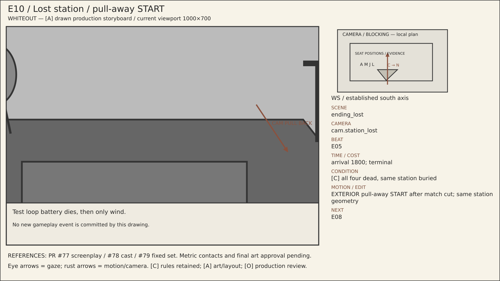
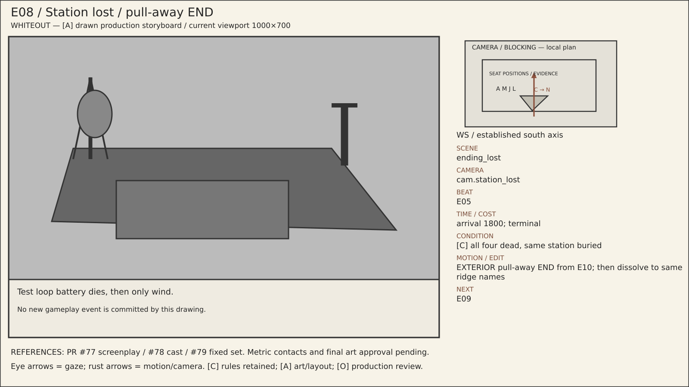
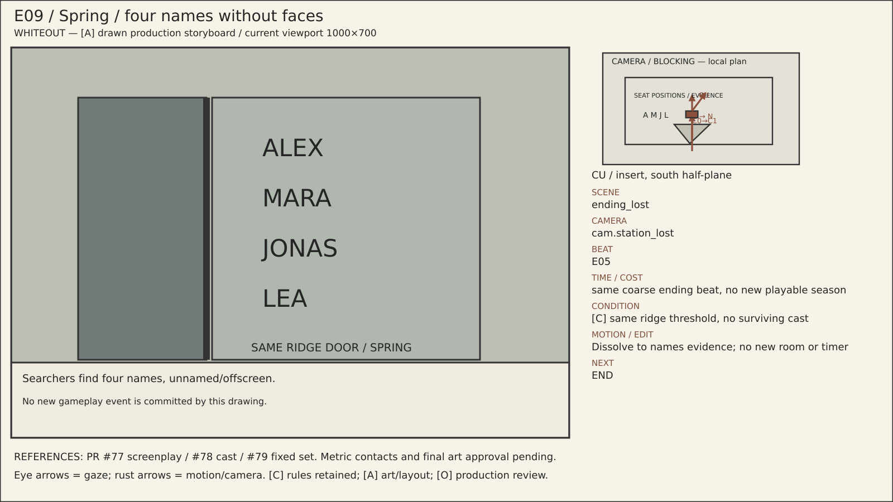

# ending_lost — visual storyboard pages

[Reading guide](../README.md) · [Branches](../BRANCHES.md) · [Shot index](../SHOTS.md)

The sheets are contact overviews. Full-size panels and readable metadata are
listed below on this same page; no separate file needs opening for each shot.
All imagery is [A] blocking/art, with [C] rule associations and [O] final approval.

## Sheet 1

## E10 — Lost station / pull-away START

**Scene:** `ending_lost` · **Location:** `loc.aurora_exterior` · **Camera:** `cam.station_lost` · **Beat:** `E05`.

**Time:** arrival 1800; terminal.

**Condition / variant:** [C] all four dead, same station buried.

**Audio/dialogue:** Test loop battery dies, then only wind.

**Motion/edit:** EXTERIOR pull-away START after match cut; same station geometry. **Next:** E08.

[Editable SVG](../panels/e10.svg) · [Source metadata](../sources/shots.json)

## E08 — Station lost / pull-away END

**Scene:** `ending_lost` · **Location:** `loc.aurora_exterior` · **Camera:** `cam.station_lost` · **Beat:** `E05`.

**Time:** arrival 1800; terminal.

**Condition / variant:** [C] all four dead, same station buried.

**Audio/dialogue:** Test loop battery dies, then only wind.

**Motion/edit:** EXTERIOR pull-away END from E10; then dissolve to same ridge names. **Next:** E09.

[Editable SVG](../panels/e08.svg) · [Source metadata](../sources/shots.json)

## E09 — Spring / four names without faces

**Scene:** `ending_lost` · **Location:** `loc.aurora_exterior` · **Camera:** `cam.station_lost` · **Beat:** `E05`.

**Time:** same coarse ending beat, no new playable season.

**Condition / variant:** [C] same ridge threshold, no surviving cast.

**Audio/dialogue:** Searchers find four names, unnamed/offscreen.

**Motion/edit:** Dissolve to names evidence; no new room or timer. **Next:** END.

[Editable SVG](../panels/e09.svg) · [Source metadata](../sources/shots.json)
