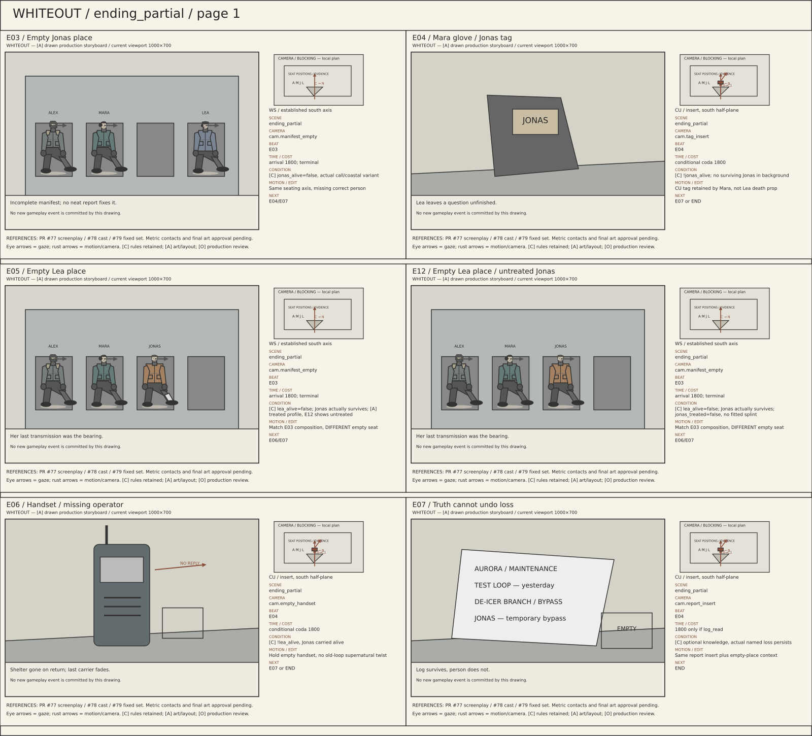
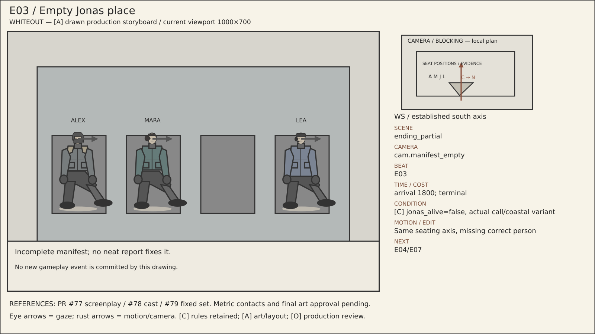
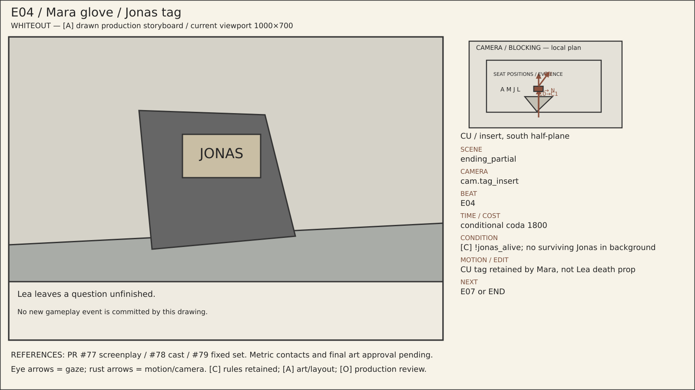
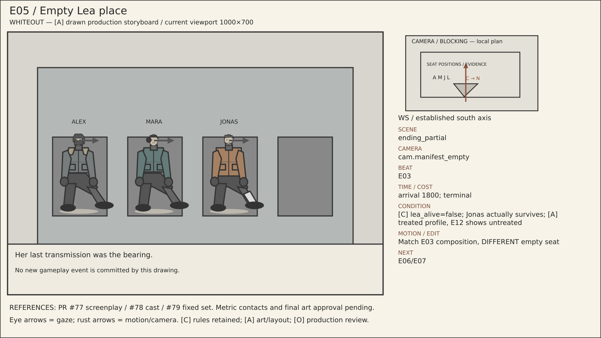
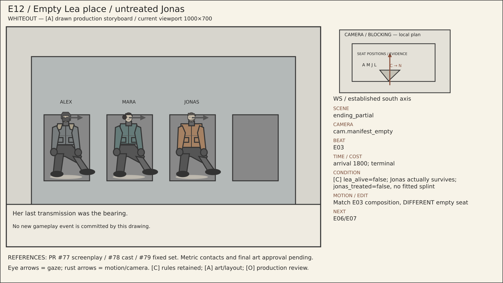
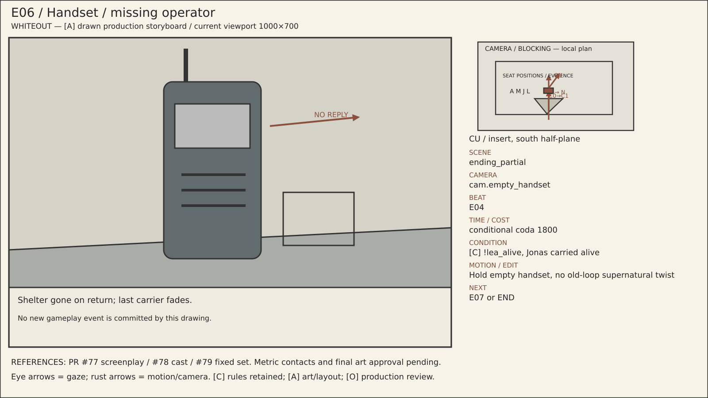
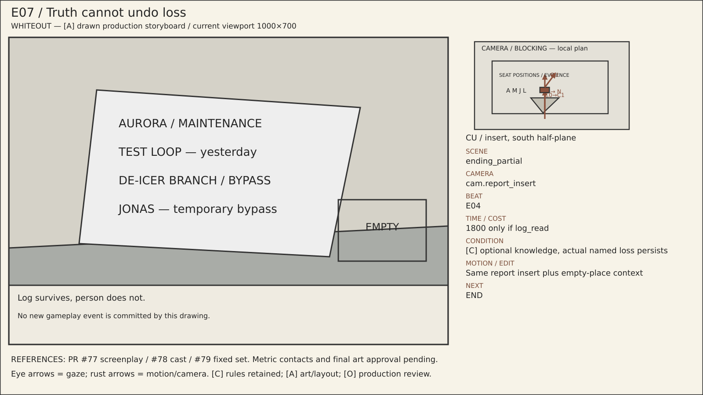

# ending_partial — visual storyboard pages

[Reading guide](../README.md) · [Branches](../BRANCHES.md) · [Shot index](../SHOTS.md)

The sheets are contact overviews. Full-size panels and readable metadata are
listed below on this same page; no separate file needs opening for each shot.
All imagery is [A] blocking/art, with [C] rule associations and [O] final approval.

## Sheet 1

## E03 — Empty Jonas place

**Scene:** `ending_partial` · **Location:** `loc.rescue_cabin` · **Camera:** `cam.manifest_empty` · **Beat:** `E03`.

**Time:** arrival 1800; terminal.

**Condition / variant:** [C] jonas_alive=false, actual call/coastal variant.

**Audio/dialogue:** Incomplete manifest; no neat report fixes it.

**Motion/edit:** Same seating axis, missing correct person. **Next:** E04/E07.

[Editable SVG](../panels/e03.svg) · [Source metadata](../sources/shots.json)

## E04 — Mara glove / Jonas tag

**Scene:** `ending_partial` · **Location:** `loc.rescue_cabin` · **Camera:** `cam.tag_insert` · **Beat:** `E04`.

**Time:** conditional coda 1800.

**Condition / variant:** [C] !jonas_alive; no surviving Jonas in background.

**Audio/dialogue:** Lea leaves a question unfinished.

**Motion/edit:** CU tag retained by Mara, not Lea death prop. **Next:** E07 or END.

[Editable SVG](../panels/e04.svg) · [Source metadata](../sources/shots.json)

## E05 — Empty Lea place

**Scene:** `ending_partial` · **Location:** `loc.rescue_cabin` · **Camera:** `cam.manifest_empty` · **Beat:** `E03`.

**Time:** arrival 1800; terminal.

**Condition / variant:** [C] lea_alive=false; Jonas actually survives; [A] treated profile, E12 shows untreated.

**Audio/dialogue:** Her last transmission was the bearing.

**Motion/edit:** Match E03 composition, DIFFERENT empty seat. **Next:** E06/E07.

[Editable SVG](../panels/e05.svg) · [Source metadata](../sources/shots.json)

## E12 — Empty Lea place / untreated Jonas

**Scene:** `ending_partial` · **Location:** `loc.rescue_cabin` · **Camera:** `cam.manifest_empty` · **Beat:** `E03`.

**Time:** arrival 1800; terminal.

**Condition / variant:** [C] lea_alive=false; Jonas actually survives; jonas_treated=false, no fitted splint.

**Audio/dialogue:** Her last transmission was the bearing.

**Motion/edit:** Match E03 composition, DIFFERENT empty seat. **Next:** E06/E07.

[Editable SVG](../panels/e12.svg) · [Source metadata](../sources/shots.json)

## E06 — Handset / missing operator

**Scene:** `ending_partial` · **Location:** `loc.rescue_cabin` · **Camera:** `cam.empty_handset` · **Beat:** `E04`.

**Time:** conditional coda 1800.

**Condition / variant:** [C] !lea_alive, Jonas carried alive.

**Audio/dialogue:** Shelter gone on return; last carrier fades.

**Motion/edit:** Hold empty handset, no old-loop supernatural twist. **Next:** E07 or END.

[Editable SVG](../panels/e06.svg) · [Source metadata](../sources/shots.json)

## E07 — Truth cannot undo loss

**Scene:** `ending_partial` · **Location:** `loc.daylight_report` · **Camera:** `cam.report_insert` · **Beat:** `E04`.

**Time:** 1800 only if log_read.

**Condition / variant:** [C] optional knowledge, actual named loss persists.

**Audio/dialogue:** Log survives, person does not.

**Motion/edit:** Same report insert plus empty-place context. **Next:** END.

[Editable SVG](../panels/e07.svg) · [Source metadata](../sources/shots.json)
