# generator — visual storyboard pages

[Reading guide](../README.md) · [Branches](../BRANCHES.md) · [Shot index](../SHOTS.md)

The sheets are contact overviews. Full-size panels and readable metadata are
listed below on this same page; no separate file needs opening for each shot.
All imagery is [A] blocking/art, with [C] rule associations and [O] final approval.

## Sheet 1

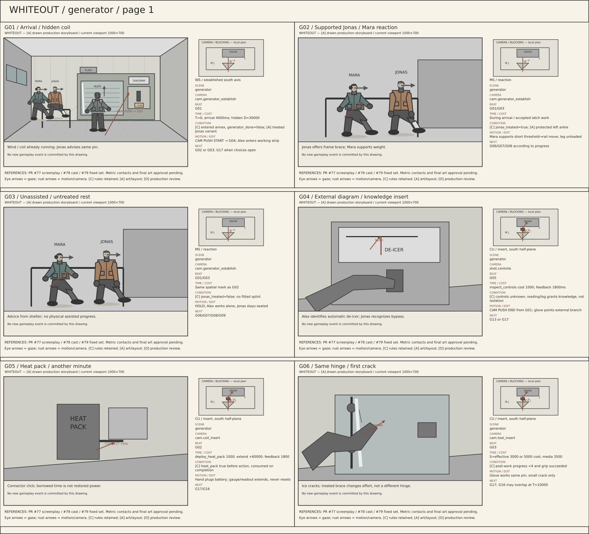

## Sheet 2

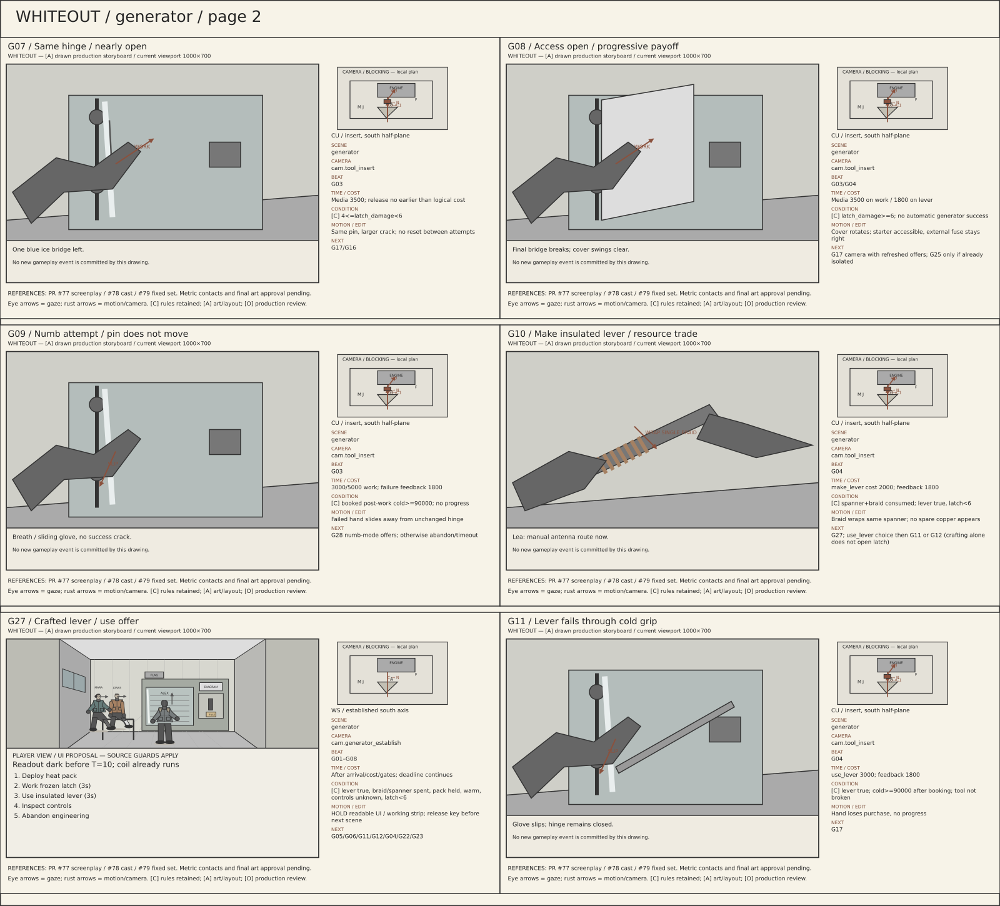

## Sheet 3

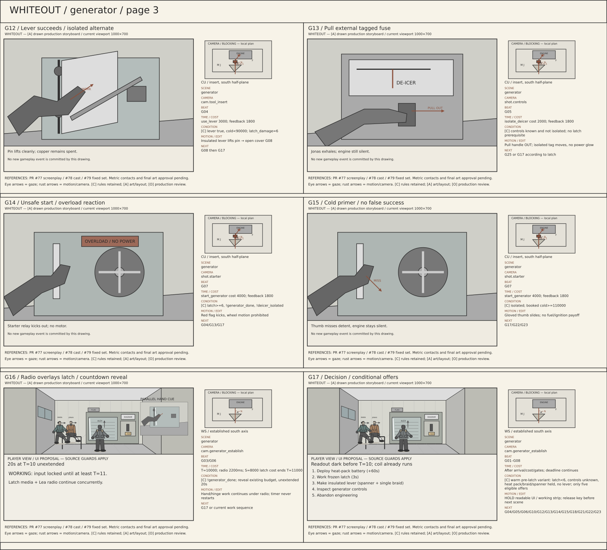

## Sheet 4

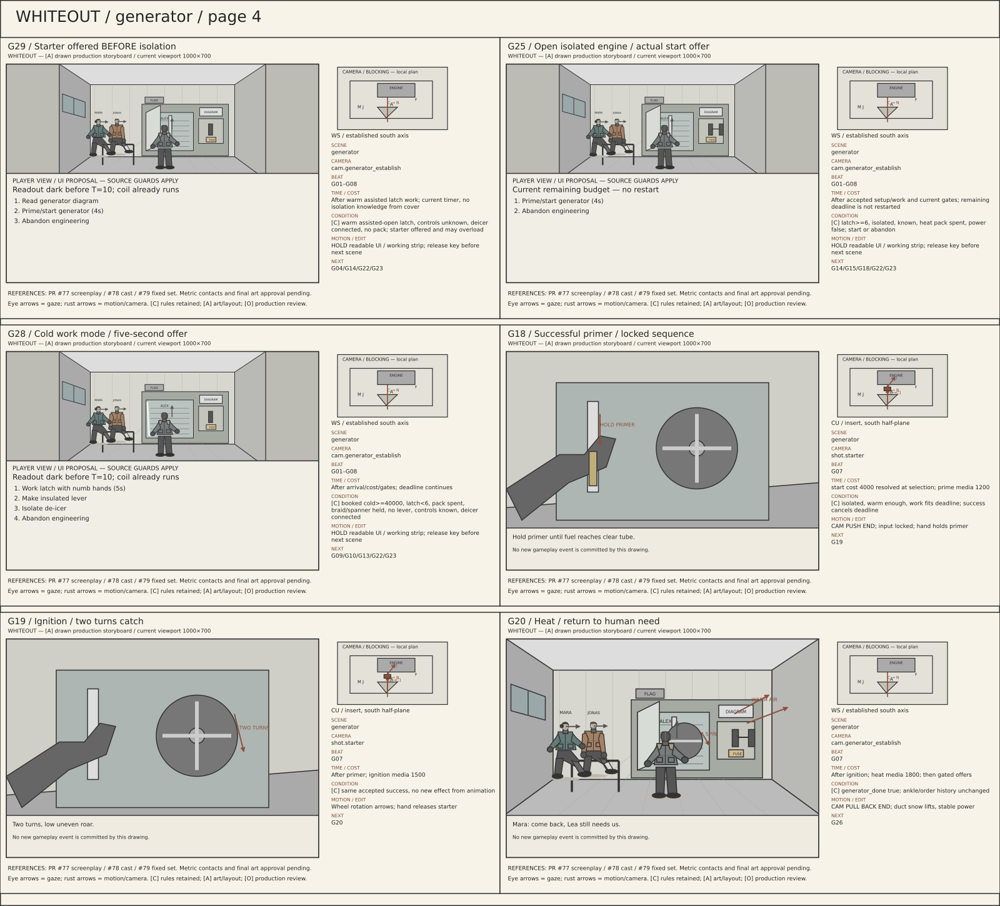

## Sheet 5

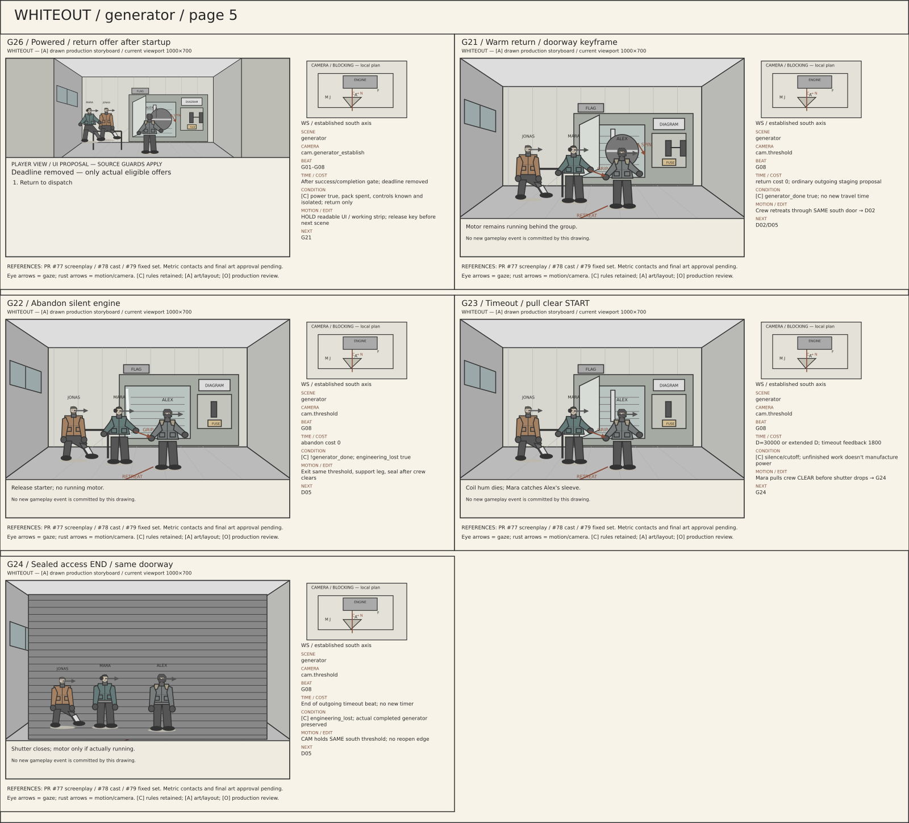

## G01 — Arrival / hidden coil

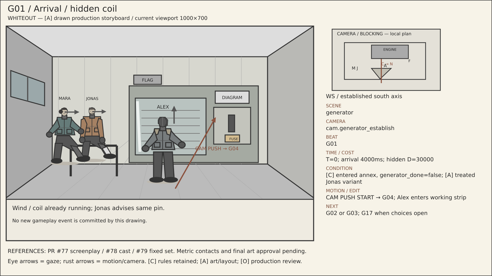

**Scene:** `generator` · **Location:** `loc.generator_annex` · **Camera:** `cam.generator_establish` · **Beat:** `G01`.

**Time:** T=0; arrival 4000ms; hidden D=30000.

**Condition / variant:** [C] entered annex, generator_done=false; [A] treated Jonas variant.

**Audio/dialogue:** Wind / coil already running; Jonas advises same pin.

**Motion/edit:** CAM PUSH START → G04; Alex enters working strip. **Next:** G02 or G03; G17 when choices open.

[Editable SVG](../panels/g01.svg) · [Source metadata](../sources/shots.json)

## G02 — Supported Jonas / Mara reaction

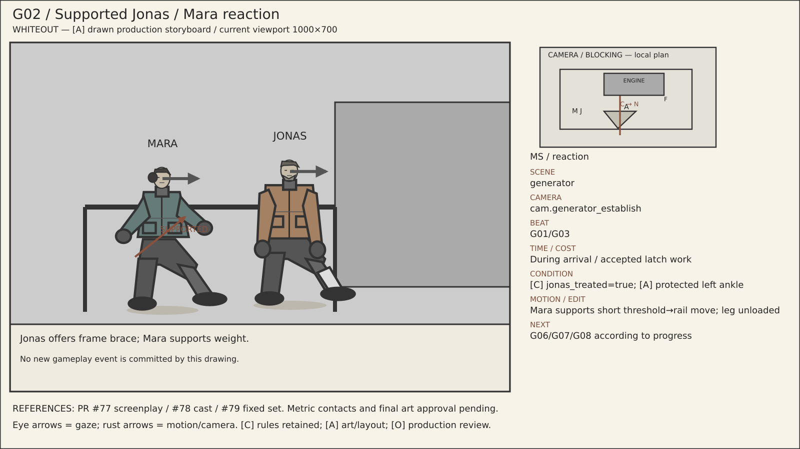

**Scene:** `generator` · **Location:** `loc.generator_annex` · **Camera:** `cam.generator_establish` · **Beat:** `G01/G03`.

**Time:** During arrival / accepted latch work.

**Condition / variant:** [C] jonas_treated=true; [A] protected left ankle.

**Audio/dialogue:** Jonas offers frame brace; Mara supports weight.

**Motion/edit:** Mara supports short threshold→rail move; leg unloaded. **Next:** G06/G07/G08 according to progress.

[Editable SVG](../panels/g02.svg) · [Source metadata](../sources/shots.json)

## G03 — Unassisted / untreated rest

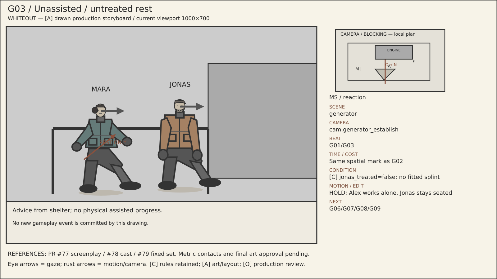

**Scene:** `generator` · **Location:** `loc.generator_annex` · **Camera:** `cam.generator_establish` · **Beat:** `G01/G03`.

**Time:** Same spatial mark as G02.

**Condition / variant:** [C] jonas_treated=false; no fitted splint.

**Audio/dialogue:** Advice from shelter; no physical assisted progress.

**Motion/edit:** HOLD; Alex works alone, Jonas stays seated. **Next:** G06/G07/G08/G09.

[Editable SVG](../panels/g03.svg) · [Source metadata](../sources/shots.json)

## G04 — External diagram / knowledge insert

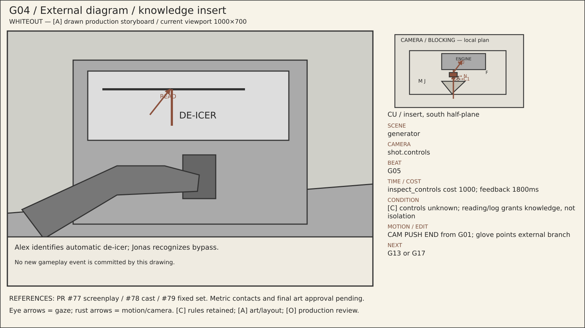

**Scene:** `generator` · **Location:** `loc.generator_annex` · **Camera:** `shot.controls` · **Beat:** `G05`.

**Time:** inspect_controls cost 1000; feedback 1800ms.

**Condition / variant:** [C] controls unknown; reading/log grants knowledge, not isolation.

**Audio/dialogue:** Alex identifies automatic de-icer; Jonas recognizes bypass.

**Motion/edit:** CAM PUSH END from G01; glove points external branch. **Next:** G13 or G17.

[Editable SVG](../panels/g04.svg) · [Source metadata](../sources/shots.json)

## G05 — Heat pack / another minute

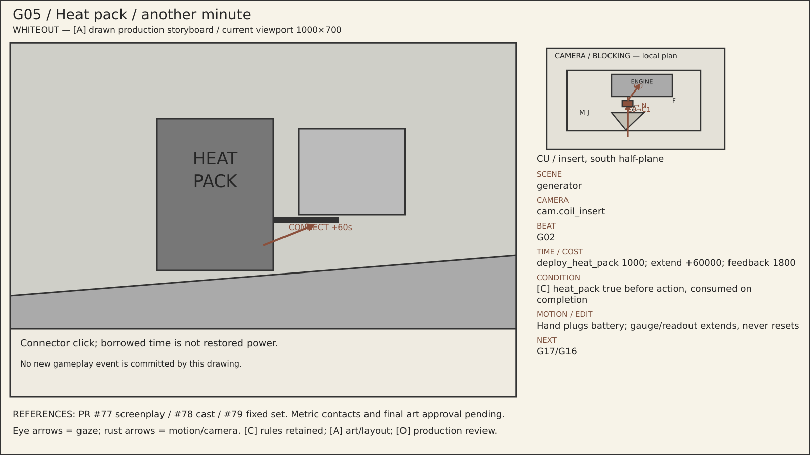

**Scene:** `generator` · **Location:** `loc.generator_annex` · **Camera:** `cam.coil_insert` · **Beat:** `G02`.

**Time:** deploy_heat_pack 1000; extend +60000; feedback 1800.

**Condition / variant:** [C] heat_pack true before action, consumed on completion.

**Audio/dialogue:** Connector click; borrowed time is not restored power.

**Motion/edit:** Hand plugs battery; gauge/readout extends, never resets. **Next:** G17/G16.

[Editable SVG](../panels/g05.svg) · [Source metadata](../sources/shots.json)

## G06 — Same hinge / first crack

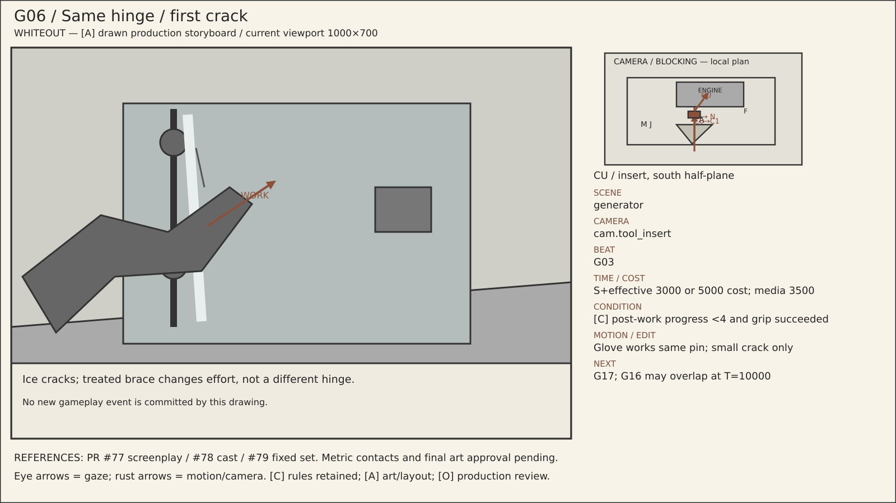

**Scene:** `generator` · **Location:** `loc.generator_annex` · **Camera:** `cam.tool_insert` · **Beat:** `G03`.

**Time:** S+effective 3000 or 5000 cost; media 3500.

**Condition / variant:** [C] post-work progress <4 and grip succeeded.

**Audio/dialogue:** Ice cracks; treated brace changes effort, not a different hinge.

**Motion/edit:** Glove works same pin; small crack only. **Next:** G17; G16 may overlap at T=10000.

[Editable SVG](../panels/g06.svg) · [Source metadata](../sources/shots.json)

## G07 — Same hinge / nearly open

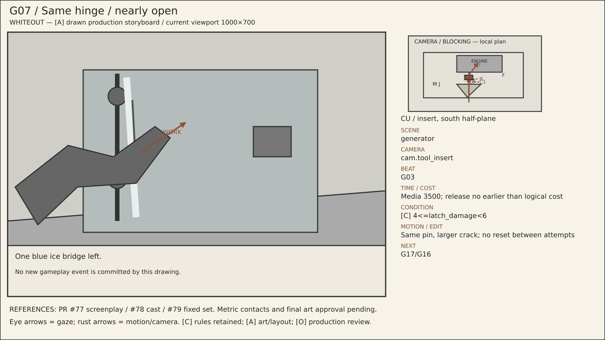

**Scene:** `generator` · **Location:** `loc.generator_annex` · **Camera:** `cam.tool_insert` · **Beat:** `G03`.

**Time:** Media 3500; release no earlier than logical cost.

**Condition / variant:** [C] 4<=latch_damage<6.

**Audio/dialogue:** One blue ice bridge left.

**Motion/edit:** Same pin, larger crack; no reset between attempts. **Next:** G17/G16.

[Editable SVG](../panels/g07.svg) · [Source metadata](../sources/shots.json)

## G08 — Access open / progressive payoff

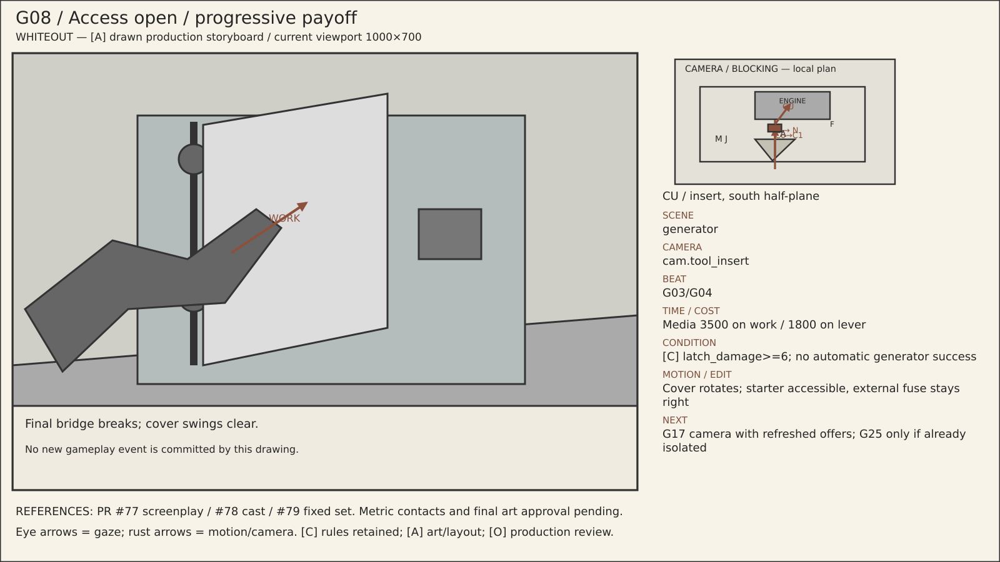

**Scene:** `generator` · **Location:** `loc.generator_annex` · **Camera:** `cam.tool_insert` · **Beat:** `G03/G04`.

**Time:** Media 3500 on work / 1800 on lever.

**Condition / variant:** [C] latch_damage>=6; no automatic generator success.

**Audio/dialogue:** Final bridge breaks; cover swings clear.

**Motion/edit:** Cover rotates; starter accessible, external fuse stays right. **Next:** G17 camera with refreshed offers; G25 only if already isolated.

[Editable SVG](../panels/g08.svg) · [Source metadata](../sources/shots.json)

## G09 — Numb attempt / pin does not move

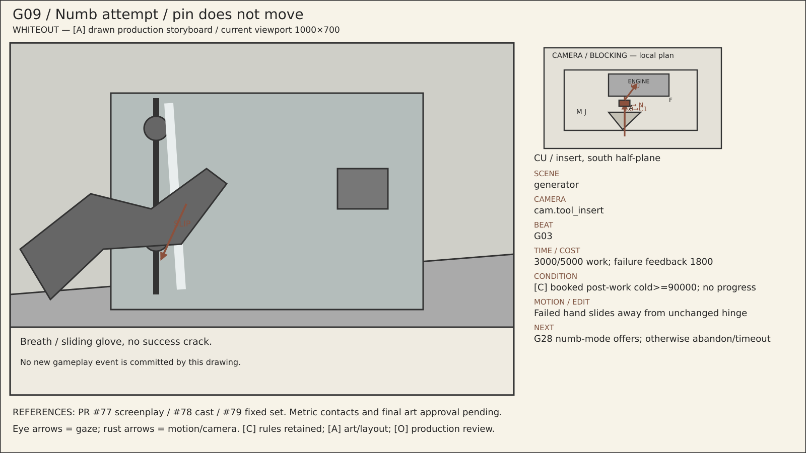

**Scene:** `generator` · **Location:** `loc.generator_annex` · **Camera:** `cam.tool_insert` · **Beat:** `G03`.

**Time:** 3000/5000 work; failure feedback 1800.

**Condition / variant:** [C] booked post-work cold>=90000; no progress.

**Audio/dialogue:** Breath / sliding glove, no success crack.

**Motion/edit:** Failed hand slides away from unchanged hinge. **Next:** G28 numb-mode offers; otherwise abandon/timeout.

[Editable SVG](../panels/g09.svg) · [Source metadata](../sources/shots.json)

## G10 — Make insulated lever / resource trade

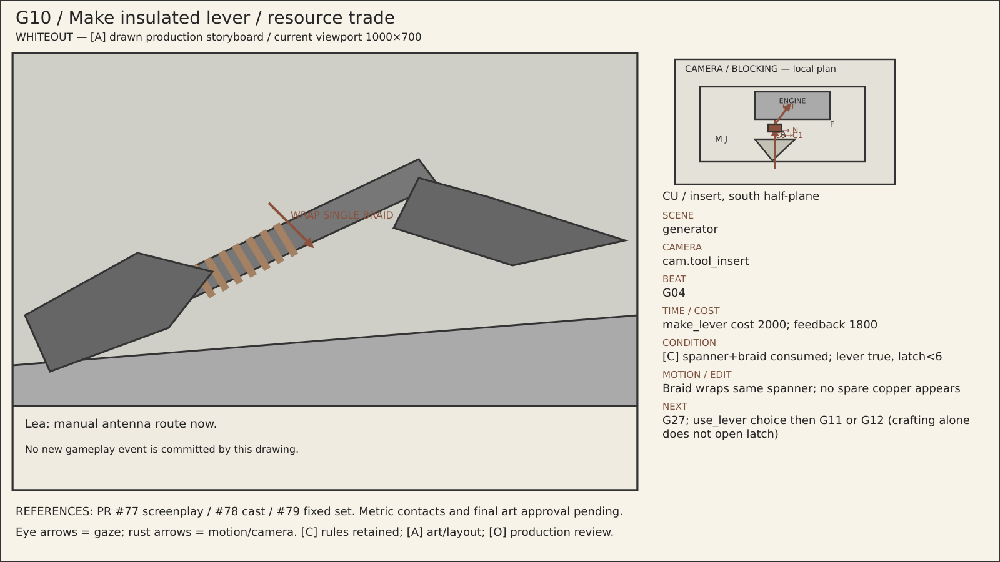

**Scene:** `generator` · **Location:** `loc.generator_annex` · **Camera:** `cam.tool_insert` · **Beat:** `G04`.

**Time:** make_lever cost 2000; feedback 1800.

**Condition / variant:** [C] spanner+braid consumed; lever true, latch<6.

**Audio/dialogue:** Lea: manual antenna route now.

**Motion/edit:** Braid wraps same spanner; no spare copper appears. **Next:** G27; use_lever choice then G11 or G12 (crafting alone does not open latch).

[Editable SVG](../panels/g10.svg) · [Source metadata](../sources/shots.json)

## G27 — Crafted lever / use offer

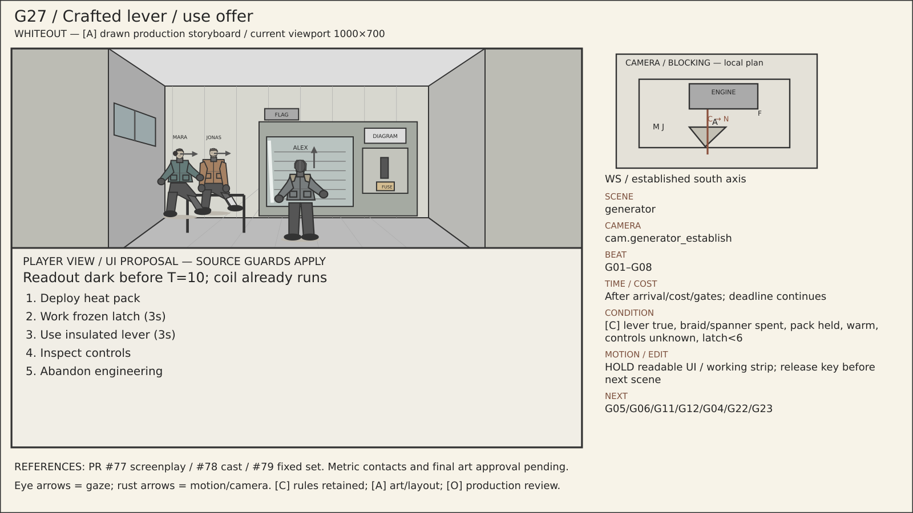

**Scene:** `generator` · **Location:** `loc.generator_annex` · **Camera:** `cam.generator_establish` · **Beat:** `G01–G08`.

**Time:** After arrival/cost/gates; deadline continues.

**Condition / variant:** [C] lever true, braid/spanner spent, pack held, warm, controls unknown, latch<6.

**Audio/dialogue:** Coil hum; player chooses, no authored start-timer button.

**Motion/edit:** HOLD readable UI / working strip; release key before next scene. **Next:** G05/G06/G11/G12/G04/G22/G23.

[Editable SVG](../panels/g27.svg) · [Source metadata](../sources/shots.json)

## G11 — Lever fails through cold grip

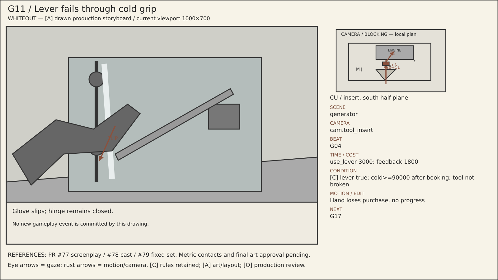

**Scene:** `generator` · **Location:** `loc.generator_annex` · **Camera:** `cam.tool_insert` · **Beat:** `G04`.

**Time:** use_lever 3000; feedback 1800.

**Condition / variant:** [C] lever true; cold>=90000 after booking; tool not broken.

**Audio/dialogue:** Glove slips; hinge remains closed.

**Motion/edit:** Hand loses purchase, no progress. **Next:** G17.

[Editable SVG](../panels/g11.svg) · [Source metadata](../sources/shots.json)

## G12 — Lever succeeds / isolated alternate

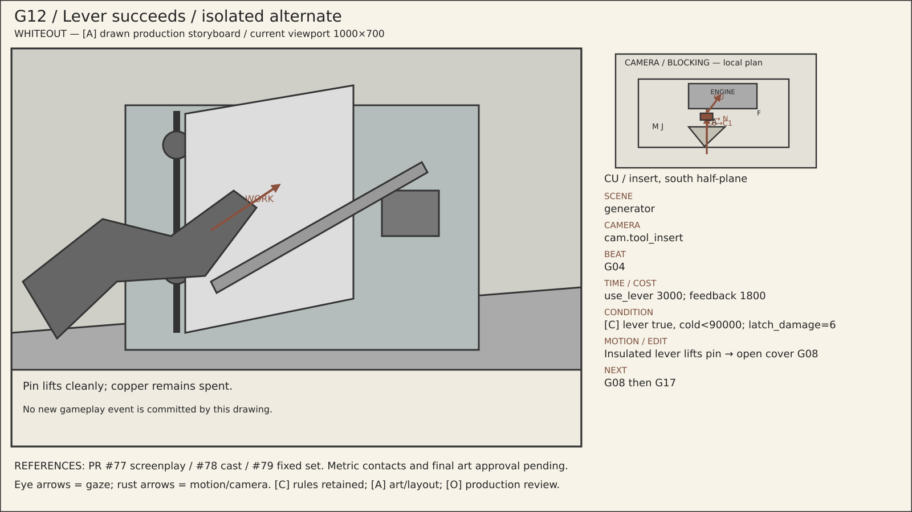

**Scene:** `generator` · **Location:** `loc.generator_annex` · **Camera:** `cam.tool_insert` · **Beat:** `G04`.

**Time:** use_lever 3000; feedback 1800.

**Condition / variant:** [C] lever true, cold<90000; latch_damage=6.

**Audio/dialogue:** Pin lifts cleanly; copper remains spent.

**Motion/edit:** Insulated lever lifts pin → open cover G08. **Next:** G08 then G17.

[Editable SVG](../panels/g12.svg) · [Source metadata](../sources/shots.json)

## G13 — Pull external tagged fuse

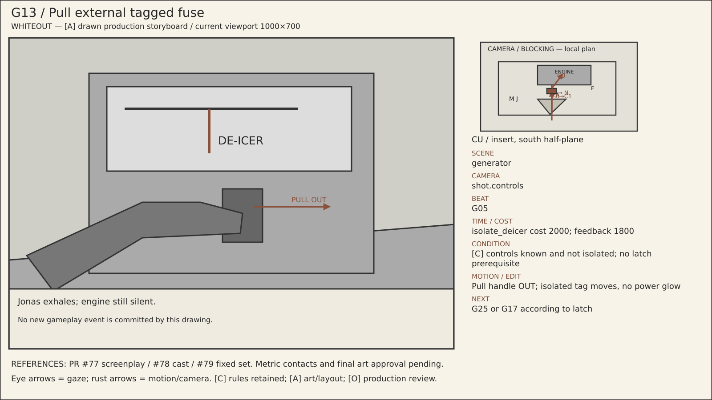

**Scene:** `generator` · **Location:** `loc.generator_annex` · **Camera:** `shot.controls` · **Beat:** `G05`.

**Time:** isolate_deicer cost 2000; feedback 1800.

**Condition / variant:** [C] controls known and not isolated; no latch prerequisite.

**Audio/dialogue:** Jonas exhales; engine still silent.

**Motion/edit:** Pull handle OUT; isolated tag moves, no power glow. **Next:** G25 or G17 according to latch.

[Editable SVG](../panels/g13.svg) · [Source metadata](../sources/shots.json)

## G14 — Unsafe start / overload reaction

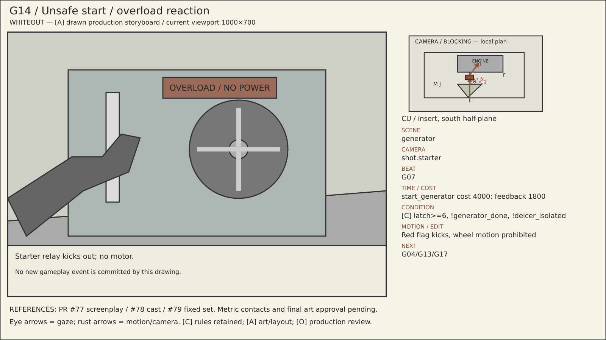

**Scene:** `generator` · **Location:** `loc.generator_annex` · **Camera:** `shot.starter` · **Beat:** `G07`.

**Time:** start_generator cost 4000; feedback 1800.

**Condition / variant:** [C] latch>=6, !generator_done, !deicer_isolated.

**Audio/dialogue:** Starter relay kicks out; no motor.

**Motion/edit:** Red flag kicks, wheel motion prohibited. **Next:** G04/G13/G17.

[Editable SVG](../panels/g14.svg) · [Source metadata](../sources/shots.json)

## G15 — Cold primer / no false success

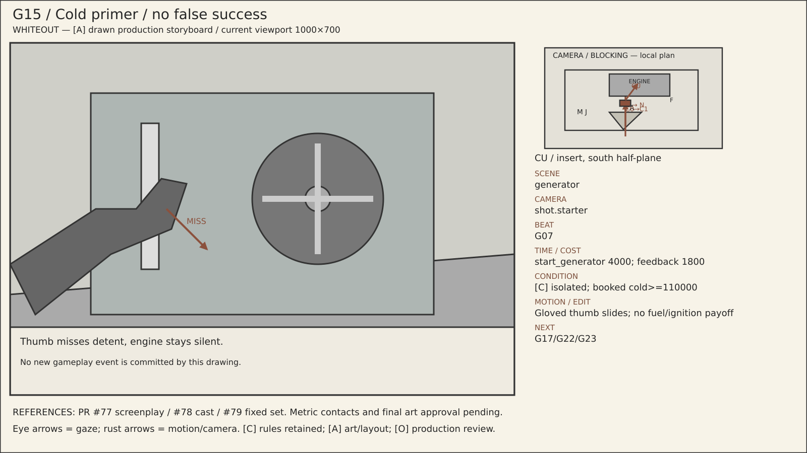

**Scene:** `generator` · **Location:** `loc.generator_annex` · **Camera:** `shot.starter` · **Beat:** `G07`.

**Time:** start_generator 4000; feedback 1800.

**Condition / variant:** [C] isolated; booked cold>=110000.

**Audio/dialogue:** Thumb misses detent, engine stays silent.

**Motion/edit:** Gloved thumb slides; no fuel/ignition payoff. **Next:** G17/G22/G23.

[Editable SVG](../panels/g15.svg) · [Source metadata](../sources/shots.json)

## G16 — Radio overlays latch / countdown reveal

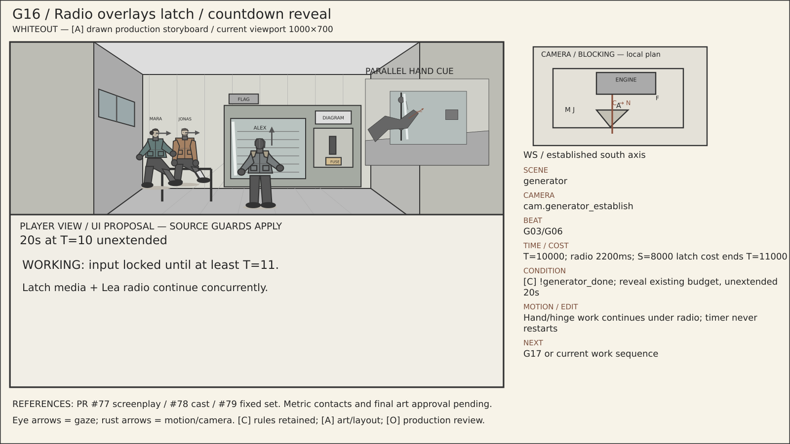

**Scene:** `generator` · **Location:** `loc.generator_annex` · **Camera:** `cam.generator_establish` · **Beat:** `G03/G06`.

**Time:** T=10000; radio 2200ms; S=8000 latch cost ends T=11000.

**Condition / variant:** [C] !generator_done; reveal existing budget, unextended 20s.

**Audio/dialogue:** Lea remotely: ten seconds elapsed; no duplicate Lea.

**Motion/edit:** Hand/hinge work continues under radio; timer never restarts. **Next:** G17 or current work sequence.

[Editable SVG](../panels/g16.svg) · [Source metadata](../sources/shots.json)

## G17 — Decision / conditional offers

**Scene:** `generator` · **Location:** `loc.generator_annex` · **Camera:** `cam.generator_establish` · **Beat:** `G01–G08`.

**Time:** After arrival/cost/gates; deadline continues.

**Condition / variant:** [C] warm pre-latch variant: latch<6, controls unknown, heat pack/braid/spanner held, no lever; only five eligible offers.

**Audio/dialogue:** Coil hum; player chooses, no authored start-timer button.

**Motion/edit:** HOLD readable UI / working strip; release key before next scene. **Next:** G04/G05/G06/G10/G12/G13/G14/G15/G18/G21/G22/G23.

[Editable SVG](../panels/g17.svg) · [Source metadata](../sources/shots.json)

## G29 — Starter offered BEFORE isolation

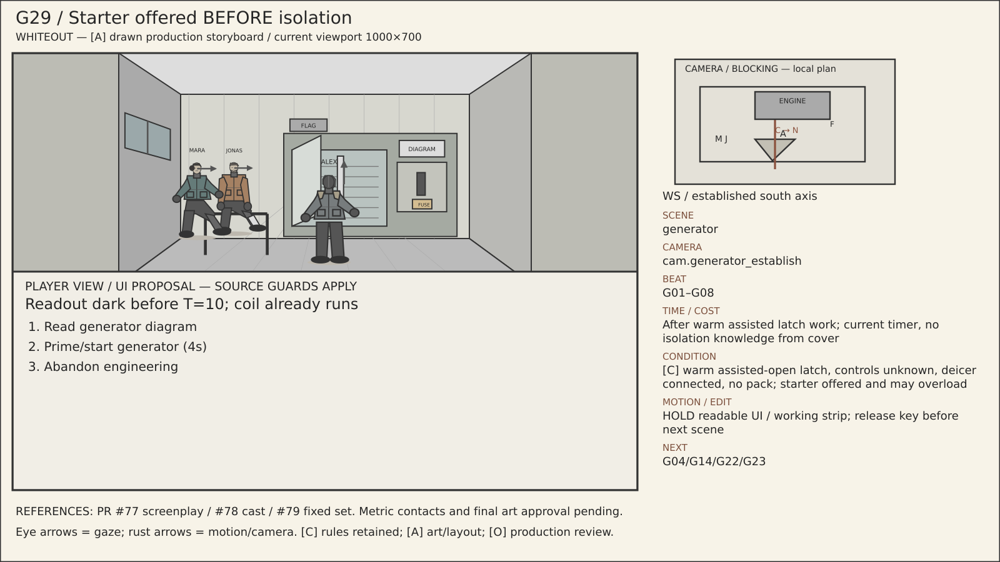

**Scene:** `generator` · **Location:** `loc.generator_annex` · **Camera:** `cam.generator_establish` · **Beat:** `G01–G08`.

**Time:** After warm assisted latch work; current timer, no isolation knowledge from cover.

**Condition / variant:** [C] warm assisted-open latch, controls unknown, deicer connected, no pack; starter offered and may overload.

**Audio/dialogue:** Coil hum; player chooses, no authored start-timer button.

**Motion/edit:** HOLD readable UI / working strip; release key before next scene. **Next:** G04/G14/G22/G23.

[Editable SVG](../panels/g29.svg) · [Source metadata](../sources/shots.json)

## G25 — Open isolated engine / actual start offer

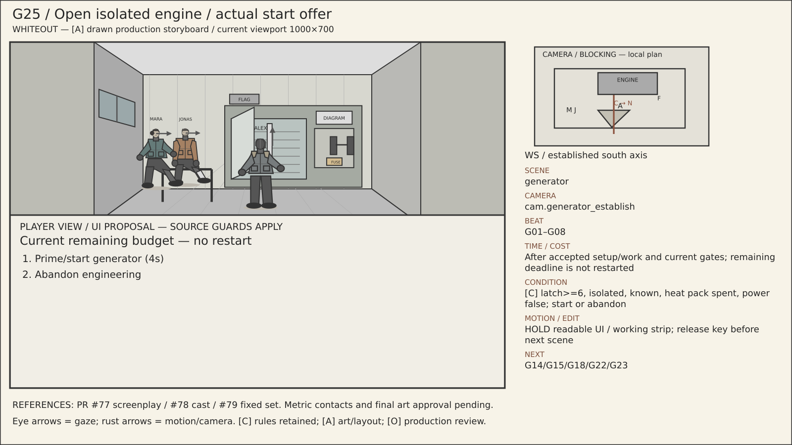

**Scene:** `generator` · **Location:** `loc.generator_annex` · **Camera:** `cam.generator_establish` · **Beat:** `G01–G08`.

**Time:** After accepted setup/work and current gates; remaining deadline is not restarted.

**Condition / variant:** [C] latch>=6, isolated, known, heat pack spent, power false; start or abandon.

**Audio/dialogue:** Coil hum; player chooses, no authored start-timer button.

**Motion/edit:** HOLD readable UI / working strip; release key before next scene. **Next:** G14/G15/G18/G22/G23.

[Editable SVG](../panels/g25.svg) · [Source metadata](../sources/shots.json)

## G28 — Cold work mode / five-second offer

**Scene:** `generator` · **Location:** `loc.generator_annex` · **Camera:** `cam.generator_establish` · **Beat:** `G01–G08`.

**Time:** After arrival/cost/gates; deadline continues.

**Condition / variant:** [C] booked cold>=40000, latch<6, pack spent, braid/spanner held, no lever, controls known, deicer connected.

**Audio/dialogue:** Coil hum; player chooses, no authored start-timer button.

**Motion/edit:** HOLD readable UI / working strip; release key before next scene. **Next:** G09/G10/G13/G22/G23.

[Editable SVG](../panels/g28.svg) · [Source metadata](../sources/shots.json)

## G18 — Successful primer / locked sequence

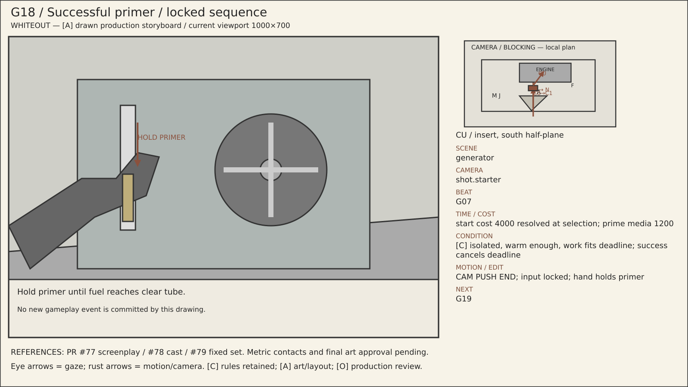

**Scene:** `generator` · **Location:** `loc.generator_annex` · **Camera:** `shot.starter` · **Beat:** `G07`.

**Time:** start cost 4000 resolved at selection; prime media 1200.

**Condition / variant:** [C] isolated, warm enough, work fits deadline; success cancels deadline.

**Audio/dialogue:** Hold primer until fuel reaches clear tube.

**Motion/edit:** CAM PUSH END; input locked; hand holds primer. **Next:** G19.

[Editable SVG](../panels/g18.svg) · [Source metadata](../sources/shots.json)

## G19 — Ignition / two turns catch

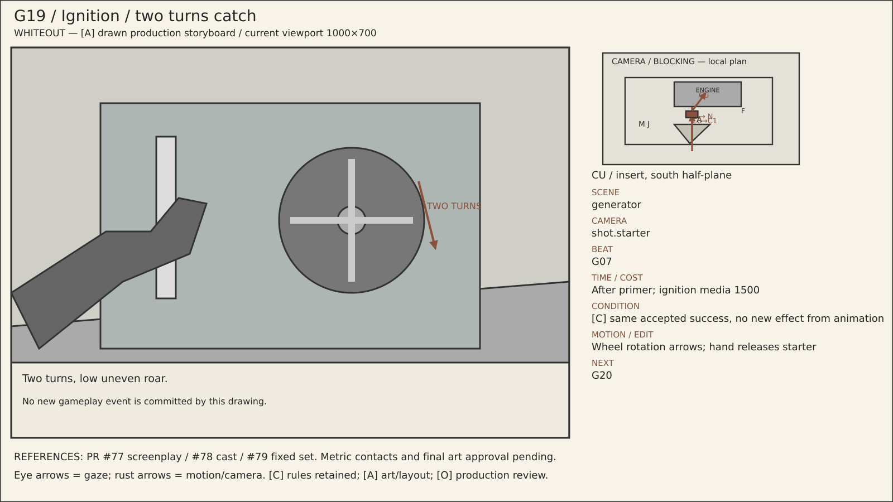

**Scene:** `generator` · **Location:** `loc.generator_annex` · **Camera:** `shot.starter` · **Beat:** `G07`.

**Time:** After primer; ignition media 1500.

**Condition / variant:** [C] same accepted success, no new effect from animation.

**Audio/dialogue:** Two turns, low uneven roar.

**Motion/edit:** Wheel rotation arrows; hand releases starter. **Next:** G20.

[Editable SVG](../panels/g19.svg) · [Source metadata](../sources/shots.json)

## G20 — Heat / return to human need

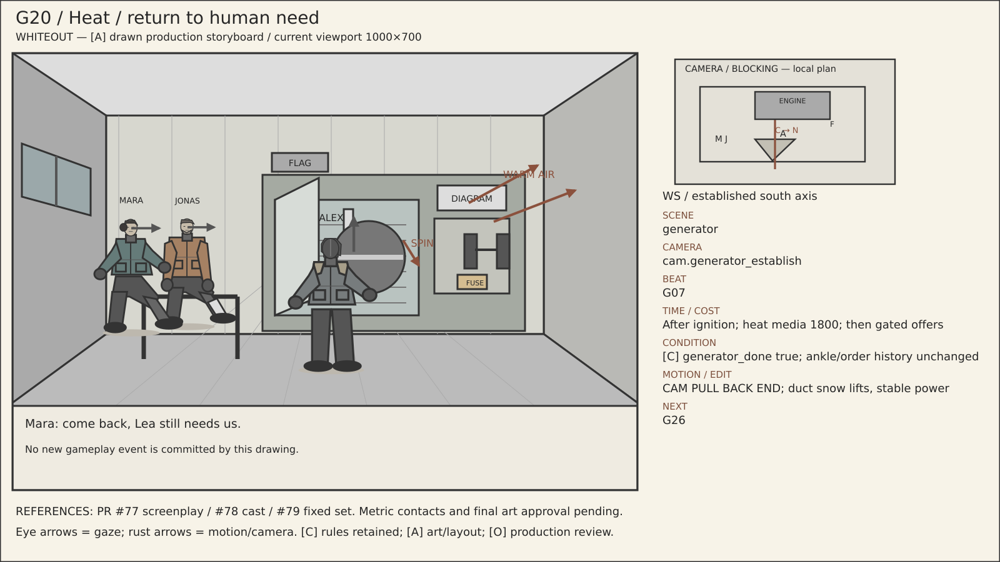

**Scene:** `generator` · **Location:** `loc.generator_annex` · **Camera:** `cam.generator_establish` · **Beat:** `G07`.

**Time:** After ignition; heat media 1800; then gated offers.

**Condition / variant:** [C] generator_done true; ankle/order history unchanged.

**Audio/dialogue:** Mara: come back, Lea still needs us.

**Motion/edit:** CAM PULL BACK END; duct snow lifts, stable power. **Next:** G26.

[Editable SVG](../panels/g20.svg) · [Source metadata](../sources/shots.json)

## G26 — Powered / return offer after startup

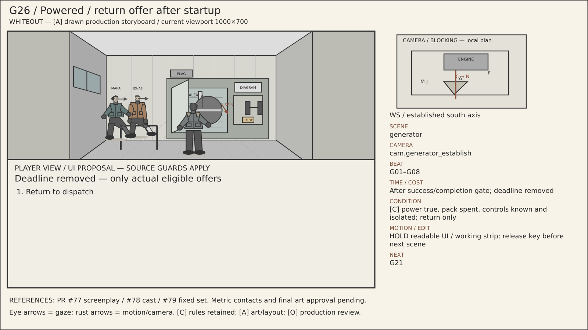

**Scene:** `generator` · **Location:** `loc.generator_annex` · **Camera:** `cam.generator_establish` · **Beat:** `G01–G08`.

**Time:** After success/completion gate; deadline removed.

**Condition / variant:** [C] power true, pack spent, controls known and isolated; return only.

**Audio/dialogue:** Coil hum; player chooses, no authored start-timer button.

**Motion/edit:** HOLD readable UI / working strip; release key before next scene. **Next:** G21.

[Editable SVG](../panels/g26.svg) · [Source metadata](../sources/shots.json)

## G21 — Warm return / doorway keyframe

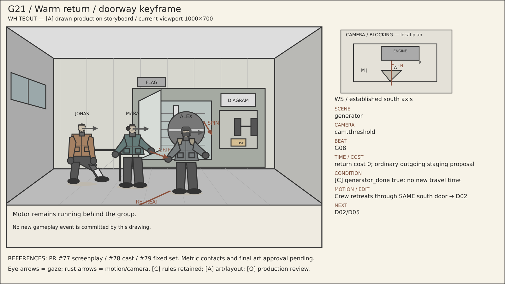

**Scene:** `generator` · **Location:** `loc.generator_annex` · **Camera:** `cam.threshold` · **Beat:** `G08`.

**Time:** return cost 0; ordinary outgoing staging proposal.

**Condition / variant:** [C] generator_done true; no new travel time.

**Audio/dialogue:** Motor remains running behind the group.

**Motion/edit:** Crew retreats through SAME south door → D02. **Next:** D02/D05.

[Editable SVG](../panels/g21.svg) · [Source metadata](../sources/shots.json)

## G22 — Abandon silent engine

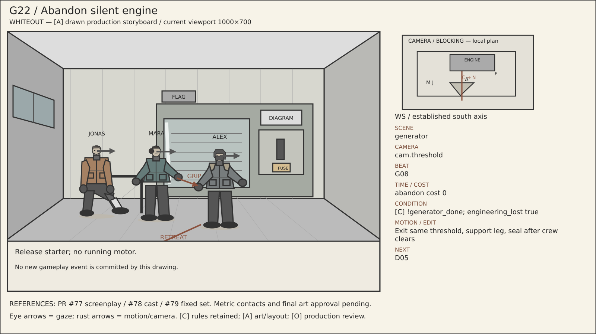

**Scene:** `generator` · **Location:** `loc.generator_annex` · **Camera:** `cam.threshold` · **Beat:** `G08`.

**Time:** abandon cost 0.

**Condition / variant:** [C] !generator_done; engineering_lost true.

**Audio/dialogue:** Release starter; no running motor.

**Motion/edit:** Exit same threshold, support leg, seal after crew clears. **Next:** D05.

[Editable SVG](../panels/g22.svg) · [Source metadata](../sources/shots.json)

## G23 — Timeout / pull clear START

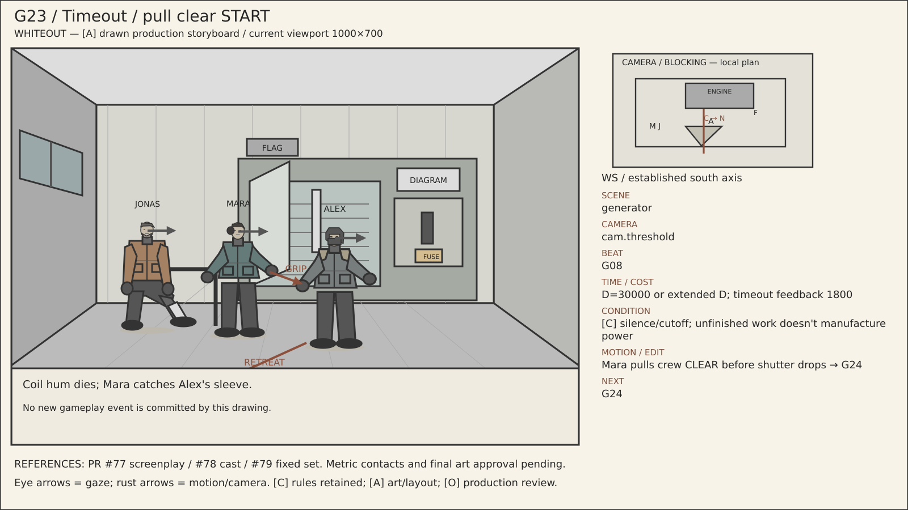

**Scene:** `generator` · **Location:** `loc.generator_annex` · **Camera:** `cam.threshold` · **Beat:** `G08`.

**Time:** D=30000 or extended D; timeout feedback 1800.

**Condition / variant:** [C] silence/cutoff; unfinished work doesn't manufacture power.

**Audio/dialogue:** Coil hum dies; Mara catches Alex's sleeve.

**Motion/edit:** Mara pulls crew CLEAR before shutter drops → G24. **Next:** G24.

[Editable SVG](../panels/g23.svg) · [Source metadata](../sources/shots.json)

## G24 — Sealed access END / same doorway

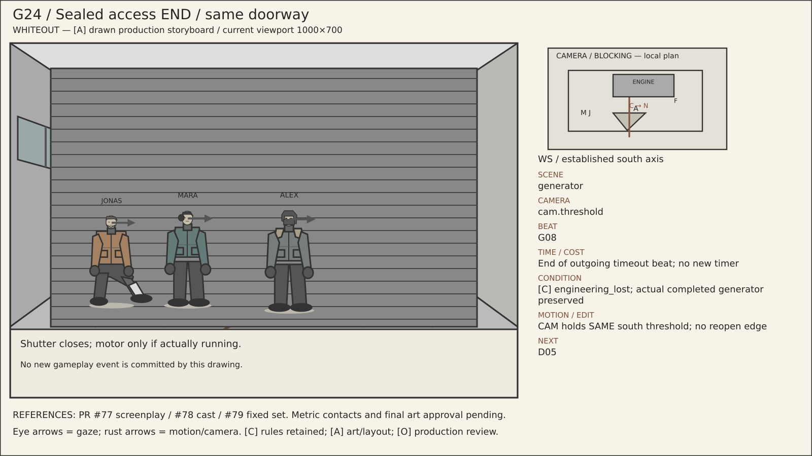

**Scene:** `generator` · **Location:** `loc.generator_annex` · **Camera:** `cam.threshold` · **Beat:** `G08`.

**Time:** End of outgoing timeout beat; no new timer.

**Condition / variant:** [C] engineering_lost; actual completed generator preserved.

**Audio/dialogue:** Shutter closes; motor only if actually running.

**Motion/edit:** CAM holds SAME south threshold; no reopen edge. **Next:** D05.

[Editable SVG](../panels/g24.svg) · [Source metadata](../sources/shots.json)

## Generated arrival artist study (alternate development, not extra coverage)

Original tool-generated pencil study using cast/environment references. The
normalized blocking panel above remains the indexed board; this alternate
development drawing is not counted as a second completed shot.

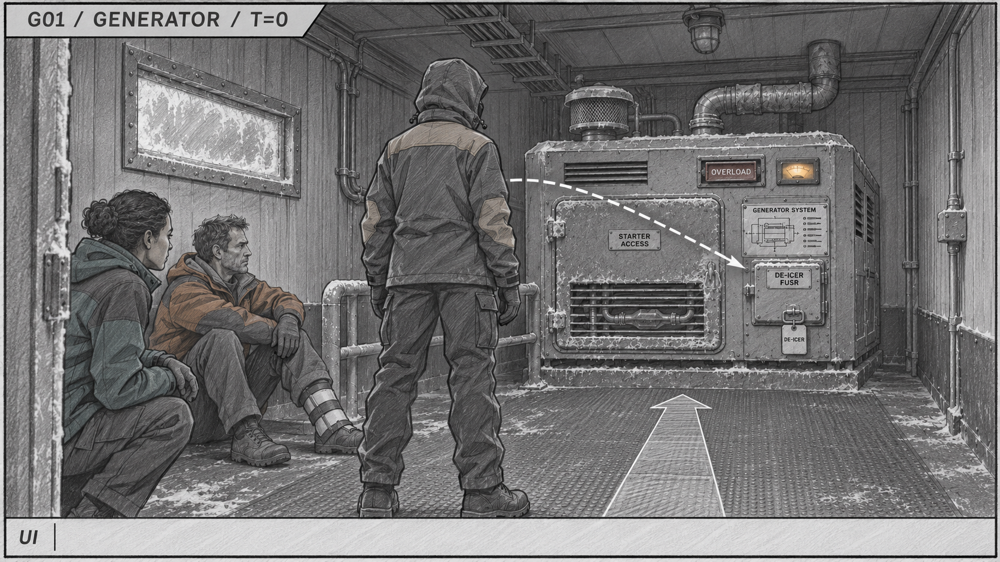
