# radio — visual storyboard pages

[Reading guide](../README.md) · [Branches](../BRANCHES.md) · [Shot index](../SHOTS.md)

The sheets are contact overviews. Full-size panels and readable metadata are
listed below on this same page; no separate file needs opening for each shot.
All imagery is [A] blocking/art, with [C] rule associations and [O] final approval.

## Sheet 1

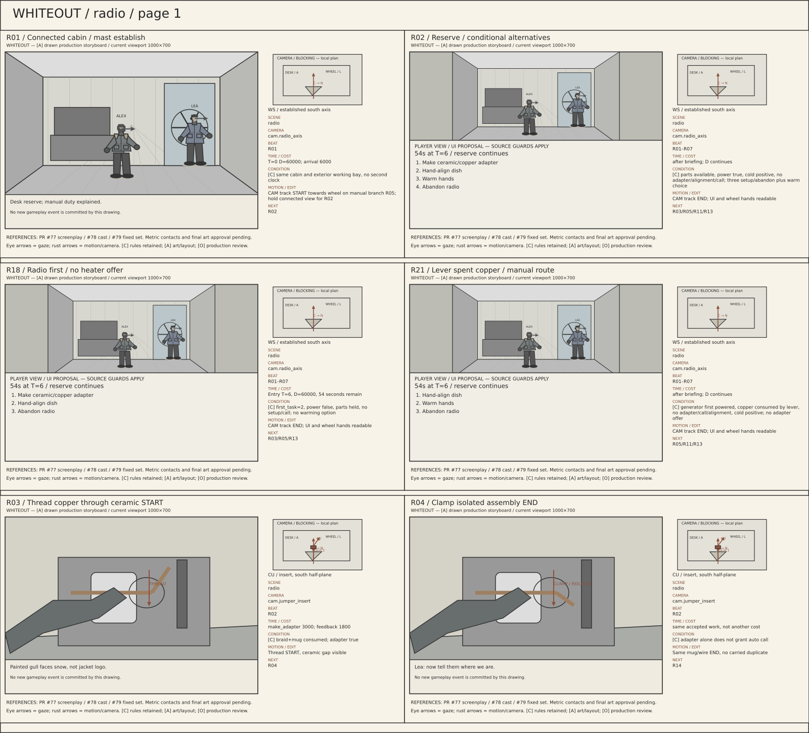

## Sheet 2

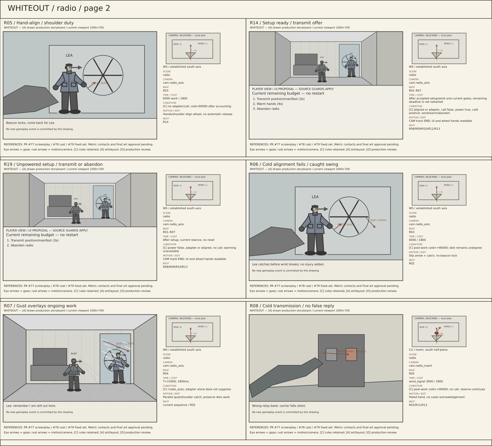

## Sheet 3

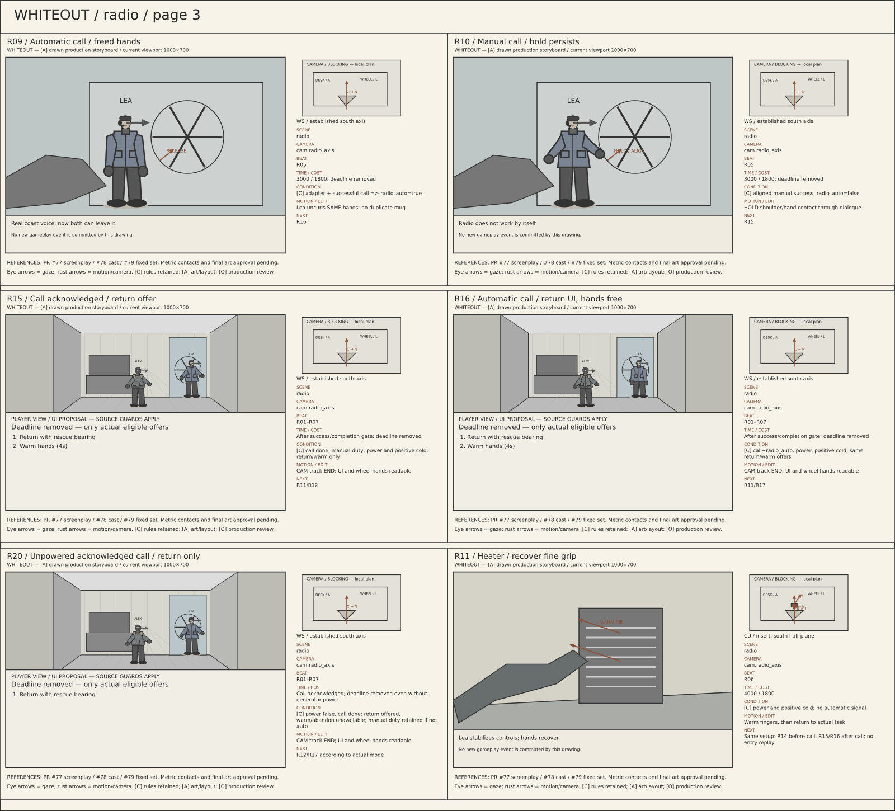

## Sheet 4

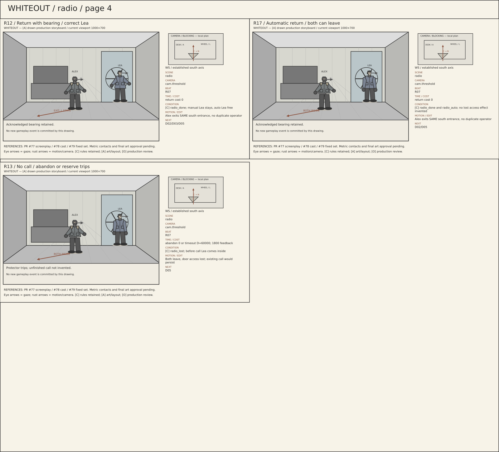

## R01 — Connected cabin / mast establish

**Scene:** `radio` · **Location:** `loc.radio_cabin` · **Camera:** `cam.radio_axis` · **Beat:** `R01`.

**Time:** T=0 D=60000; arrival 6000.

**Condition / variant:** [C] same cabin and exterior working bay, no second clock.

**Audio/dialogue:** Desk reserve; manual duty explained.

**Motion/edit:** CAM track START towards wheel on manual branch R05; hold connected view for R02. **Next:** R02.

[Editable SVG](../panels/r01.svg) · [Source metadata](../sources/shots.json)

## R02 — Reserve / conditional alternatives

**Scene:** `radio` · **Location:** `loc.radio_cabin` · **Camera:** `cam.radio_axis` · **Beat:** `R01–R07`.

**Time:** after briefing; D continues.

**Condition / variant:** [C] parts available, power true, cold positive, no adapter/alignment/call; three setup/abandon plus warm choice.

**Audio/dialogue:** Prepared jumper or someone must hold.

**Motion/edit:** CAM track END; UI and wheel hands readable. **Next:** R03/R05/R11/R13.

[Editable SVG](../panels/r02.svg) · [Source metadata](../sources/shots.json)

## R18 — Radio first / no heater offer

**Scene:** `radio` · **Location:** `loc.radio_cabin` · **Camera:** `cam.radio_axis` · **Beat:** `R01–R07`.

**Time:** Entry T=6, D=60000, 54 seconds remain.

**Condition / variant:** [C] first_task=2, power false, parts held, no setup/call; no warming option.

**Audio/dialogue:** Prepared jumper or someone must hold.

**Motion/edit:** CAM track END; UI and wheel hands readable. **Next:** R03/R05/R13.

[Editable SVG](../panels/r18.svg) · [Source metadata](../sources/shots.json)

## R21 — Lever spent copper / manual route

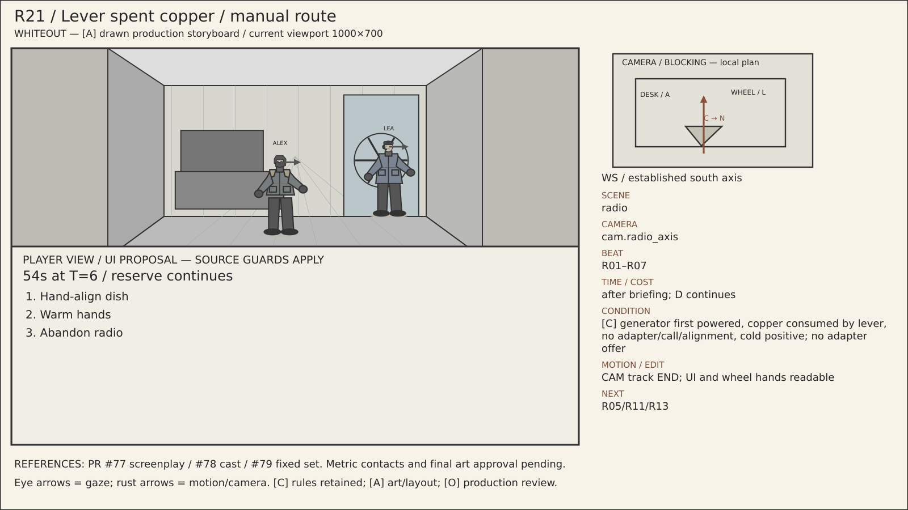

**Scene:** `radio` · **Location:** `loc.radio_cabin` · **Camera:** `cam.radio_axis` · **Beat:** `R01–R07`.

**Time:** after briefing; D continues.

**Condition / variant:** [C] generator first powered, copper consumed by lever, no adapter/call/alignment, cold positive; no adapter offer.

**Audio/dialogue:** Prepared jumper or someone must hold.

**Motion/edit:** CAM track END; UI and wheel hands readable. **Next:** R05/R11/R13.

[Editable SVG](../panels/r21.svg) · [Source metadata](../sources/shots.json)

## R03 — Thread copper through ceramic START

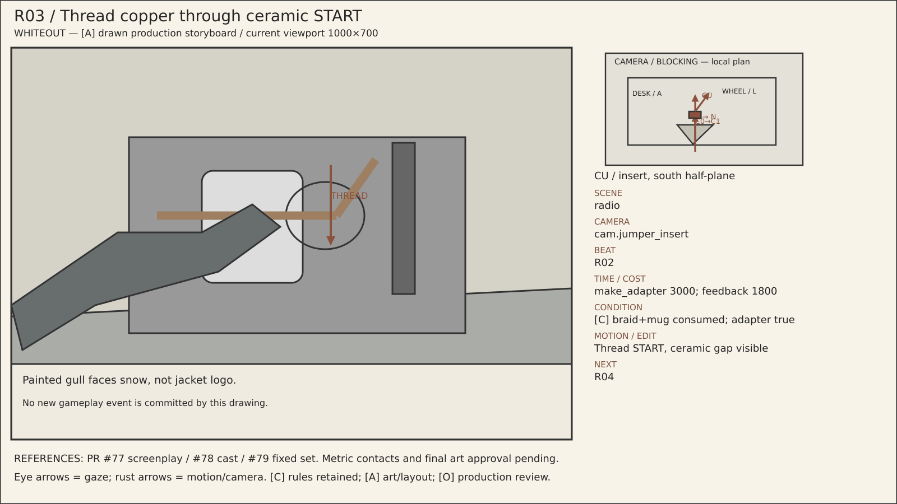

**Scene:** `radio` · **Location:** `loc.radio_cabin` · **Camera:** `cam.jumper_insert` · **Beat:** `R02`.

**Time:** make_adapter 3000; feedback 1800.

**Condition / variant:** [C] braid+mug consumed; adapter true.

**Audio/dialogue:** Painted gull faces snow, not jacket logo.

**Motion/edit:** Thread START, ceramic gap visible. **Next:** R04.

[Editable SVG](../panels/r03.svg) · [Source metadata](../sources/shots.json)

## R04 — Clamp isolated assembly END

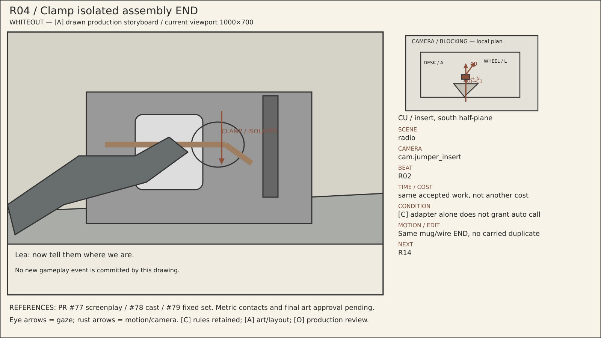

**Scene:** `radio` · **Location:** `loc.radio_cabin` · **Camera:** `cam.jumper_insert` · **Beat:** `R02`.

**Time:** same accepted work, not another cost.

**Condition / variant:** [C] adapter alone does not grant auto call.

**Audio/dialogue:** Lea: now tell them where we are.

**Motion/edit:** Same mug/wire END, no carried duplicate. **Next:** R14.

[Editable SVG](../panels/r04.svg) · [Source metadata](../sources/shots.json)

## R05 — Hand-align / shoulder duty

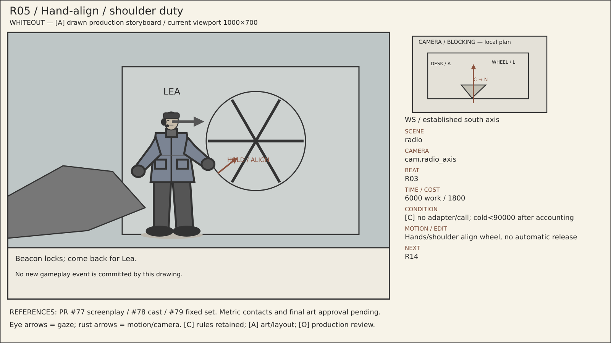

**Scene:** `radio` · **Location:** `loc.radio_cabin` · **Camera:** `cam.radio_axis` · **Beat:** `R03`.

**Time:** 6000 work / 1800.

**Condition / variant:** [C] no adapter/call; cold<90000 after accounting.

**Audio/dialogue:** Beacon locks; come back for Lea.

**Motion/edit:** Hands/shoulder align wheel, no automatic release. **Next:** R14.

[Editable SVG](../panels/r05.svg) · [Source metadata](../sources/shots.json)

## R14 — Setup ready / transmit offer

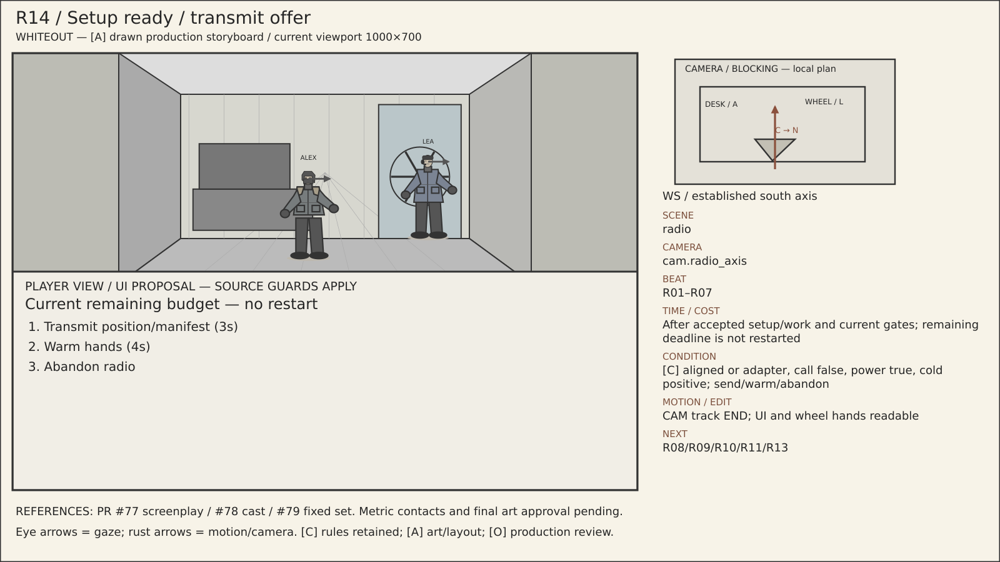

**Scene:** `radio` · **Location:** `loc.radio_cabin` · **Camera:** `cam.radio_axis` · **Beat:** `R01–R07`.

**Time:** After accepted setup/work and current gates; remaining deadline is not restarted.

**Condition / variant:** [C] aligned or adapter, call false, power true, cold positive; send/warm/abandon.

**Audio/dialogue:** Prepared jumper or someone must hold.

**Motion/edit:** CAM track END; UI and wheel hands readable. **Next:** R08/R09/R10/R11/R13.

[Editable SVG](../panels/r14.svg) · [Source metadata](../sources/shots.json)

## R19 — Unpowered setup / transmit or abandon

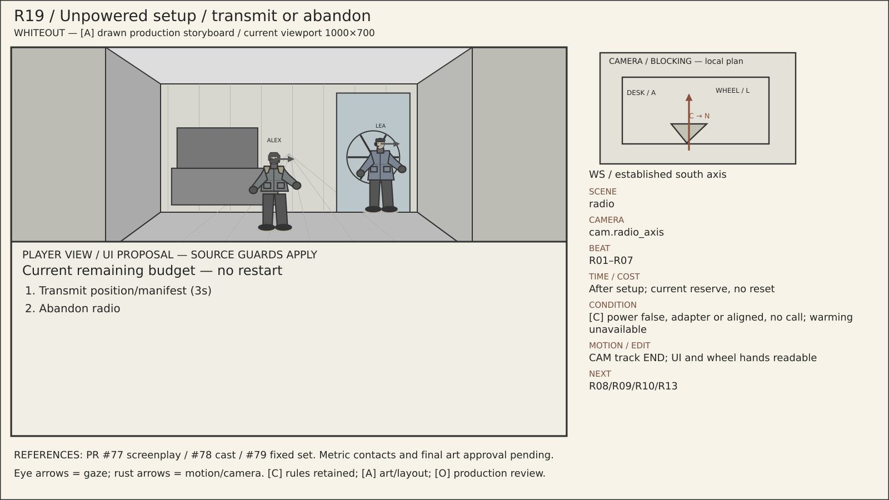

**Scene:** `radio` · **Location:** `loc.radio_cabin` · **Camera:** `cam.radio_axis` · **Beat:** `R01–R07`.

**Time:** After setup; current reserve, no reset.

**Condition / variant:** [C] power false, adapter or aligned, no call; warming unavailable.

**Audio/dialogue:** Prepared jumper or someone must hold.

**Motion/edit:** CAM track END; UI and wheel hands readable. **Next:** R08/R09/R10/R13.

[Editable SVG](../panels/r19.svg) · [Source metadata](../sources/shots.json)

## R06 — Cold alignment fails / caught swing

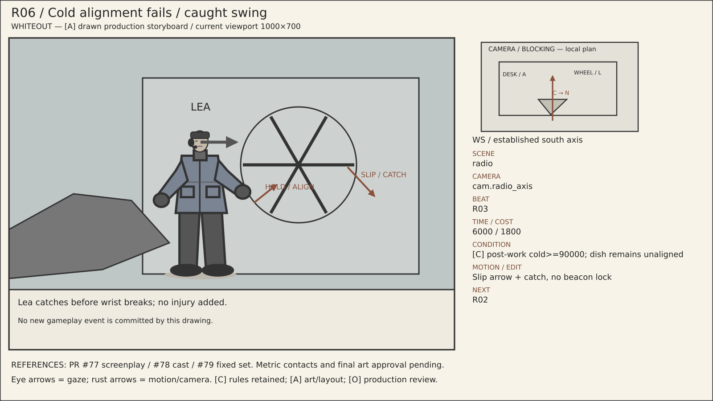

**Scene:** `radio` · **Location:** `loc.radio_cabin` · **Camera:** `cam.radio_axis` · **Beat:** `R03`.

**Time:** 6000 / 1800.

**Condition / variant:** [C] post-work cold>=90000; dish remains unaligned.

**Audio/dialogue:** Lea catches before wrist breaks; no injury added.

**Motion/edit:** Slip arrow + catch, no beacon lock. **Next:** R02.

[Editable SVG](../panels/r06.svg) · [Source metadata](../sources/shots.json)

## R07 — Gust overlays ongoing work

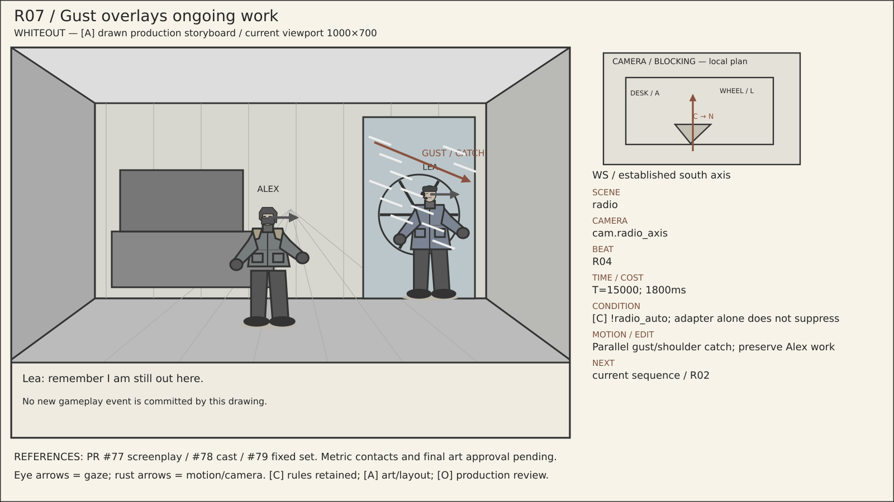

**Scene:** `radio` · **Location:** `loc.radio_cabin` · **Camera:** `cam.radio_axis` · **Beat:** `R04`.

**Time:** T=15000; 1800ms.

**Condition / variant:** [C] !radio_auto; adapter alone does not suppress.

**Audio/dialogue:** Lea: remember I am still out here.

**Motion/edit:** Parallel gust/shoulder catch; preserve Alex work. **Next:** current sequence / R02.

[Editable SVG](../panels/r07.svg) · [Source metadata](../sources/shots.json)

## R08 — Cold transmission / no false reply

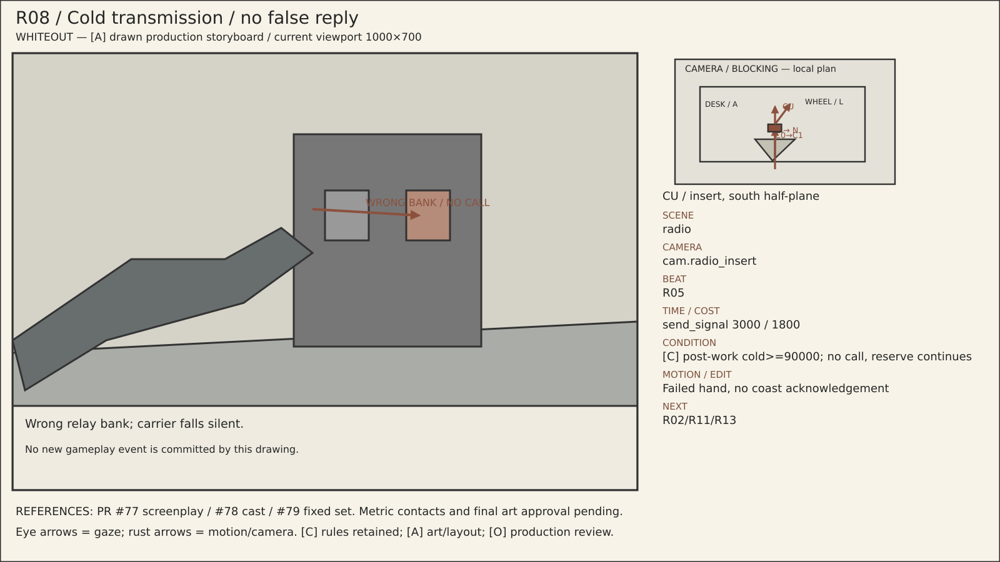

**Scene:** `radio` · **Location:** `loc.radio_cabin` · **Camera:** `cam.radio_insert` · **Beat:** `R05`.

**Time:** send_signal 3000 / 1800.

**Condition / variant:** [C] post-work cold>=90000; no call, reserve continues.

**Audio/dialogue:** Wrong relay bank; carrier falls silent.

**Motion/edit:** Failed hand, no coast acknowledgement. **Next:** R02/R11/R13.

[Editable SVG](../panels/r08.svg) · [Source metadata](../sources/shots.json)

## R09 — Automatic call / freed hands

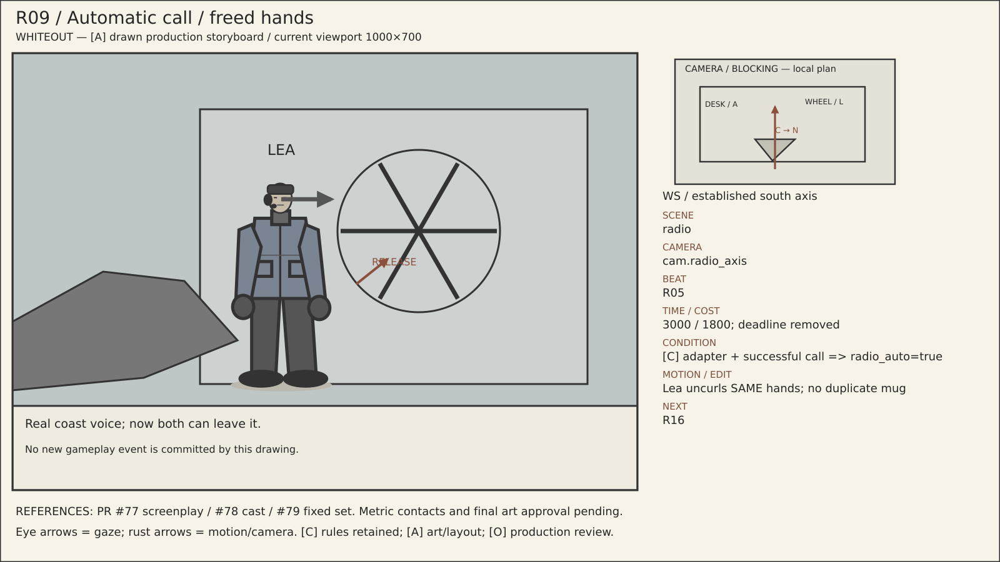

**Scene:** `radio` · **Location:** `loc.radio_cabin` · **Camera:** `cam.radio_axis` · **Beat:** `R05`.

**Time:** 3000 / 1800; deadline removed.

**Condition / variant:** [C] adapter + successful call => radio_auto=true.

**Audio/dialogue:** Real coast voice; now both can leave it.

**Motion/edit:** Lea uncurls SAME hands; no duplicate mug. **Next:** R16.

[Editable SVG](../panels/r09.svg) · [Source metadata](../sources/shots.json)

## R10 — Manual call / hold persists

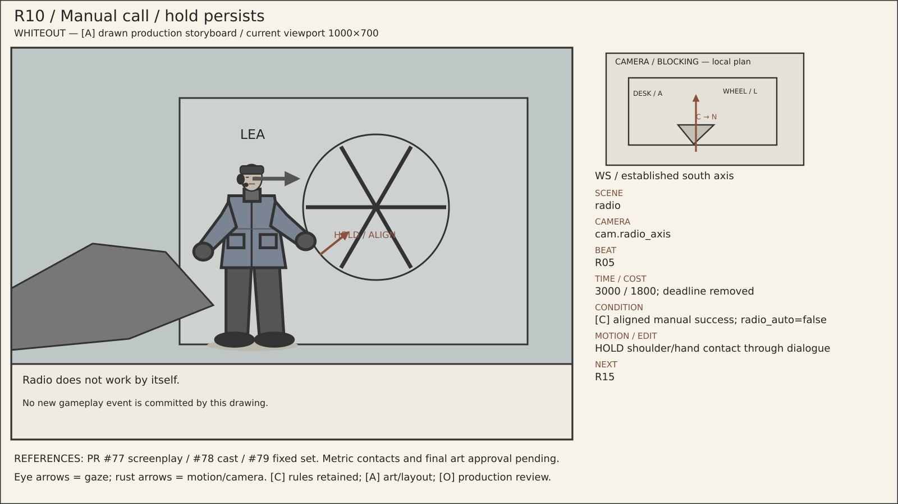

**Scene:** `radio` · **Location:** `loc.radio_cabin` · **Camera:** `cam.radio_axis` · **Beat:** `R05`.

**Time:** 3000 / 1800; deadline removed.

**Condition / variant:** [C] aligned manual success; radio_auto=false.

**Audio/dialogue:** Radio does not work by itself.

**Motion/edit:** HOLD shoulder/hand contact through dialogue. **Next:** R15.

[Editable SVG](../panels/r10.svg) · [Source metadata](../sources/shots.json)

## R15 — Call acknowledged / return offer

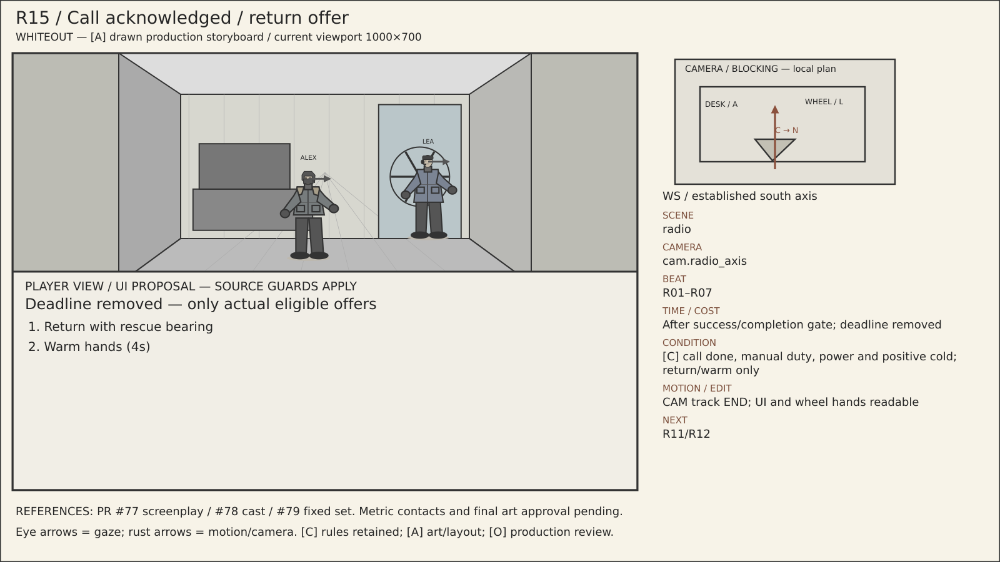

**Scene:** `radio` · **Location:** `loc.radio_cabin` · **Camera:** `cam.radio_axis` · **Beat:** `R01–R07`.

**Time:** After success/completion gate; deadline removed.

**Condition / variant:** [C] call done, manual duty, power and positive cold; return/warm only.

**Audio/dialogue:** Prepared jumper or someone must hold.

**Motion/edit:** CAM track END; UI and wheel hands readable. **Next:** R11/R12.

[Editable SVG](../panels/r15.svg) · [Source metadata](../sources/shots.json)

## R16 — Automatic call / return UI, hands free

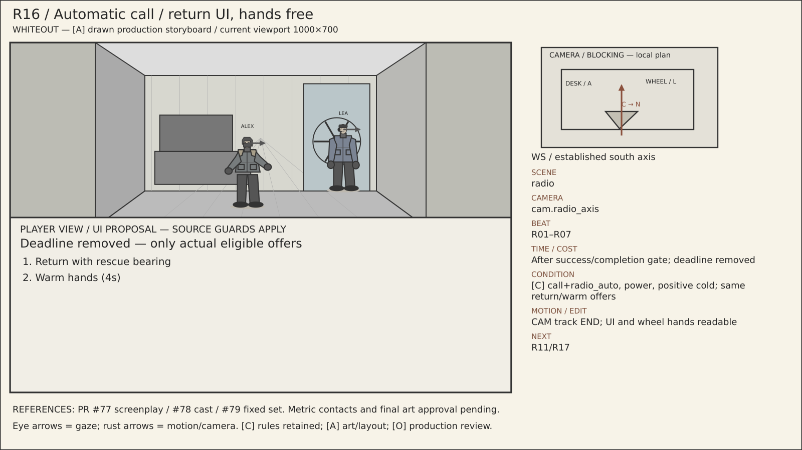

**Scene:** `radio` · **Location:** `loc.radio_cabin` · **Camera:** `cam.radio_axis` · **Beat:** `R01–R07`.

**Time:** After success/completion gate; deadline removed.

**Condition / variant:** [C] call+radio_auto, power, positive cold; same return/warm offers.

**Audio/dialogue:** Prepared jumper or someone must hold.

**Motion/edit:** CAM track END; UI and wheel hands readable. **Next:** R11/R17.

[Editable SVG](../panels/r16.svg) · [Source metadata](../sources/shots.json)

## R20 — Unpowered acknowledged call / return only

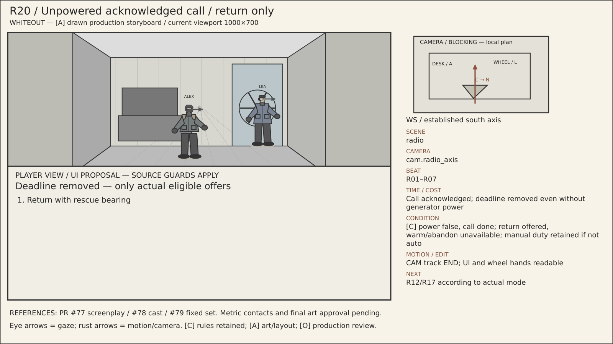

**Scene:** `radio` · **Location:** `loc.radio_cabin` · **Camera:** `cam.radio_axis` · **Beat:** `R01–R07`.

**Time:** Call acknowledged; deadline removed even without generator power.

**Condition / variant:** [C] power false, call done; return offered, warm/abandon unavailable; manual duty retained if not auto.

**Audio/dialogue:** Prepared jumper or someone must hold.

**Motion/edit:** CAM track END; UI and wheel hands readable. **Next:** R12/R17 according to actual mode.

[Editable SVG](../panels/r20.svg) · [Source metadata](../sources/shots.json)

## R11 — Heater / recover fine grip

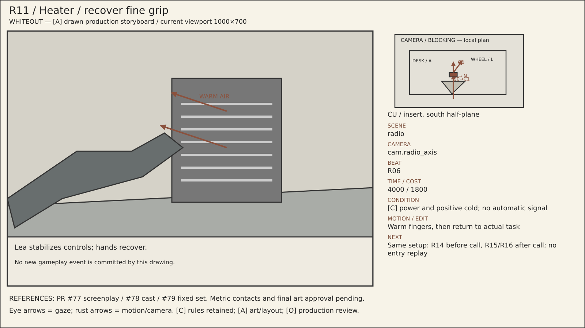

**Scene:** `radio` · **Location:** `loc.radio_cabin` · **Camera:** `cam.radio_axis` · **Beat:** `R06`.

**Time:** 4000 / 1800.

**Condition / variant:** [C] power and positive cold; no automatic signal.

**Audio/dialogue:** Lea stabilizes controls; hands recover.

**Motion/edit:** Warm fingers, then return to actual task. **Next:** Same setup: R14 before call, R15/R16 after call; no entry replay.

[Editable SVG](../panels/r11.svg) · [Source metadata](../sources/shots.json)

## R12 — Return with bearing / correct Lea

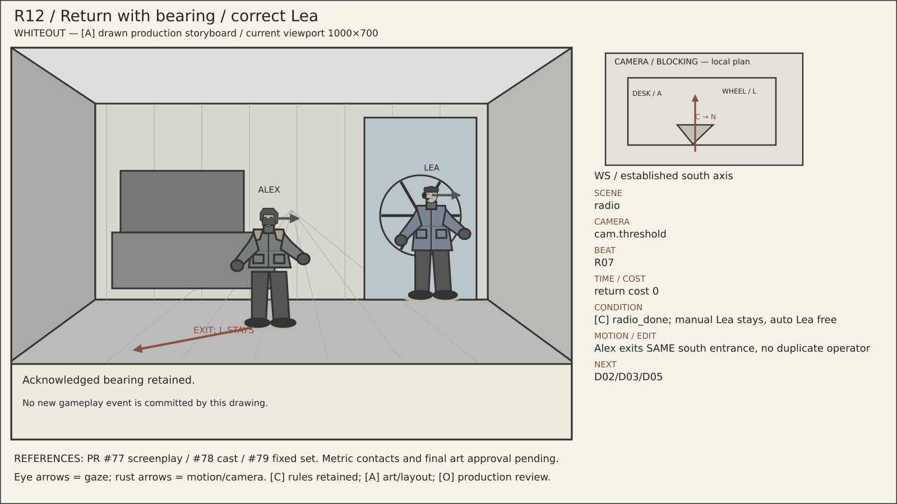

**Scene:** `radio` · **Location:** `loc.radio_cabin` · **Camera:** `cam.threshold` · **Beat:** `R07`.

**Time:** return cost 0.

**Condition / variant:** [C] radio_done; manual Lea stays, auto Lea free.

**Audio/dialogue:** Acknowledged bearing retained.

**Motion/edit:** Alex exits SAME south entrance, no duplicate operator. **Next:** D02/D03/D05.

[Editable SVG](../panels/r12.svg) · [Source metadata](../sources/shots.json)

## R17 — Automatic return / both can leave

**Scene:** `radio` · **Location:** `loc.radio_cabin` · **Camera:** `cam.threshold` · **Beat:** `R07`.

**Time:** return cost 0.

**Condition / variant:** [C] radio_done and radio_auto; no lost access effect invented.

**Audio/dialogue:** Acknowledged bearing retained.

**Motion/edit:** Alex exits SAME south entrance, no duplicate operator. **Next:** D02/D05.

[Editable SVG](../panels/r17.svg) · [Source metadata](../sources/shots.json)

## R13 — No call / abandon or reserve trips

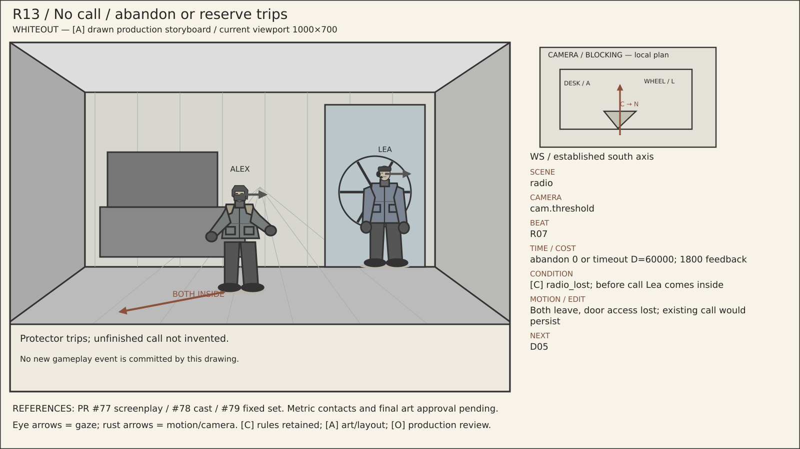

**Scene:** `radio` · **Location:** `loc.radio_cabin` · **Camera:** `cam.threshold` · **Beat:** `R07`.

**Time:** abandon 0 or timeout D=60000; 1800 feedback.

**Condition / variant:** [C] radio_lost; before call Lea comes inside.

**Audio/dialogue:** Protector trips; unfinished call not invented.

**Motion/edit:** Both leave, door access lost; existing call would persist. **Next:** D05.

[Editable SVG](../panels/r13.svg) · [Source metadata](../sources/shots.json)

## Generated connected-set artist study (alternate development)

Same role as generator study; no additional coverage count.

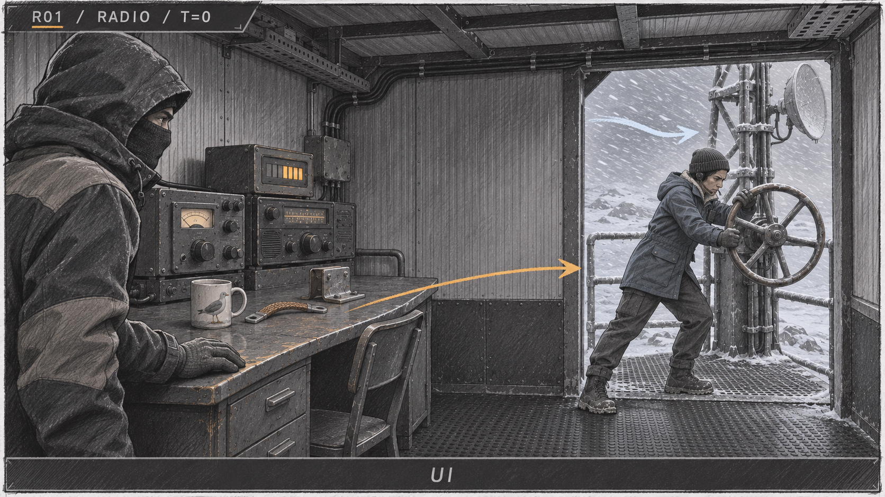
