# stores — visual storyboard pages

[Reading guide](../README.md) · [Branches](../BRANCHES.md) · [Shot index](../SHOTS.md)

The sheets are contact overviews. Full-size panels and readable metadata are
listed below on this same page; no separate file needs opening for each shot.
All imagery is [A] blocking/art, with [C] rule associations and [O] final approval.

## Sheet 1

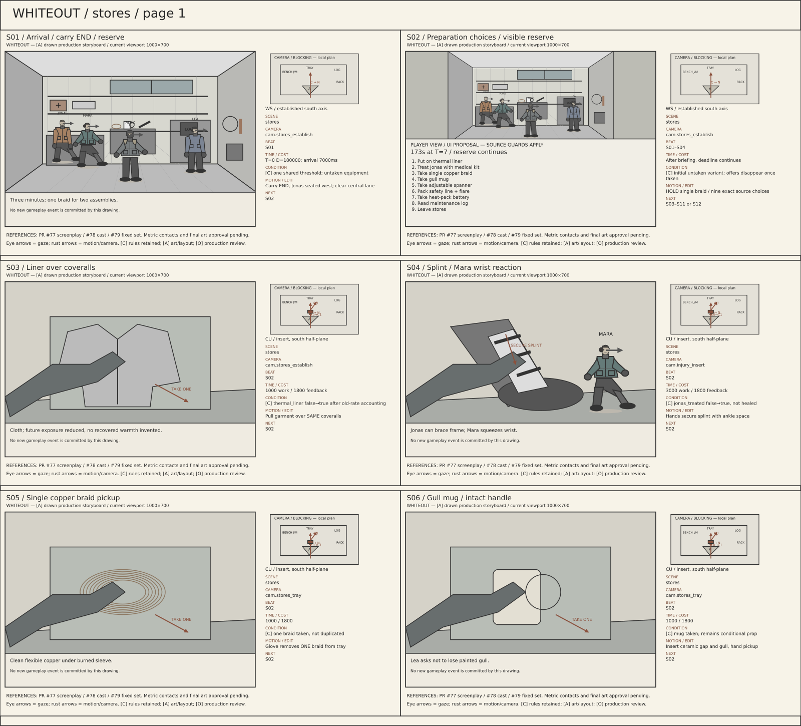

## Sheet 2

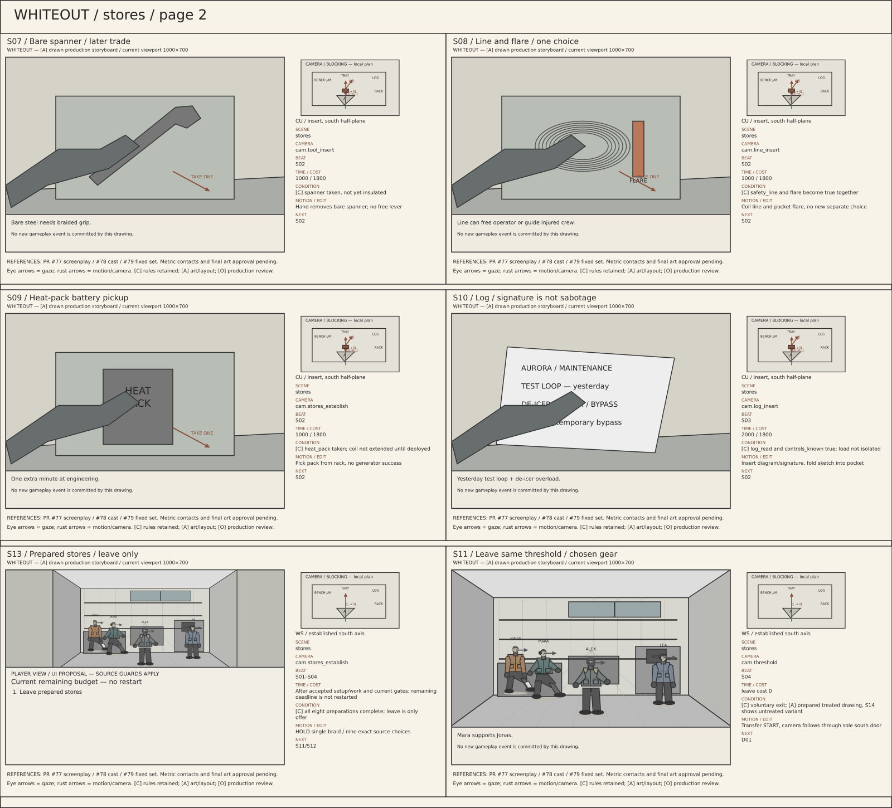

## Sheet 3

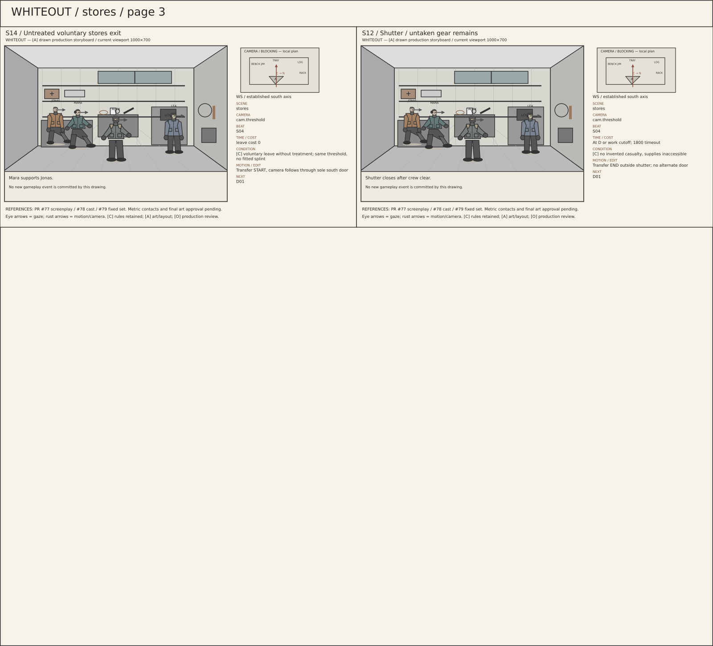

## S01 — Arrival / carry END / reserve

**Scene:** `stores` · **Location:** `loc.emergency_stores` · **Camera:** `cam.stores_establish` · **Beat:** `S01`.

**Time:** T=0 D=180000; arrival 7000ms.

**Condition / variant:** [C] one shared threshold; untaken equipment.

**Audio/dialogue:** Three minutes; one braid for two assemblies.

**Motion/edit:** Carry END, Jonas seated west; clear central lane. **Next:** S02.

[Editable SVG](../panels/s01.svg) · [Source metadata](../sources/shots.json)

## S02 — Preparation choices / visible reserve

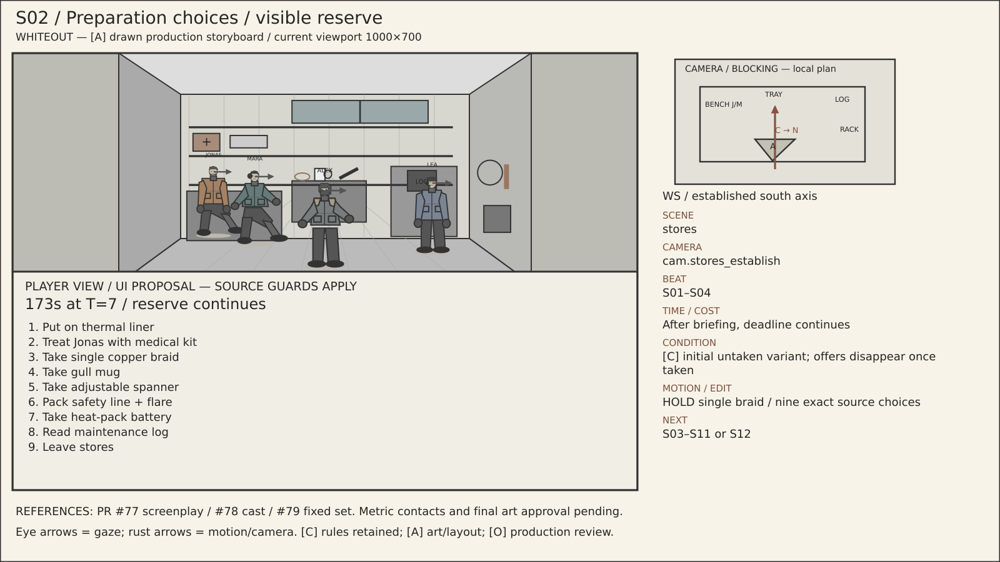

**Scene:** `stores` · **Location:** `loc.emergency_stores` · **Camera:** `cam.stores_establish` · **Beat:** `S01–S04`.

**Time:** After briefing, deadline continues.

**Condition / variant:** [C] initial untaken variant; offers disappear once taken.

**Audio/dialogue:** Choose people and equipment deliberately.

**Motion/edit:** HOLD single braid / nine exact source choices. **Next:** S03–S11 or S12.

[Editable SVG](../panels/s02.svg) · [Source metadata](../sources/shots.json)

## S03 — Liner over coveralls

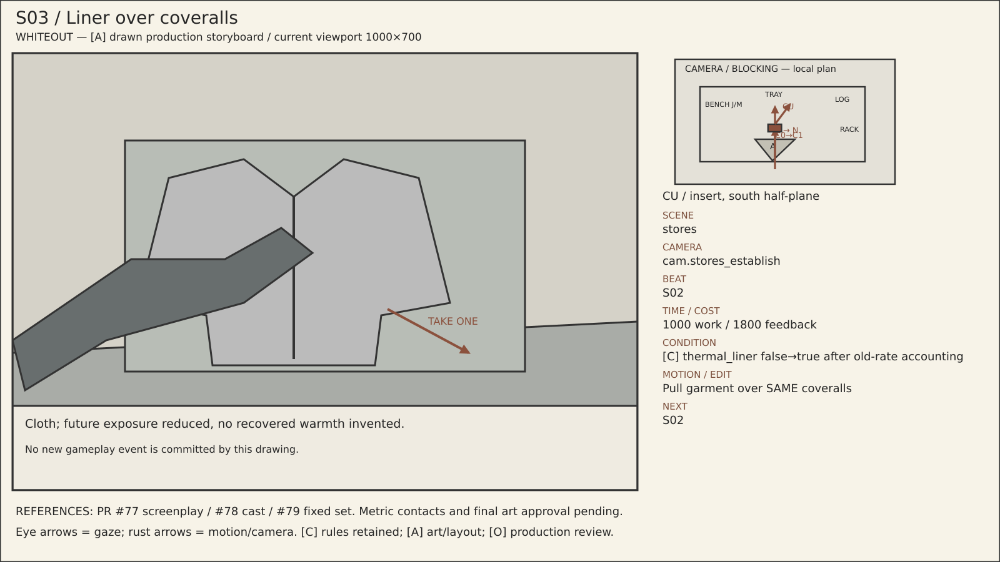

**Scene:** `stores` · **Location:** `loc.emergency_stores` · **Camera:** `cam.stores_establish` · **Beat:** `S02`.

**Time:** 1000 work / 1800 feedback.

**Condition / variant:** [C] thermal_liner false→true after old-rate accounting.

**Audio/dialogue:** Cloth; future exposure reduced, no recovered warmth invented.

**Motion/edit:** Pull garment over SAME coveralls. **Next:** S02.

[Editable SVG](../panels/s03.svg) · [Source metadata](../sources/shots.json)

## S04 — Splint / Mara wrist reaction

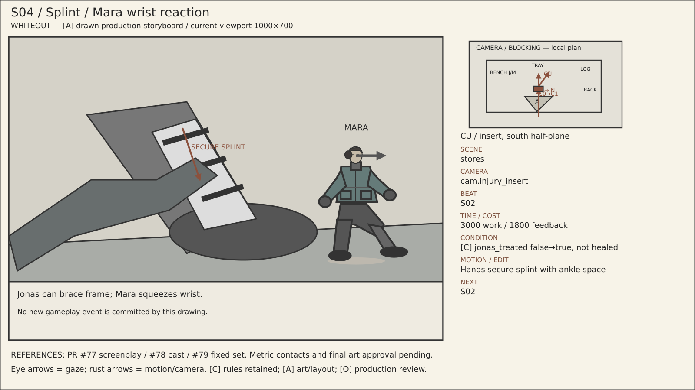

**Scene:** `stores` · **Location:** `loc.emergency_stores` · **Camera:** `cam.injury_insert` · **Beat:** `S02`.

**Time:** 3000 work / 1800 feedback.

**Condition / variant:** [C] jonas_treated false→true, not healed.

**Audio/dialogue:** Jonas can brace frame; Mara squeezes wrist.

**Motion/edit:** Hands secure splint with ankle space. **Next:** S02.

[Editable SVG](../panels/s04.svg) · [Source metadata](../sources/shots.json)

## S05 — Single copper braid pickup

**Scene:** `stores` · **Location:** `loc.emergency_stores` · **Camera:** `cam.stores_tray` · **Beat:** `S02`.

**Time:** 1000 / 1800.

**Condition / variant:** [C] one braid taken, not duplicated.

**Audio/dialogue:** Clean flexible copper under burned sleeve.

**Motion/edit:** Glove removes ONE braid from tray. **Next:** S02.

[Editable SVG](../panels/s05.svg) · [Source metadata](../sources/shots.json)

## S06 — Gull mug / intact handle

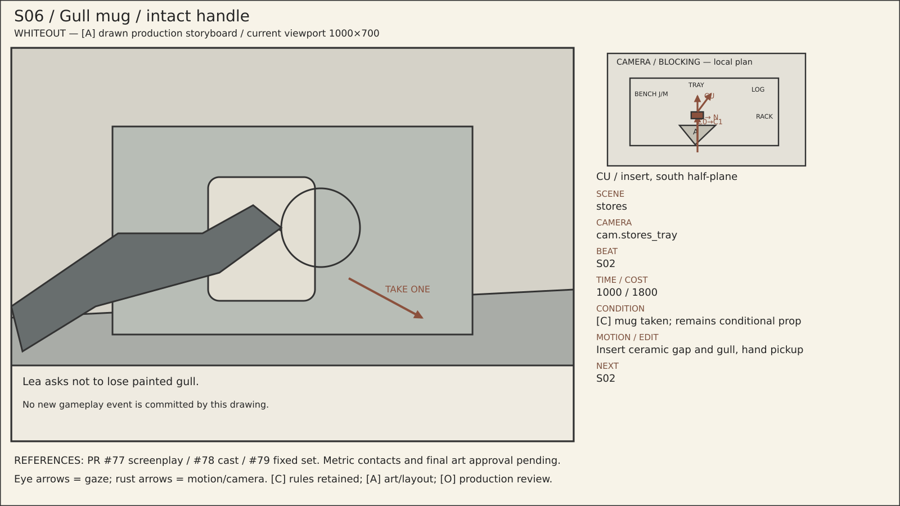

**Scene:** `stores` · **Location:** `loc.emergency_stores` · **Camera:** `cam.stores_tray` · **Beat:** `S02`.

**Time:** 1000 / 1800.

**Condition / variant:** [C] mug taken; remains conditional prop.

**Audio/dialogue:** Lea asks not to lose painted gull.

**Motion/edit:** Insert ceramic gap and gull, hand pickup. **Next:** S02.

[Editable SVG](../panels/s06.svg) · [Source metadata](../sources/shots.json)

## S07 — Bare spanner / later trade

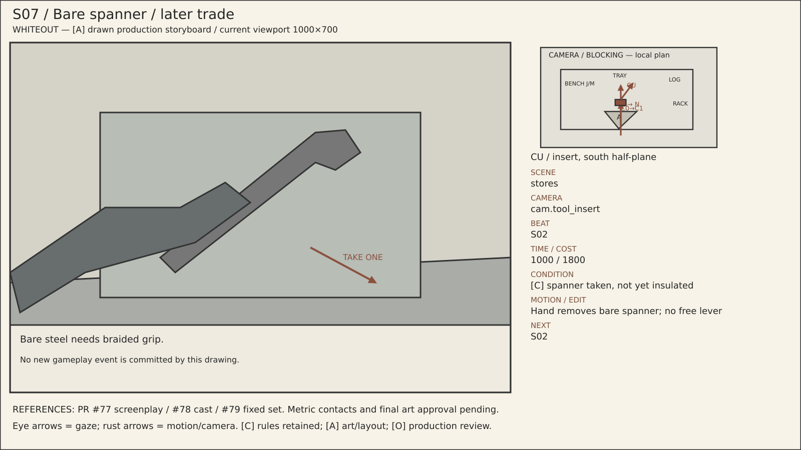

**Scene:** `stores` · **Location:** `loc.emergency_stores` · **Camera:** `cam.tool_insert` · **Beat:** `S02`.

**Time:** 1000 / 1800.

**Condition / variant:** [C] spanner taken, not yet insulated.

**Audio/dialogue:** Bare steel needs braided grip.

**Motion/edit:** Hand removes bare spanner; no free lever. **Next:** S02.

[Editable SVG](../panels/s07.svg) · [Source metadata](../sources/shots.json)

## S08 — Line and flare / one choice

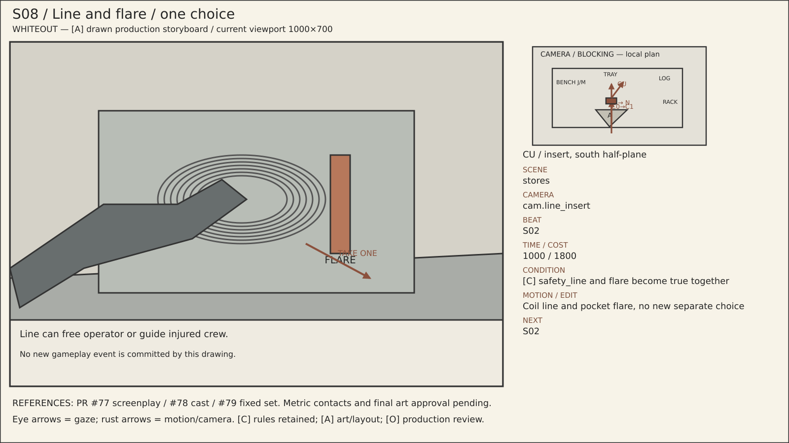

**Scene:** `stores` · **Location:** `loc.emergency_stores` · **Camera:** `cam.line_insert` · **Beat:** `S02`.

**Time:** 1000 / 1800.

**Condition / variant:** [C] safety_line and flare become true together.

**Audio/dialogue:** Line can free operator or guide injured crew.

**Motion/edit:** Coil line and pocket flare, no new separate choice. **Next:** S02.

[Editable SVG](../panels/s08.svg) · [Source metadata](../sources/shots.json)

## S09 — Heat-pack battery pickup

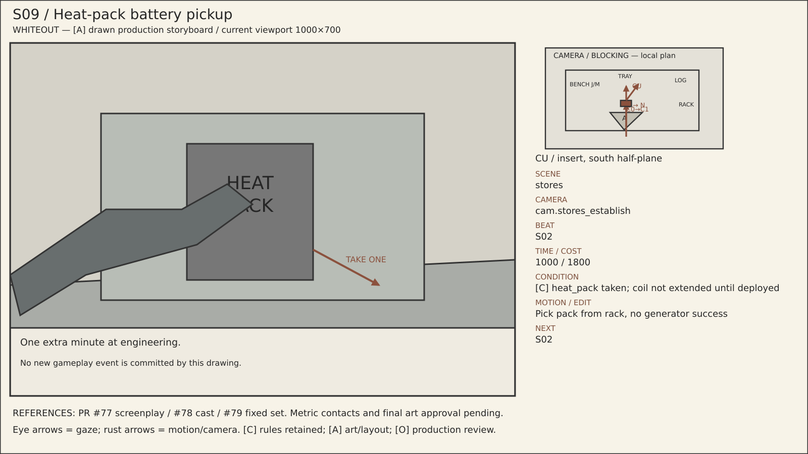

**Scene:** `stores` · **Location:** `loc.emergency_stores` · **Camera:** `cam.stores_establish` · **Beat:** `S02`.

**Time:** 1000 / 1800.

**Condition / variant:** [C] heat_pack taken; coil not extended until deployed.

**Audio/dialogue:** One extra minute at engineering.

**Motion/edit:** Pick pack from rack, no generator success. **Next:** S02.

[Editable SVG](../panels/s09.svg) · [Source metadata](../sources/shots.json)

## S10 — Log / signature is not sabotage

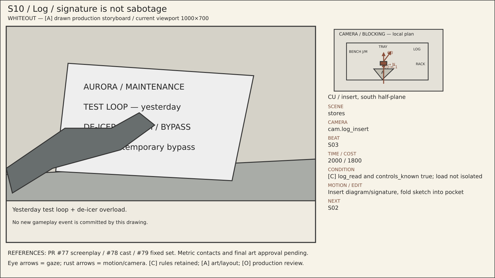

**Scene:** `stores` · **Location:** `loc.emergency_stores` · **Camera:** `cam.log_insert` · **Beat:** `S03`.

**Time:** 2000 / 1800.

**Condition / variant:** [C] log_read and controls_known true; load not isolated.

**Audio/dialogue:** Yesterday test loop + de-icer overload.

**Motion/edit:** Insert diagram/signature, fold sketch into pocket. **Next:** S02.

[Editable SVG](../panels/s10.svg) · [Source metadata](../sources/shots.json)

## S13 — Prepared stores / leave only

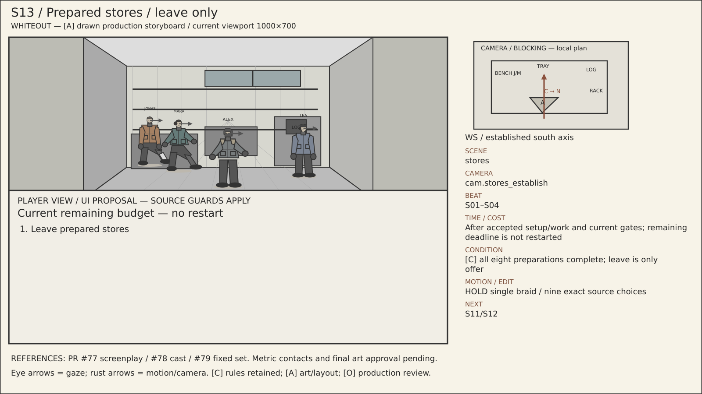

**Scene:** `stores` · **Location:** `loc.emergency_stores` · **Camera:** `cam.stores_establish` · **Beat:** `S01–S04`.

**Time:** After accepted setup/work and current gates; remaining deadline is not restarted.

**Condition / variant:** [C] all eight preparations complete; leave is only offer.

**Audio/dialogue:** Choose people and equipment deliberately.

**Motion/edit:** HOLD single braid / nine exact source choices. **Next:** S11/S12.

[Editable SVG](../panels/s13.svg) · [Source metadata](../sources/shots.json)

## S11 — Leave same threshold / chosen gear

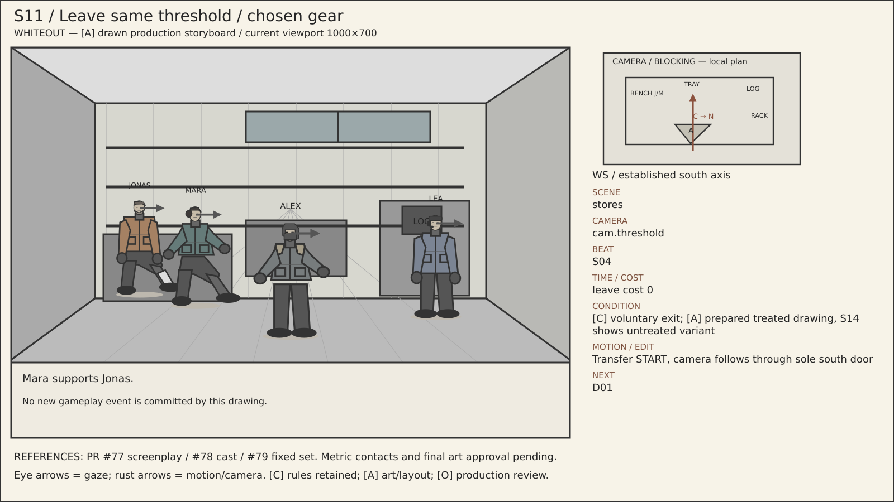

**Scene:** `stores` · **Location:** `loc.emergency_stores` · **Camera:** `cam.threshold` · **Beat:** `S04`.

**Time:** leave cost 0.

**Condition / variant:** [C] voluntary exit; [A] prepared treated drawing, S14 shows untreated variant.

**Audio/dialogue:** Mara supports Jonas.

**Motion/edit:** Transfer START, camera follows through sole south door. **Next:** D01.

[Editable SVG](../panels/s11.svg) · [Source metadata](../sources/shots.json)

## S14 — Untreated voluntary stores exit

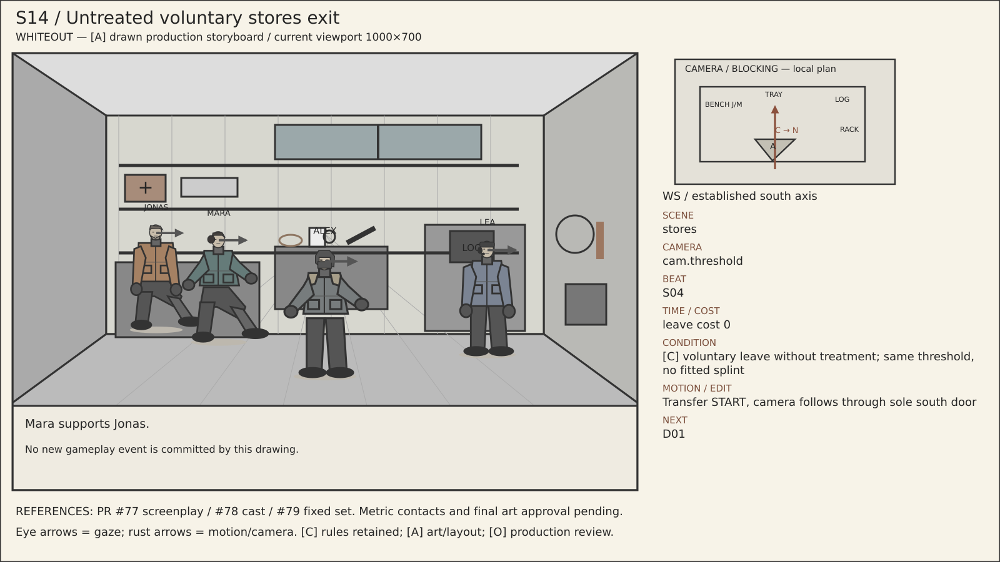

**Scene:** `stores` · **Location:** `loc.emergency_stores` · **Camera:** `cam.threshold` · **Beat:** `S04`.

**Time:** leave cost 0.

**Condition / variant:** [C] voluntary leave without treatment; same threshold, no fitted splint.

**Audio/dialogue:** Mara supports Jonas.

**Motion/edit:** Transfer START, camera follows through sole south door. **Next:** D01.

[Editable SVG](../panels/s14.svg) · [Source metadata](../sources/shots.json)

## S12 — Shutter / untaken gear remains

**Scene:** `stores` · **Location:** `loc.emergency_stores` · **Camera:** `cam.threshold` · **Beat:** `S04`.

**Time:** At D or work cutoff; 1800 timeout.

**Condition / variant:** [C] no invented casualty, supplies inaccessible.

**Audio/dialogue:** Shutter closes after crew clear.

**Motion/edit:** Transfer END outside shutter; no alternate door. **Next:** D01.

[Editable SVG](../panels/s12.svg) · [Source metadata](../sources/shots.json)
